# SRM과 공급업체 포털 그림 가이드: 거래 심사부터 평가, 위험 관리, 견적까지

이 가이드에서는 공급업체와 거래를 신청하고 일상 업무로 관리하는 과정을 설명합니다. 내부 직원은 심사, 정보 관리, 평가를 담당합니다. 공급업체는 자신의 포털 계정으로 기업 정보, 평가 결과, 견적 요청을 확인합니다. 두 신분은 각자의 입구와 권한으로 사용해야 합니다.

먼저 하려는 일을 찾아 읽어 보세요.

| 하려는 일 | 시작할 곳 |
| --- | --- |
| 공급업체 수, 거래 상태, 위험 확인 | 1절: 공급업체 개요 |
| 내부에서 공급업체를 만들고 거래 승인 진행 | 2절: 생성과 승인 |
| 기업 정보 조회, 담당자 이관, 연락처·자격 관리 | 3~5절: 일상 관리 |
| 점수를 매기고 기간별 성과 비교 | 6절: 성과 평가 |
| 위험 조회, 지표 갱신, 채점 규칙 관리 | 7절: 위험 관리 |
| 공급업체를 초대해 계정·입점·정보 등록 진행 | 8~9절: 초대와 포털 |
| 받은 견적 요청에 응답하고 견적 수정 | 10절: 포털 견적 |
| 권한 부족, 오래된 화면, 실패, 상태 제한 처리 | 11절: 문제 확인과 복구 |

## 읽기 전에: 계정과 기업부터 확인하기

내부 직원은 「내 작업대」의 앱 목록 또는 「앱」에서 「공급업체 관계 관리」를 엽니다. 앱은 새 브라우저 탭에서 열립니다. 이 탭의 왼쪽 메뉴와 오른쪽 위 검색은 현재 앱만 대상으로 합니다. 작업대로 돌아가려면 원래 탭으로 전환하세요. 메뉴가 없다면 계정 권한부터 확인합니다. 동료의 화면 주소를 안다고 권한까지 생기는 것은 아닙니다.

| 현재 신분 | 주로 하는 일 | 데이터 범위 |
| --- | --- | --- |
| SRM 관리자 | 기업 내 공급업체·초대·평가·위험 관리 | 현재 기업에서 허용된 데이터 |
| 구매 관리자 | 본 부서와 하위 부서의 공급업체·평가·위험 관리 | 실제 조직과 역할 설정에 따름 |
| 구매 담당자 | 본인이 맡은 공급업체의 일상 관리 | 보통 본인 담당 기록 |
| 공급업체 | 자사 정보·평가·견적 확인 및 처리 | 계정에 연결된 기업 |

포털 계정은 입점과 기업 연결을 먼저 완료해야 합니다. 일반 계정 등록만으로 기업 정보를 볼 수는 없습니다. 내부 관리자도 공급업체 대신 포털 견적을 제출할 수 없습니다. 여러 역할이 있는 계정 역시 역할 이름만 보지 말고, 실제 허용된 입구와 범위를 확인하세요.

스크린샷은 같은 로컬 환경의 전용 시연 계정과 업무 샘플을 사용했습니다. 업무 이름, 지표 이름, 평가 비고는 중국어로 남아 있을 수 있습니다. 전화번호·이메일·계좌 같은 정보는 권한에 따른 마스킹 또는 촬영 마스크로 보호합니다. 통제된 테스트 세션의 조작 이미지는 사람이 CAPTCHA를 입력했거나 외부 계정 인증을 마쳤다는 증거가 아닙니다. 삭제나 거래 종료처럼 쉽게 되돌릴 수 없는 작업을 공유 데이터에서 그대로 따라 하지 마세요.

## 1. 공급업체 개요: 현재 상황부터 파악하기

개요 권한이 있는 관리자나 구매 관리자는 현재 앱의 왼쪽에서 「공급업체 개요」를 엽니다.

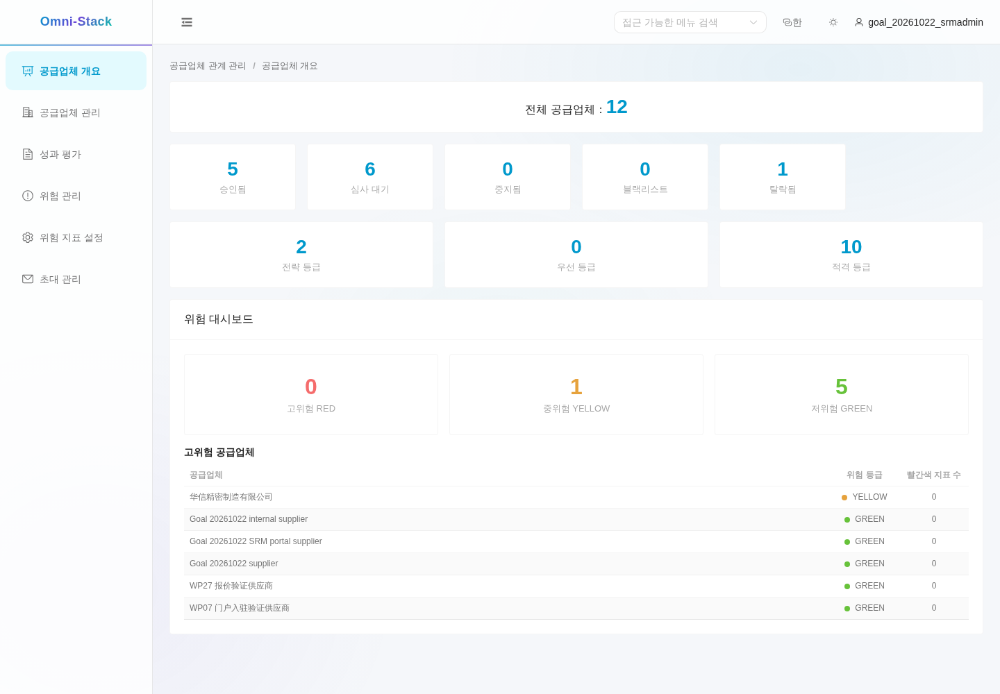

공급업체 수와 상태별 분포를 먼저 보고 위험 현황을 확인합니다. 수치는 현재 계정이 볼 수 있는 데이터만 집계하므로 담당자·관리자에 따라 다를 수 있습니다. 데이터가 없어서 0으로 보이는 것은 정상입니다. 예상과 다르다면 현재 기업, 계정 범위, 필터부터 확인하세요.

## 2. 공급업체 생성과 거래 승인

### 2.1 내부 직원이 새로 만드는 방법

「공급업체 관리」에서 「새 공급사」를 누릅니다. 필수 표시를 따라 이름과 유형을 입력한 뒤 업종, 품목, 신용 코드, 웹사이트, 연락 정보를 확인합니다. 담당자를 지정할 때는 배정 가능한 내부 직원만 선택합니다.

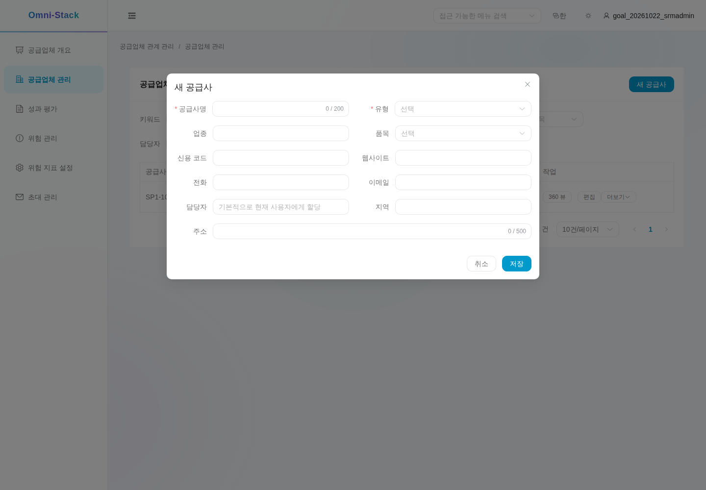

저장하기 전에 이름과 신용 코드를 확인해 같은 기업을 중복 등록하지 않도록 합니다. 정상 저장 후에는 거래 심사가 시작됩니다. 목록 상태와 「승인 진행」부터 확인하세요. 저장 성공이 거래 허용을 뜻하지는 않습니다. 시작 조건이 맞지 않거나 서비스가 일시적으로 실패하면 처리 대기나 시작 실패 단계에 남을 수 있으며, 관리자가 실제 프로세스를 확인해야 합니다.

### 2.2 누가 승인하고 결과는 어디서 보는가

승인자는 「내 작업대」의 승인 대기 영역에서 자신에게 배정된 항목을 처리합니다. 공급업체 관리의 「승인 진행」은 진행 상황을 보는 입구입니다. 심사를 건너뛰어 바로 승인하는 버튼이 아닙니다.

로컬 시연에서는 반려, 수정, 재제출, 여러 승인자의 승인을 실제로 진행했습니다. 기업마다 게시된 프로세스가 다를 수 있으므로 실제 할당된 할 일을 처리하세요. 마지막에는 공급업체 목록으로 돌아와 「승인됨」을 확인합니다. 프로세스가 생성되었거나 신청이 접수되었다는 것만으로 거래 심사가 끝난 것은 아닙니다.

### 2.3 반려 후 다시 제출하기

반려되면 먼저 승인 의견을 읽고 정보를 수정합니다. 내부 직원은 해당 행의 「더보기」에서 「심사 재제출」을 사용합니다. 공급업체는 자사 기업 정보 화면에서 허용된 재제출 작업을 사용합니다. 다시 제출하면 새 승인 회차가 시작되고 이전 의견과 이력은 남습니다.

「심사 대기」와 「반려됨」은 서로 다른 상태입니다. 현재 재제출은 반려 후 수정에 해당합니다. 회수·취소·시작 실패 후 대기 중인 기록을 무조건 다시 시작하는 공통 버튼은 없습니다. 원래 프로세스부터 확인하고 같은 기업을 반복해서 새로 만들지 마세요.

## 3. 공급업체 검색, 360 뷰, 담당자 이관

### 3.1 검색과 필터

「공급업체 관리」에서 키워드, 상태, 품목, 담당자로 필터링합니다. 찾을 수 없다면 조건을 지운 뒤 현재 계정의 데이터 범위에 속하는지 확인합니다.

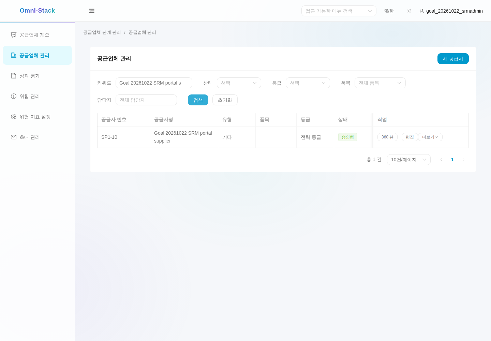

표가 넓으면 표 안에서 가로로 스크롤해 나머지 열을 확인합니다. 작업 열은 오른쪽에 고정되어 있습니다. 담당자가 미배정이면 담당자가 필요한 업무를 하기 전에 적법한 내부 배정을 완료합니다.

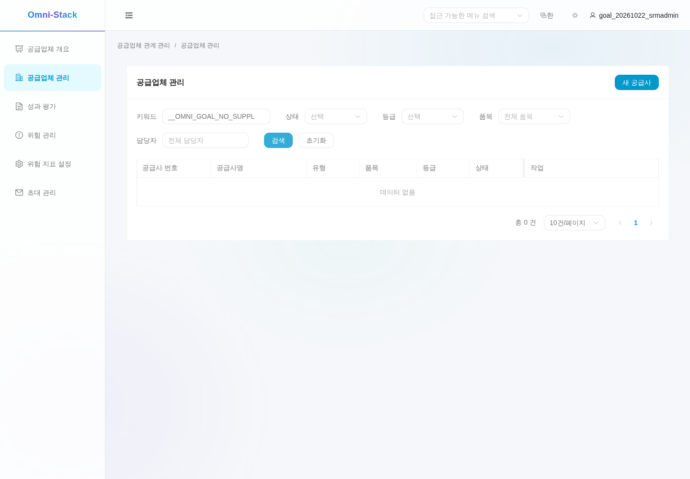

빈 목록은 현재 조건에서 보이는 결과가 없다는 뜻입니다. 직접 권한을 넓혀도 된다는 뜻이 아닙니다.

### 3.2 360 뷰: 연락하기 전에 전체 정보 보기

공급업체 행에서 「360 뷰」를 선택합니다.

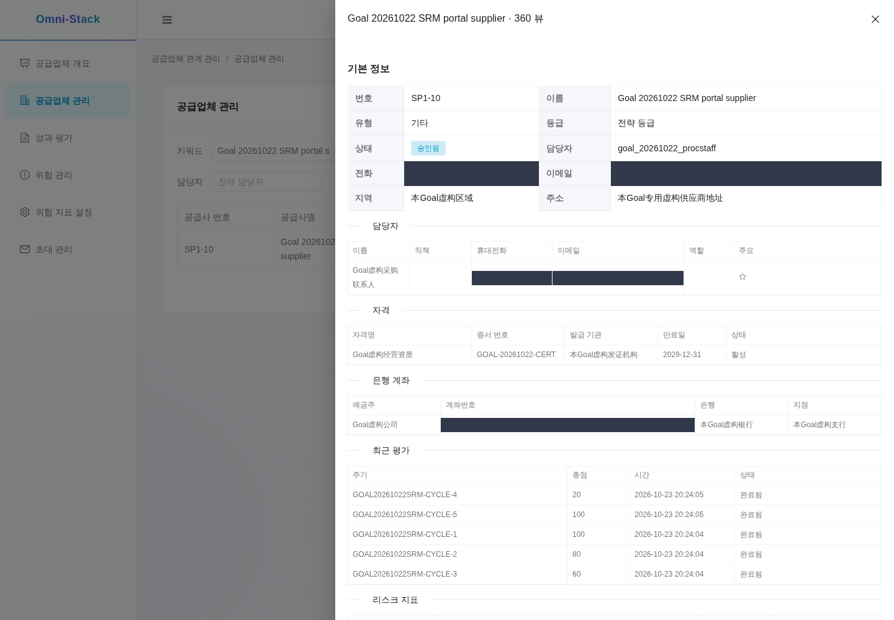

패널에는 기본 정보, 연락처, 자격, 은행 계좌, 최근 성과 평가, 위험 지표가 있습니다. 아래쪽 정보는 패널 안에서 더 스크롤해 확인합니다. 최근 평가는 일부 요약이므로 전체 기록은 평가 화면에서 조회하세요.

빈 영역은 자료 미등록, 권한 부족, 현재 보이는 기록 없음 중 하나일 수 있습니다. 특히 위험 지표가 비었다는 이유만으로 아직 평가하지 않았다고 판단하지 마세요. 해당 기업에서 지표 유형을 활성화했는지도 확인합니다. 전화번호나 계좌의 별표는 현재 권한에 따라 가려진 정보이며 데이터 손상이 아닙니다.

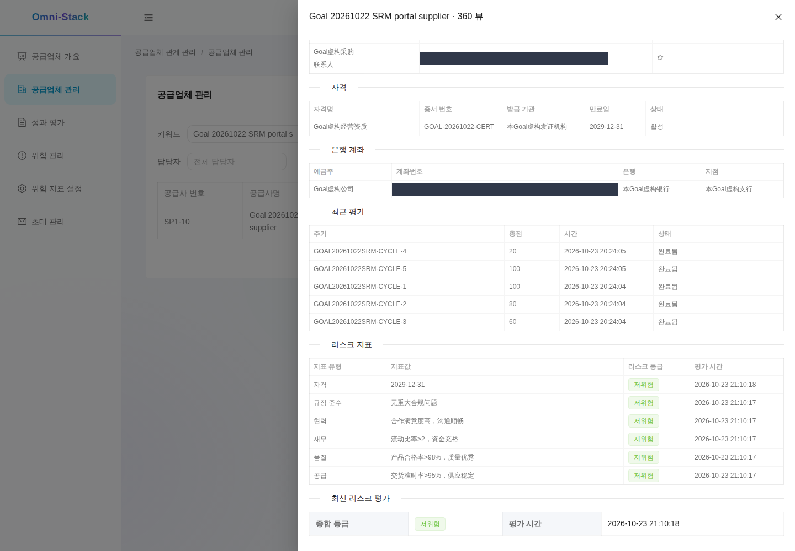

### 3.3 기본 정보 수정하기

해당 행의 편집 작업으로 이름, 유형, 업종, 품목, 웹사이트, 연락 정보, 지역, 주소 등 현재 폼이 지원하는 항목을 수정합니다. 공급업체 등급은 평가 결과 등 실제 규칙에 따릅니다. 정보 편집은 등급이나 거래 상태를 마음대로 바꾸는 입구가 아닙니다.

연락 정보가 마스킹된 안내 표시로만 보이면 빈칸을 채우려고 별표를 다시 입력하지 마세요. 바꿔야 할 항목만 수정합니다. 이전 저장이 성공했는지 불확실하다면 먼저 새로고침해서 결과를 확인하세요.

### 3.4 담당자 이관하기

권한이 있는 직원이 편집 창에서 새 내부 담당자를 검색·선택한 뒤 저장합니다. 후보는 직원 상태, 조직, 본인의 배정 가능 범위에 따라 결정됩니다. 구매 관리자는 허용된 하위 부서를 포함할 수 있으므로 모든 부서 간 작업이 거부되는 것은 아닙니다.

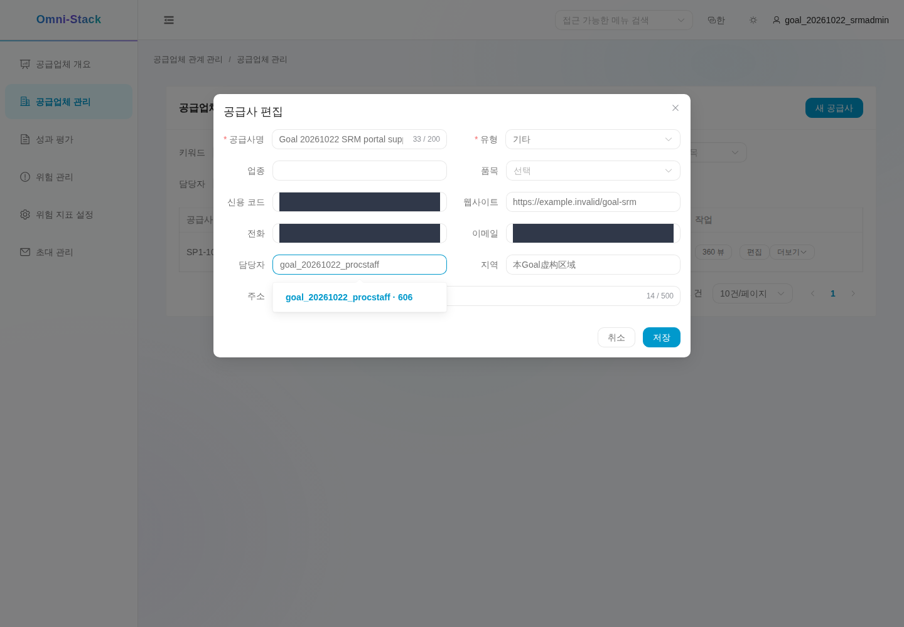

공급업체 포털 계정은 내부 담당자가 될 수 없습니다. 검색에 나타나지 않는 것은 정상적인 신분 분리입니다. 다른 정보 항목을 바꾸는 방법으로 우회하지 마세요. 적법한 이관은 관련 평가의 담당 범위도 함께 갱신하지만 기존 점수는 바꾸지 않습니다.

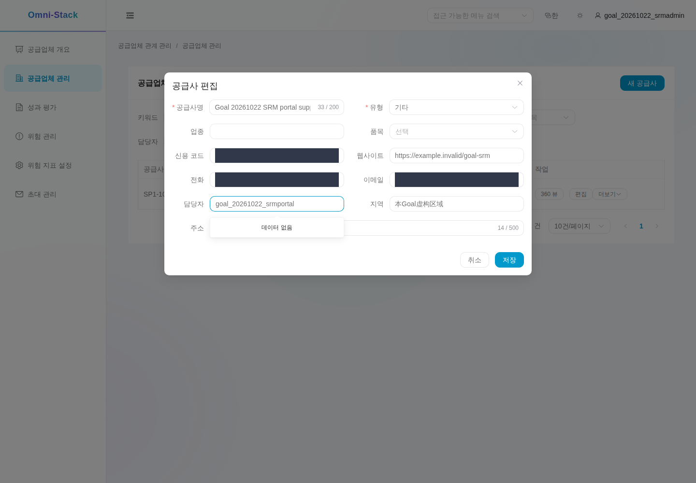

정보 수정과 담당자 이관은 따로 확인하는 편이 명확합니다. 한 번에 둘 다 바꾸면 정보가 먼저 저장되고 담당자 이관만 실패할 수 있습니다. 앞서 저장한 정보까지 취소되었다는 뜻은 아닙니다. 새로고침으로 어느 부분이 성공했는지 확인하고 남은 부분을 처리하세요.

## 4. 정지, 재개, 블랙리스트, 거래 종료, 삭제

해당 행의 「더보기」에서 작업합니다. 버튼 표시 여부는 현재 상태와 권한에 따라 결정됩니다.

| 현재 상황 | 처리 방법 | 처리 후 확인 |
| --- | --- | --- |
| 승인 중인 회차를 끝내야 함 | 실제 신청자가 권한에 따라 회수 또는 취소 | 기존 할 일이 끝나고 공급업체가 처리 대기로 돌아감 |
| 승인됨, 잠시 거래를 멈춤 | 「정지」 사용 | 목록에 「정지됨」 표시 |
| 정지됨, 거래를 재개함 | 정지 상태의 「재개」 사용 | 다시 「승인됨」 표시 |
| 승인됨, 거래를 금지함 | 「블랙리스트 추가」 사용 | 블랙리스트 상태 표시 |
| 블랙리스트, 거래를 다시 허용함 | 전용 「블랙리스트 제외」 사용 | 현재 규칙에 따라 승인됨으로 복귀 |
| 승인됨 또는 정지됨, 거래를 종료함 | 「제외」 사용 | 「제외됨」으로 표시되고 이력은 유지 |

정지 후 재개와 블랙리스트 제외는 서로 다른 작업이며 대체할 수 없습니다. 「제외됨」은 정식 최종 상태로, 일반적인 복구 입구가 없습니다. 삭제도 거래를 복원하는 방법이 아닙니다.

승인 회수와 취소는 누가 신청했는지도 확인해야 합니다. 다른 관리자가 해당 공급업체를 볼 수 있어도 신청자 대신 승인을 끝낼 수 있다는 뜻은 아닙니다. 처리 후 상태와 기존 할 일을 확인하고 모든 대기 기록을 바로 재제출할 수 있다고 가정하지 마세요.

삭제는 현재 상태, 승인, 업무 이력에 따라 제한됩니다. 평가 같은 중요한 이력이 있는 공급업체를 프로세스 초기화 목적으로 삭제하지 마세요. 거부 이유를 읽고 기록을 보존하면서 실제 업무 상태에 맞게 처리합니다.

## 5. 연락처, 자격, 은행 계좌 관리

### 5.1 올바른 관리 입구

공급업체 행의 「더보기」에서 「연관 자료 관리」를 열고 공급업체 연락처를 다루는 「담당자」, 자격, 은행 계좌 탭을 전환합니다. 360 뷰는 주로 조회용입니다. 기본 정보 편집 창 역시 모든 하위 자료를 관리하는 입구는 아닙니다.

| 자료 | 입력·확인할 내용 | 저장 성공 확인 |
| --- | --- | --- |
| 연락처 | 이름, 부서나 직책, 연락 정보, 주요 연락처 여부 | 목록에 기록이 있고 주요 표시가 올바름 |
| 자격 | 이름, 증서 번호, 발급 기관, 발급일, 만료일 | 날짜가 맞고 조회·수정·삭제 가능 |
| 은행 계좌 | 예금주, 계좌번호, 은행, 지점, 기본 계좌 여부 | 목록에 계좌가 있고 기본 표시가 올바름 |

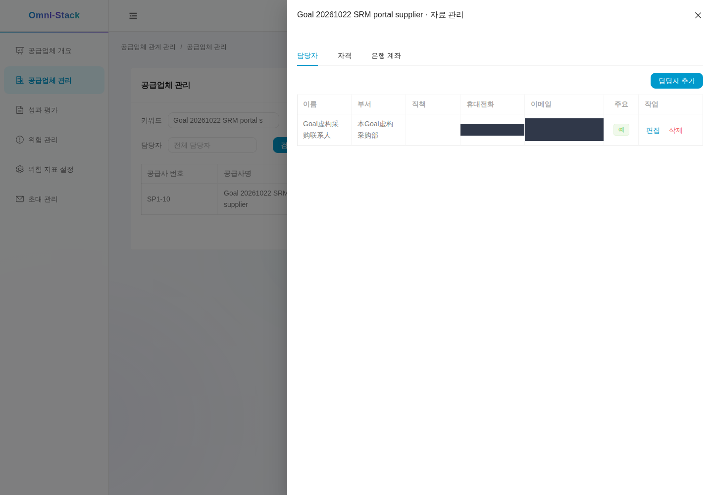

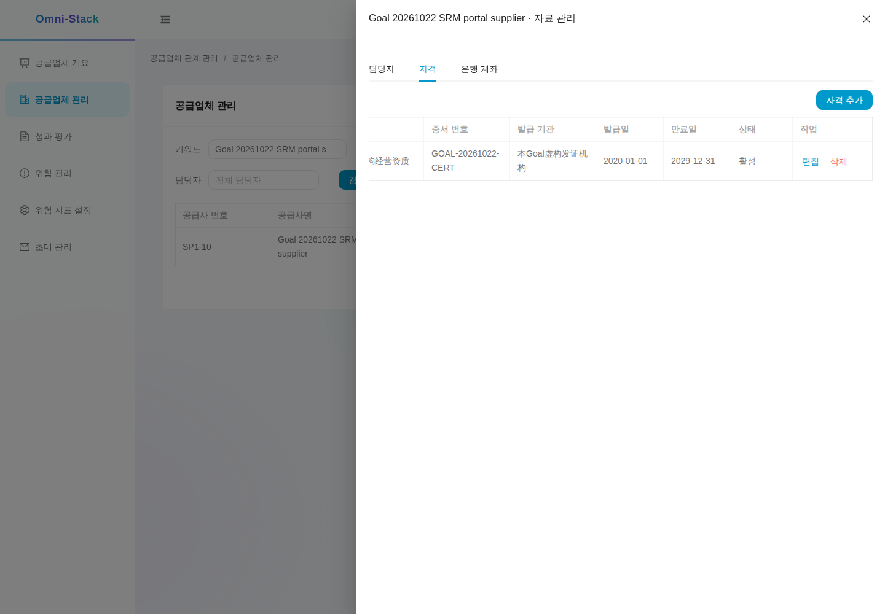

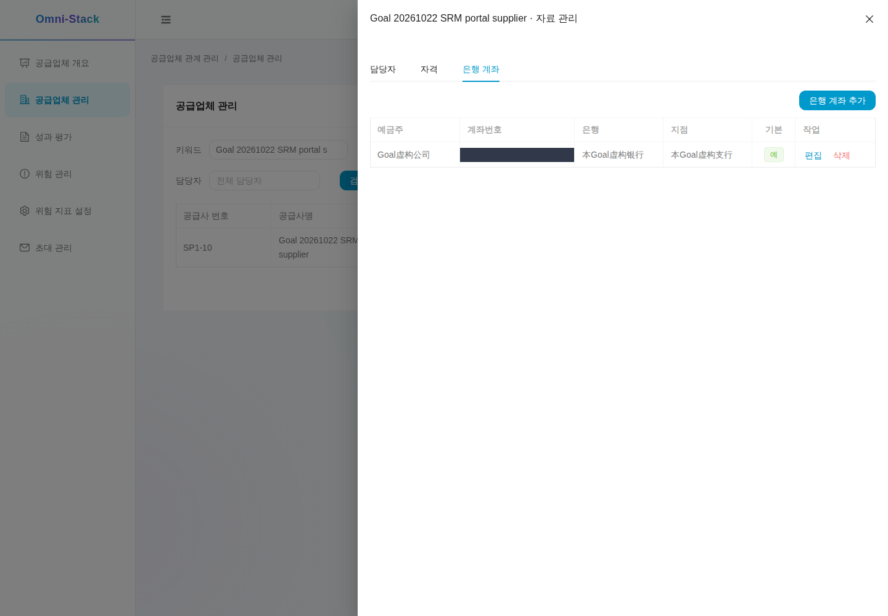

관련 자료 표도 가로로 스크롤할 수 있습니다. 이 「담당자」는 공급업체 측의 연락 창구이며 3절에서 데이터 범위를 관리하는 내부 담당자와 다릅니다.

### 5.2 주요 연락처와 기본 계좌

한 공급업체에는 유효한 주요 연락처와 기본 계좌가 각각 하나씩만 있습니다. 다른 항목을 주요 또는 기본으로 지정했다면 기존 항목의 표시가 해제되었는지 확인합니다. 표에 두 기록이 있다고 두 기본 항목이 모두 유효한 것은 아닙니다.

### 5.3 자격 만료와 개인정보

자격 만료일은 발급일보다 빠를 수 없습니다. 증서가 만료되었거나 만료가 가까우면 실제 갱신 정보를 입력하고 위험을 다시 확인합니다. 조건을 충족하는 공급업체는 관련 증서 위험을 다시 계산합니다. 만료된 자격을 삭제해도 결과가 달라질 수 있지만, 경고를 지우려고 실제 증빙을 삭제해서는 안 됩니다.

은행 계좌와 연락 정보는 권한에 따라 가려질 수 있습니다. 필수 항목 검사는 계좌의 실재 여부나 소유 관계를 확인했다는 뜻이 아닙니다. 저장이 불확실하면 먼저 새로고침하고, 삭제 후에도 목록에서 확인한 뒤 다음 작업을 진행하세요.

## 6. 성과 평가: 한 번의 점수에서 기간별 변화로

### 6.1 새 평가 시작하기

권한이 있는 내부 직원이 「성과 평가」에서 새 평가를 만듭니다. 거래 승인이 완료되고 내부 담당자가 있으며 본인의 범위 안에 있는 공급업체를 선택한 뒤 평가 기간을 입력합니다.

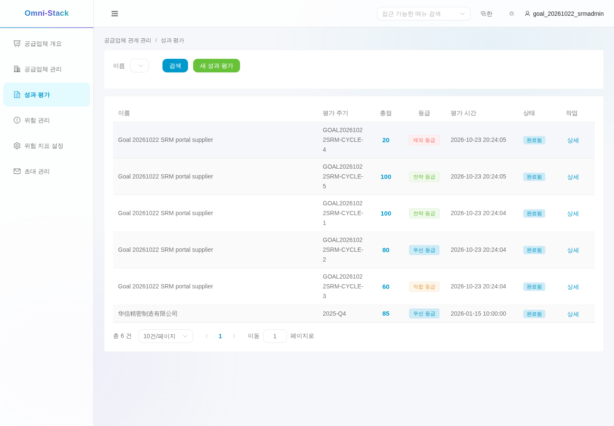

기본 평가는 품질, 납기, 가격, 서비스 네 항목이며 가중치는 순서대로 30%, 30%, 20%, 20%입니다. 폼에서 제공하는 점수로 모든 항목을 평가하고 필요한 의견을 적어 제출합니다. 항목을 빠뜨리거나 같은 항목을 두 번 제출하면 안 됩니다.

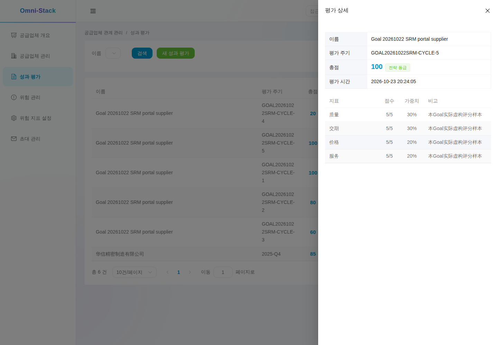

제출 후 목록에서 상세를 열어 기업, 기간, 네 점수, 가중 합계를 확인합니다. 거래 승인이나 담당자 배정이 아직이라면 평가를 위해 승인을 건너뛰지 말고 먼저 전제 조건을 갖추세요.

### 6.2 총점과 등급 이해하기

현재 총점은 20~100점이며 등급은 다음과 같습니다.

| 총점 | 평가 등급 |
| --- | --- |
| 90점 이상 | 전략 등급 |
| 75점 이상 90점 미만 | 우선 등급 |
| 60점 이상 75점 미만 | 적합 등급 |
| 60점 미만 | 제외 등급 |

평가의 「제외 등급」이 공급업체 거래 종료 작업까지 실행되었다는 뜻은 아닙니다. 거래를 끝내려면 해당 업무 작업과 권한에 따라 별도로 처리해야 합니다.

### 6.3 여러 기간의 이력 보기

새 기간의 평가는 이전 점수를 덮어쓰지 않고 별도 기록을 만듭니다. 평가 목록에서 공급업체로 필터링해 상세 점수를 보거나 360 뷰에서 최근 평가를 확인할 수 있습니다. 전체 이력과 최근 요약의 건수는 다를 수 있습니다.

공급업체는 포털에서 자사 평가만 보며 다른 기업의 이력은 볼 수 없습니다. 기본 템플릿이 없으면 기업 설정부터 확인합니다. 현재 기본 평가 항목을 자유롭게 추가·삭제하는 템플릿 관리 화면은 없습니다.

## 7. 위험 관리: 전체 색상보다 지표부터 보기

### 7.1 위험과 이력 확인하기

「위험 관리」에서 위험 등급으로 필터링하고 공급업체의 지표나 이력을 엽니다.

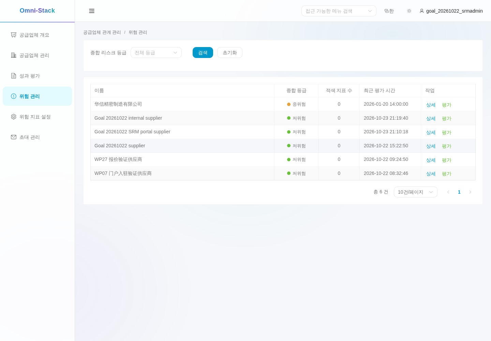

종합 등급은 각 지표 점수를 합산한 뒤 현재 설정된 구간과 비교해서 정해집니다. 한 지표가 빨간색이라고 전체가 반드시 빨간색은 아닙니다. 개별 점수, 총점, 구간을 본 뒤 결과를 판단하세요.

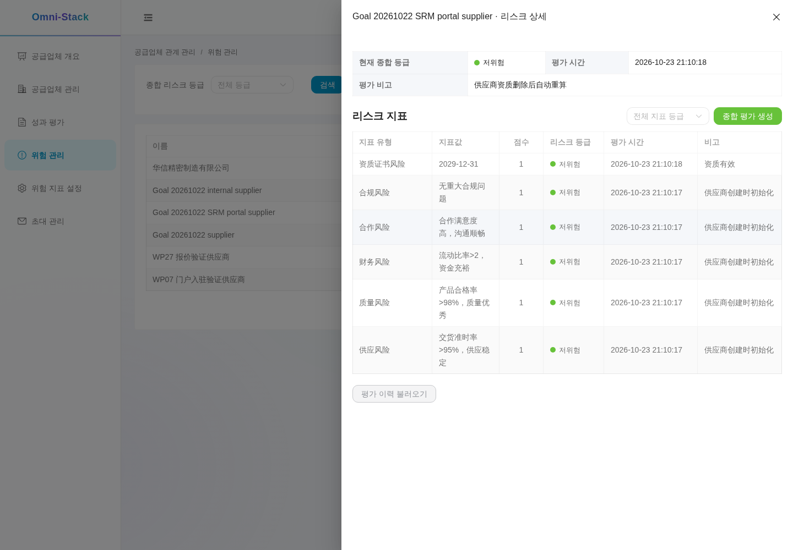

### 7.2 수동 지표 갱신과 위험 평가

권한이 있는 직원은 편집 가능한 지표에서 알맞은 채점 기준을 선택하고 저장된 점수와 설명을 확인합니다. 증서 같은 자동 지표는 자격 정보에서 관리해야 하며 일반 수동 항목처럼 색상을 임의로 바꾸지 않습니다.

위험 평가를 실행한 뒤에는 이력에 새 기록과 종합 결과가 생겼는지 확인합니다. 이력은 당시 결과를 보존합니다. 나중에 자격을 바꿔도 과거 평가가 모두 바뀌지는 않습니다. 위험 이벤트가 기록되었다고 외부 문자·이메일 등 알림이 도착한 것으로 판단해서는 안 됩니다.

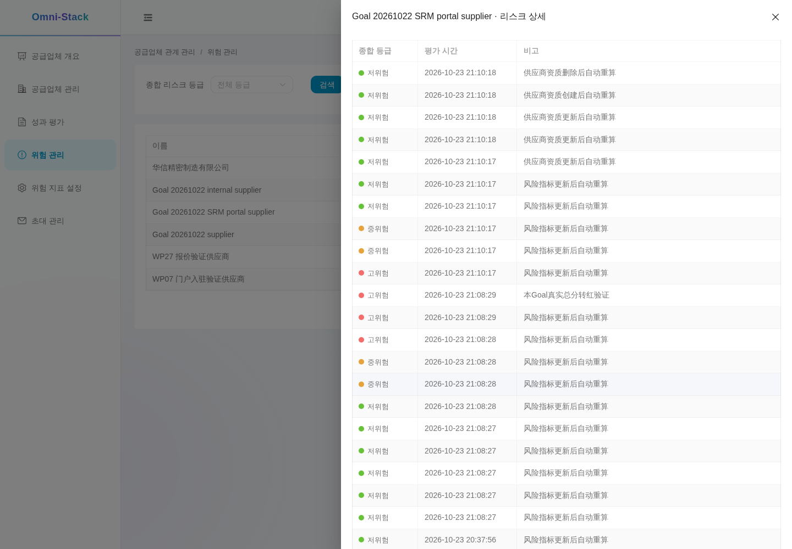

### 7.3 지표 유형, 기준, 임계값 관리하기

관리자는 「위험 지표 설정」에서 유형, 채점 기준, 종합 구간을 관리합니다.

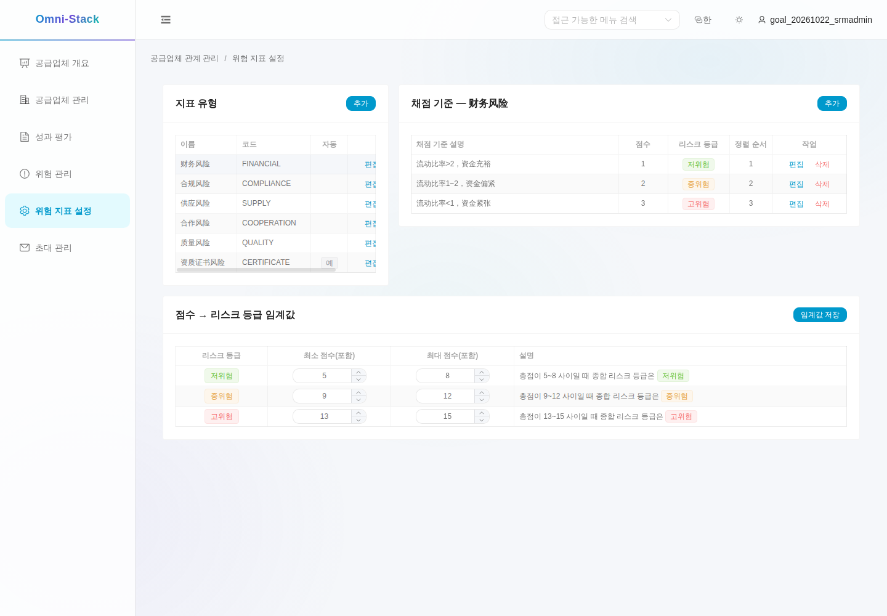

왼쪽에서 지표 유형을 선택하면 오른쪽에 채점 기준이 나타납니다. 이미지는 재무 위험을 선택한 상태이며 개별 점수는 1, 2, 3입니다. 아래 종합 구간은 모든 지표의 총점을 분류하므로 개별 채점과 구분하세요.

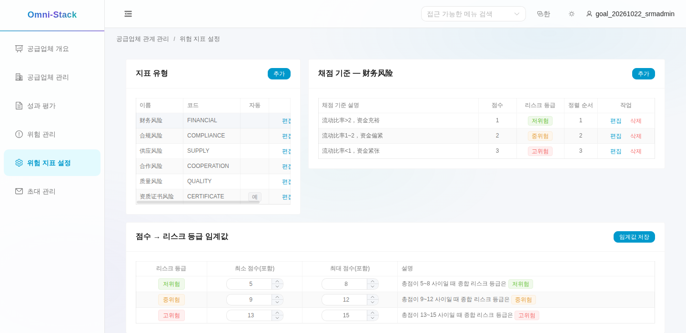

개별 항목의 채점 방식과 총점의 등급 구분을 나눈 뒤 해당 설정을 바꿉니다. 연결된 기준이 남은 유형은 삭제가 거부될 수 있으므로 먼저 연관 관계를 확인합니다. 원래 설정을 보관하고 구간이 빠지거나 겹치지 않는지 한 줄씩 점검하세요. 시스템이 모든 업무 설정 오류를 찾아준다고 가정하면 안 됩니다.

설정 변경이 과거 이력을 모두 재평가했다는 뜻은 아닙니다. 갱신이 필요한 공급업체를 실제로 평가하고 결과를 확인합니다. 지표 유형이 활성화되지 않았다면 빈 목록을 위험 0으로 해석하지 말고 설정부터 처리하세요.

유형을 추가하려면 왼쪽의 「추가」에서 코드, 이름, 필요한 설명을 입력하고 정렬 순서, 자동 계산 여부, 활성 상태를 설정합니다. 생성한 코드는 편집 창에서 바꿀 수 없습니다. 저장 후 목록에서 이름과 상태를 확인하세요. 일반적인 수동 채점에는 수동 유형을 사용합니다. 자동 계산은 프로젝트에 이미 구현된 계산 규칙이 필요하며 스위치를 켠다고 새 알고리즘이 생기지는 않습니다.

채점 기준을 추가할 때는 먼저 해당 수동 유형을 선택하고 오른쪽의 「추가」를 누릅니다. 이해하기 쉬운 판단 조건, 점수, 위험 색상, 정렬 순서, 활성 상태를 입력합니다. 점수가 높을수록 위험도 높습니다. 수정은 해당 행의 편집에서 하고 삭제 전에는 영향을 확인하세요. 자동 계산 유형에는 이 수동 추가 입구가 없습니다. 종합 구간을 조정했다면 아래 저장 버튼을 누르고 저장된 구간을 다시 읽어 확인합니다. 입력만 바꾸고 떠나면 저장되지 않습니다.

## 8. 초대 관리: 내부에서 입점 입구 준비하기

### 8.1 초대를 만들고 전달하기

권한이 있는 내부 직원은 「초대 관리」에서 유효 기간과 사용 가능 횟수를 설정해 초대를 만들고 올바른 공급업체 담당자에게 전달합니다.

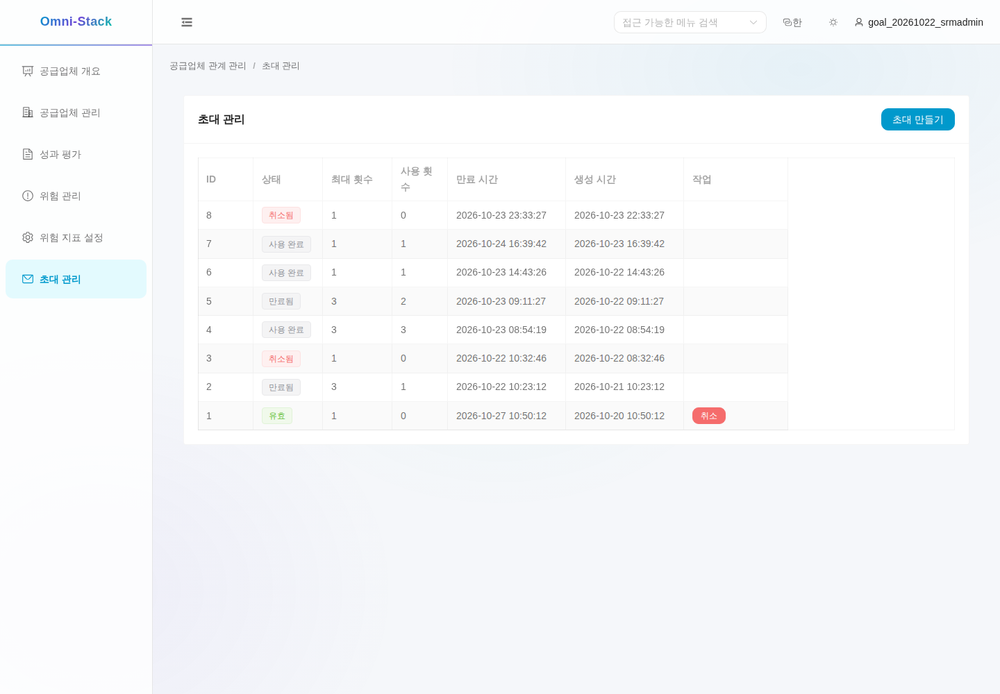

원본 초대 정보는 생성할 때만 제공됩니다. 목록이 전체 비밀 정보를 계속 보여 주는 것은 아닙니다. 공개 스크린샷, 단체 공지, 일반 문서에 노출하지 마세요. 나중에 원본을 찾지 못하더라도 숨겨진 비밀을 추측하거나 복원하려고 하지 마세요.

### 8.2 상태 확인과 철회

목록에는 활성, 사용 완료, 만료, 철회됨 같은 상태가 표시됩니다. 이미 접수된 신청은 새로고침만으로 사용 횟수를 반복 소비하지 않습니다. 그래도 구체적인 신청과 현재 초대는 확인해야 합니다.

화면의 「취소」를 누르기 전에 초대 대상을 확인합니다. 취소된 초대로 새 입점을 시작할 수 없고 반복 취소도 거부됩니다. 만료되었거나 횟수가 부족하다면 업무에 맞게 새 정식 초대를 만들고 다른 기업의 초대를 사용하지 마세요.

## 9. 공급업체 포털: 계정 등록, 입점, 정보 수정

### 9.1 계정 등록과 입점 신청은 다르다

공급업체는 전용 입구에서 로그인 또는 등록 화면을 열고 올바른 기업을 선택한 뒤 자신의 계정을 등록해 로그인합니다. 이후 내부에서 받은 초대로 자사 이름, 신용 코드, 필수 연락 정보를 작성해 입점을 신청합니다.

계정 등록만으로 공급업체 기업과 연결되는 것은 아닙니다. 입점 제출 뒤에도 신청 접수, 포털 권한·기업 연결 완료, 거래 승인 완료를 나누어 확인해야 합니다. 한 단계의 성공이 다음 단계까지 대신하지는 않습니다.

### 9.2 대기, 실패, 다시 로그인하기

신청 처리 중에는 화면의 실제 상태를 기다립니다. 역할 부여나 입점 처리 실패가 나오면 원인을 해결하고 재시도가 허용될 때 다시 시도합니다. 처리 중에 새 신청을 연속 제출하지 마세요.

기업 연결이 완료되면 안내에 따라 다시 로그인해 새 권한을 세션에 반영합니다. 이전 세션이 기업 정보를 열지 못한다고 다른 계정을 등록할 필요는 없습니다. 거래 승인이 진행 중이면 기업 상태와 승인 결과를 계속 확인합니다.

### 9.3 기업 정보: 저장과 재제출 구분하기

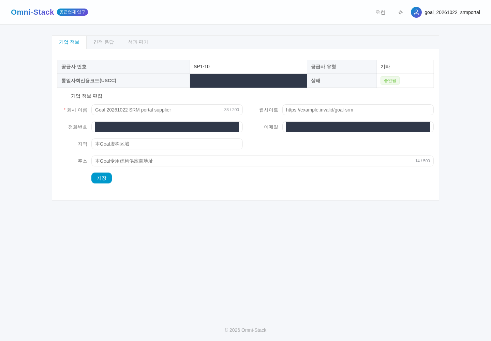

「기업 정보」에서 자사 이름, 번호, 신용 코드, 상태를 보고 현재 폼이 허용하는 웹사이트, 전화, 이메일, 지역, 주소 등을 관리합니다. 일반 저장은 자동으로 심사 대기로 돌리거나 새 승인 회차를 시작하지 않습니다.

반려되면 정보를 수정한 뒤 화면에서 허용된 재제출을 사용합니다. 이후 새 승인 상태를 확인합니다. 이미 승인된 기업에 대해 거래 심사를 반복 제출하지 마세요.

### 9.4 성과 평가: 자사 결과 읽기

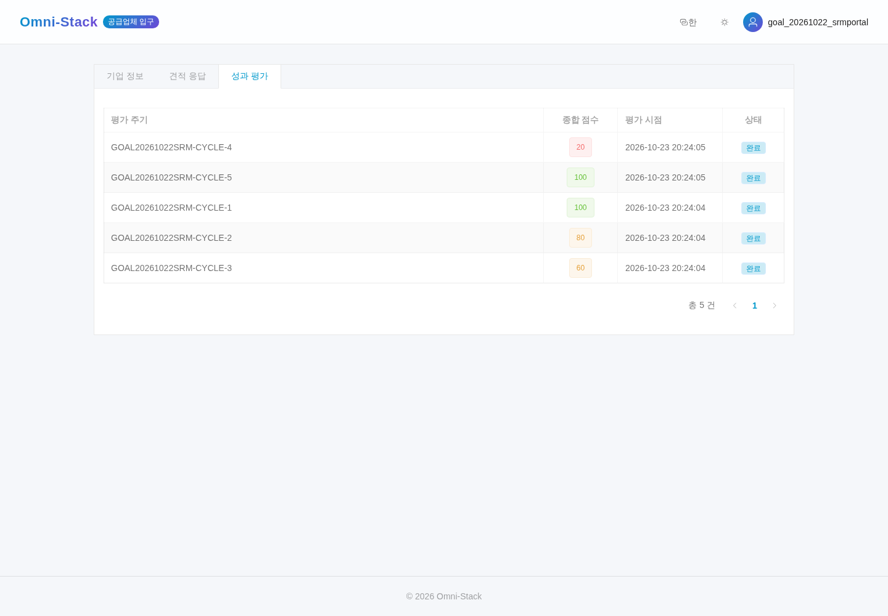

「성과 평가」에서 자사에 대한 내부 점수를 기간별로 확인합니다. 포털은 결과를 보는 곳이며 공급업체가 스스로 점수를 매기는 입구가 아닙니다. 기록이 없다면 구매 담당자에게 자사 평가가 실제로 끝났는지 확인하세요.

## 10. 포털 견적: 요청 수신부터 저장 결과까지

### 10.1 자사에 온 견적 요청 찾기

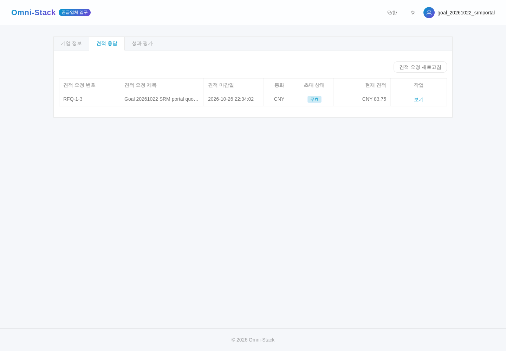

이미지의 샘플 요청은 이미 취소되어 조회만 가능합니다. 첫 견적을 연습하려면 구매 측에서 자사를 실제로 초대한, 아직 열린 요청을 제공해야 합니다.

「견적 응답」에서 요청을 찾아 상세를 열고 제목, 품목 행, 수량, 통화, 마감 시각, 현재 상태를 확인합니다. 공급업체는 거래 승인을 마쳤고 해당 요청이 실제로 자사를 초대해야 합니다. 다른 기업의 초대는 주소를 복사해도 접근할 수 없습니다.

### 10.2 첫 견적 작성과 제출

모든 품목 행에 단가, 납품 소요일, 필요한 비고를 입력하고 조건에 맞는 견적 유효 기한을 정합니다. 모든 행을 빠짐없이 입력하며 단가는 양수여야 합니다. 수량은 견적 요청에서 제공하므로 확인해야 하며 견적에서 임의로 바꾸지 않습니다. 견적 유효 기한은 요청 마감보다 빠를 수 없습니다.

제출 후 상세를 다시 열어 금액, 내용, 현재 버전을 확인합니다. 접수 표시가 나오거나 버튼이 비활성화되어도 먼저 저장 결과를 읽으세요. 대기가 조금 길다고 저장을 연속해서 누르지 마세요.

제출 결과를 확인할 수 없으면 폼의 현재 내용이 잠깁니다. 같은 내용으로 다시 시도하려면 「동일 요청 재시도」를, 서버에 무엇이 저장되었는지 먼저 보려면 「견적 상태 새로고침」을 사용합니다. 새로고침은 견적을 다시 읽고 최신 내용으로 폼을 채우는 작업이며 이전 제출 성공을 보장하지는 않습니다. 금액과 버전을 확인한 뒤 다음 조치를 결정하세요. 결과가 불명확한 상태에서 가격을 바꿔 다시 보내거나 별도 견적을 만들지 마세요.

### 10.3 견적 수정과 종료된 요청 처리

요청이 열려 있고 갱신이 허용될 때 최신 내용을 바탕으로 견적을 고치고 새 금액과 버전을 확인합니다. 다른 창에서 이미 수정했다면 새로고침하고 오래된 화면으로 덮어쓰지 않습니다.

요청이 취소·만료되었거나 다른 제한으로 갱신할 수 없어도 과거 견적은 조회될 수 있습니다. 조회 가능하다고 새 견적을 제출할 수 있는 것은 아닙니다. 구매 담당자와 다음 절차를 확인하고 이전 성공 표시를 새 제출 성공으로 오해하지 마세요.

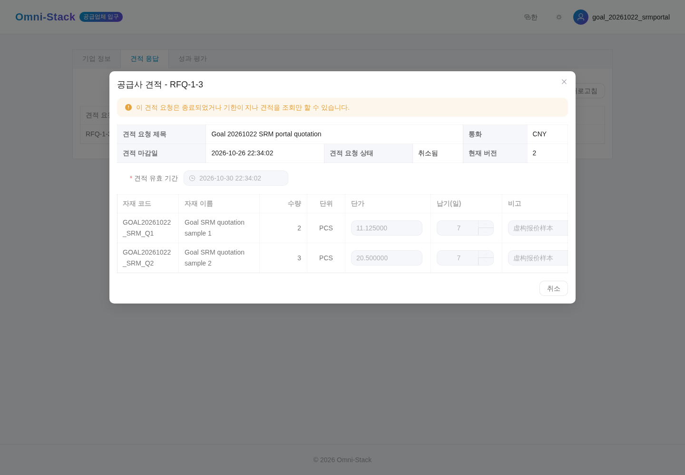

## 11. 자주 발생하는 문제와 복구

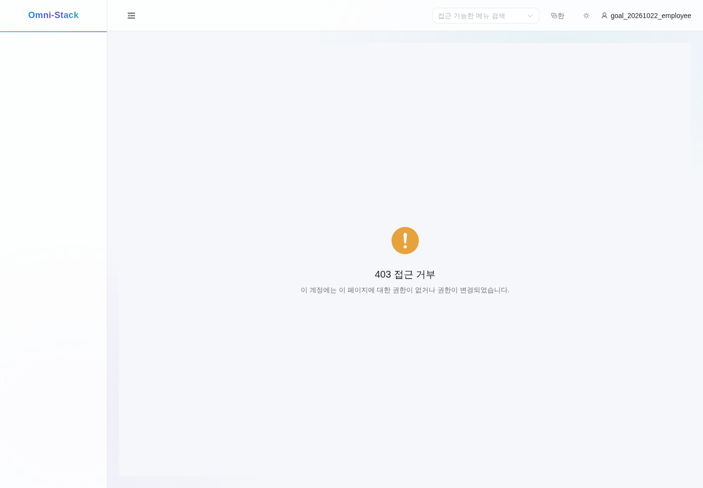

| 발생한 일 | 먼저 확인할 것 | 다음 조치 |
| --- | --- | --- |
| 목록이 비어 있음 | 현재 기업, 필터, 실제 데이터 범위 | 조건을 지우고 담당자나 조직 확인 |
| 권한 부족 또는 기록이 안 보임 | 올바른 계정, 필요한 권한과 연결 | 본인에게 허용된 입구 사용 |
| 담당자 후보가 없음 | 적격 내부 직원인지, 배정 범위 안인지 | 포털 계정이 없는 것은 정상적인 분리 |
| 기록이 바뀌었다는 표시 | 다른 창이나 동료의 수정 여부 | 최신 결과를 다시 읽고 판단 |
| 정보 저장 후 이관 실패 | 실제 저장된 부분 | 정보를 먼저 확인한 뒤 이관 처리 |
| 현재 상태에서 작업 불가 | 거래 상태, 승인 진행, 실제 신청자 | 해당 상태의 전용 작업 사용 |
| 입점 접수 후 기업 정보 접근 불가 | 연결 완료와 재로그인 여부 | 실제 상태를 기다리고 원인 해결 후 재시도 |
| 평가나 위험 데이터가 없음 | 정보 등록, 활성 설정, 실제 평가 | 빈 목록만으로 완료나 위험 없음으로 판단하지 않음 |
| 포털 요청이 없거나 견적 거부 | 자사 초대, 거래 승인, 마감, 요청 상태 | 구매 측이 전제를 확인하며 다른 기업 신분은 쓰지 않음 |

같은 브라우저에서 계정을 바꾸면 다른 탭도 새로고침해 신분을 확인해야 할 수 있습니다. 작업 전에 오른쪽 위 계정과 현재 기업을 확인하세요. 쓰기 성공 여부가 불명확하다면 원래 기록과 이력을 조회하고 같은 작업을 반복해서 보내지 마세요.

## 12. 실제로 검증한 범위

전용 로컬 샘플로 반려와 재제출, 여러 승인자의 승인, 회수와 취소, 정지와 재개, 블랙리스트 전용 해제, 거래 종료, 허용된 삭제, 담당자 이관과 복원, 관련 자료 관리, 5개 평가 기간, 위험 변화와 증서 갱신, 초대 철회, 포털 입점 실패와 복구, 견적 갱신을 실제로 수행했습니다. 구매 담당자, 상위 부서 관리자, 같은 계층의 다른 부서 직원, 내부 관리자, 두 공급업체 신분의 경계에도 실제 결과가 있습니다.

이 결과는 기록된 로컬 시나리오의 검증입니다. 사용하는 기업에 같은 인원, 프로세스, 지표가 이미 설정되어 있음을 보장하지는 않습니다. 외부 알림 전달, 실제 외부 계정 연결, 구현되지 않은 템플릿 관리 기능도 증명하지 않습니다. 연동과 실행 경계는 엔지니어링 사실 문서에서 설명합니다. 일반 사용에는 소스 코드, 명령, 데이터베이스 접근이 필요하지 않습니다.
