# SRM 与供应商门户图文教程：从准入到评估、风险和报价

这篇教程带你认识一位供应商从申请合作到日常管理的完整过程。内部同事负责审核、维护资料和评估；供应商使用自己的门户账号查看企业资料、评估结果和询价邀请。两种身份各有入口，不能互相冒用。

先看你想做哪件事：

| 我想完成什么 | 从这里开始 |
| --- | --- |
| 查看供应商数量、合作状态和风险 | 第一节：供应商概览 |
| 在内部新建供应商，跟进准入审批 | 第二节：新建与审批 |
| 查企业资料、转交负责人、维护联系人和资质 | 第三至五节：日常维护 |
| 给供应商评分，查看不同周期的表现 | 第六节：绩效评估 |
| 查看风险、更新指标或维护评分规则 | 第七节：风险管理 |
| 邀请供应商自己注册、入驻和补充资料 | 第八、九节：邀请与门户 |
| 给收到的询价填写和修改报价 | 第十节：门户报价 |
| 处理无权限、旧页面、失败或状态不允许 | 第十一节：恢复方法 |

## 读前须知：先确认身份和企业

内部人员从「我的工作台」的应用目录或「应用」中打开「供应商关系管理」，会进入新的网页标签。该标签的左侧菜单和右上角搜索只服务于当前应用；回工作台请切换原来的工作台标签。没有某个菜单时，先核对账号权限，不要把其他同事的页面地址当成自己的授权。

| 当前身份 | 通常负责什么 | 数据范围 |
| --- | --- | --- |
| SRM 管理员 | 企业内的供应商、邀请、绩效和风险管理 | 当前企业内获授权的数据 |
| 采购经理 | 本部门及下级的供应商、评估与风险 | 按实际组织和角色配置 |
| 采购员 | 本人负责的供应商及日常维护 | 通常是本人负责的记录 |
| 供应商 | 自己企业的资料、评估和询价报价 | 当前账号已关联的企业 |

门户账号需要先完成入驻和关联。只完成普通账号注册，还不能查看企业资料；内部管理员也不能替供应商使用门户报价。一个账号如果同时有多种角色，应以实际获准的入口和范围为准，不是只看角色名称。

截图使用同一套本地环境中的专用演示身份与业务样本。业务名称、指标名称和评分备注可能保留中文，电话、邮箱、账户等敏感字段按权限或截图遮罩处理。受控测试会话的操作图不等于真人输入验证码，也不代表第三方账号已授权。不要在共享数据上照抄删除、淘汰等不可随意撤销的动作。

## 一、供应商概览：先知道现在发生了什么

有概览权限的管理员或采购经理，在当前应用左侧打开「供应商概览」。

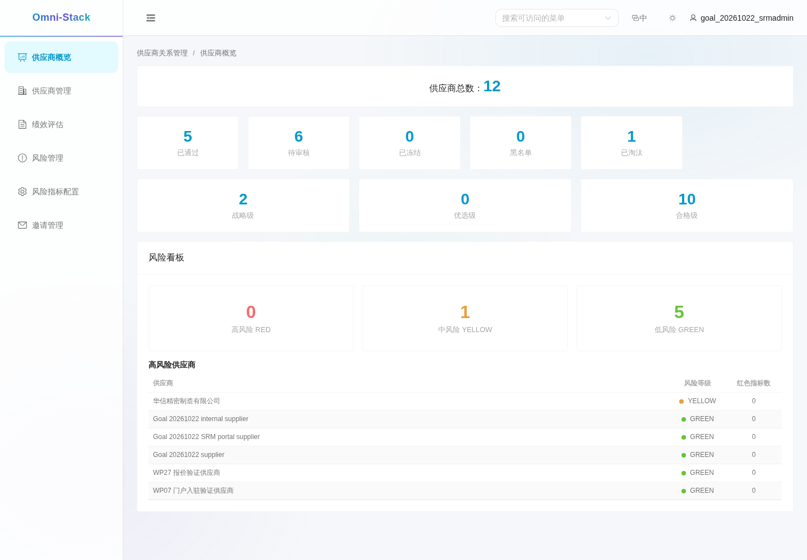

先看供应商数量和各状态分布，再看风险看板。数字只统计你当前有权看到的数据，因此采购员、经理与管理员看到的数量可能不同。没有供应商时显示零是正常情况；数量与预期不符时，先检查当前企业、账号范围和筛选条件。

## 二、新建供应商与准入审批

### 2.1 内部同事怎样新建

打开「供应商管理」，点击「新建供应商」。按必填标记填写供应商名称和类型，再核对行业、品类、信用代码、网站及联系资料。需要指定负责人时，只选择允许分配的内部同事。

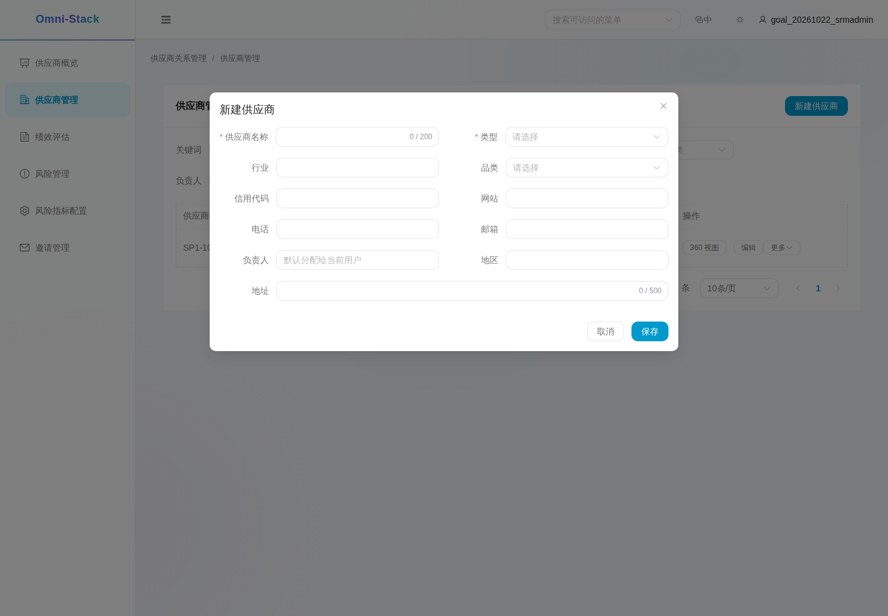

保存前先检查名称和信用代码，避免把同一家企业重复录入。正常保存后会启动准入审批；先看列表状态和「审批进度」，不要把“保存成功”理解为已经允许合作。启动条件不满足或服务暂时异常时，可能停在等待处理或启动失败的阶段，需要管理员检查实际流程情况。

### 2.2 谁来审批，怎样知道结果

审批人在「我的工作台」同页的「待我审批」中处理分给自己的事项。供应商管理里的「审批进度」用于查看进展，不是绕过审批的快捷批准按钮。

本地演示实际经过了驳回、修改、重新提交及多位审批人批准。你使用的企业可能采用不同的已发布流程，应按真实待办办理。最后回到供应商列表，确认显示「已通过」；仅看到流程已创建或申请已受理，还不能认定准入完成。

### 2.3 驳回后怎样重新提交

供应商被驳回后，先阅读审批意见并修改资料。内部人员从该行「更多」中的重新提交入口发起；供应商则在自己的企业资料页按当前按钮重新提交。再次提交会进入新一轮审批，上一轮的意见和历史仍保留。

「待审核」和「已驳回」不能混为一谈。当前重新提交入口针对驳回后的修订；撤回、取消或启动失败后的待处理记录，没有一个通用按钮能保证重新启动。遇到这类记录应先核实原流程，不要反复新建同一家企业。

## 三、查找供应商、查看 360 资料与转交负责人

### 3.1 查找和筛选

在「供应商管理」按关键词、状态、品类或负责人筛选。查不到时先清空条件，再检查是否属于当前账号的数据范围。

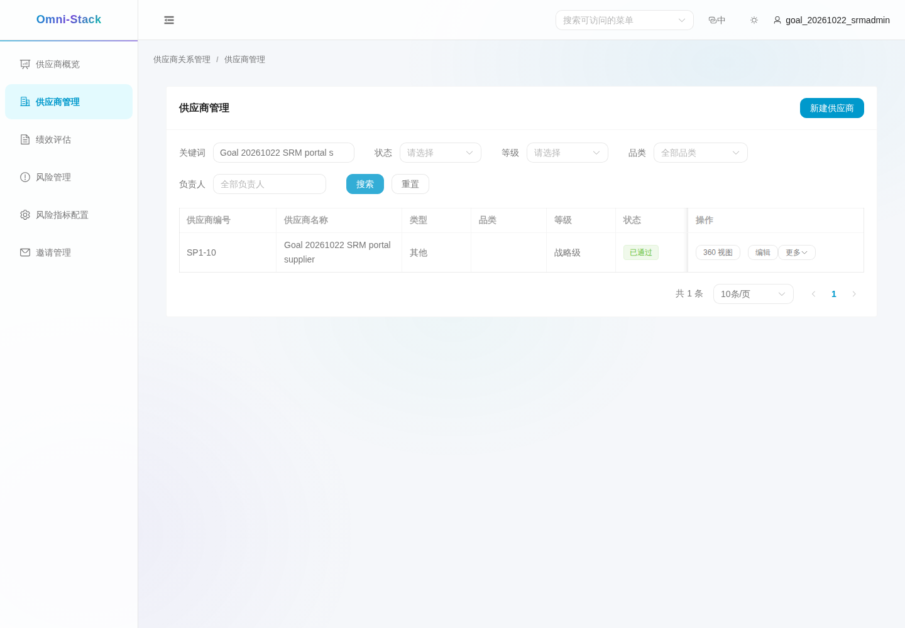

表格较宽时，在表格内部横向滚动查看其余列；操作列固定在右侧。负责人显示未分配时，先完成合法的内部分配，再进行需要负责人的业务操作。

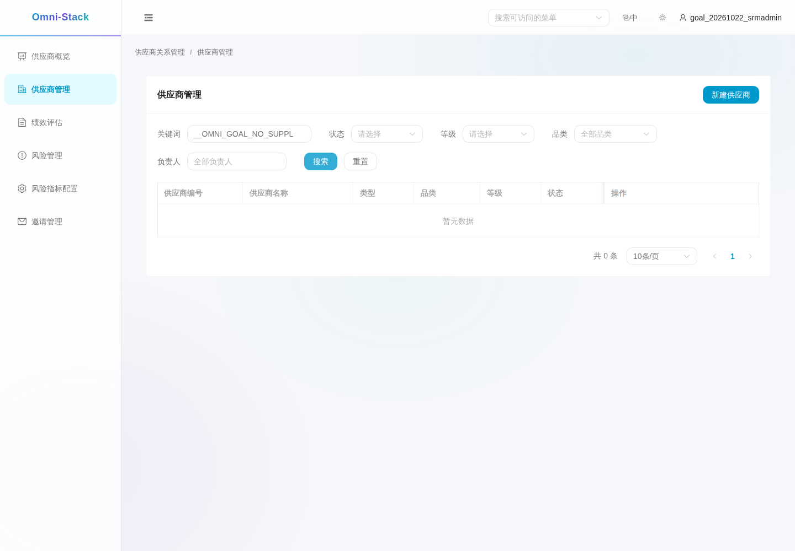

空列表只说明当前条件下没有可见结果，不表示可以自行扩大权限。

### 3.2 360 视图：沟通前把资料看全

点击供应商行的「360 视图」。

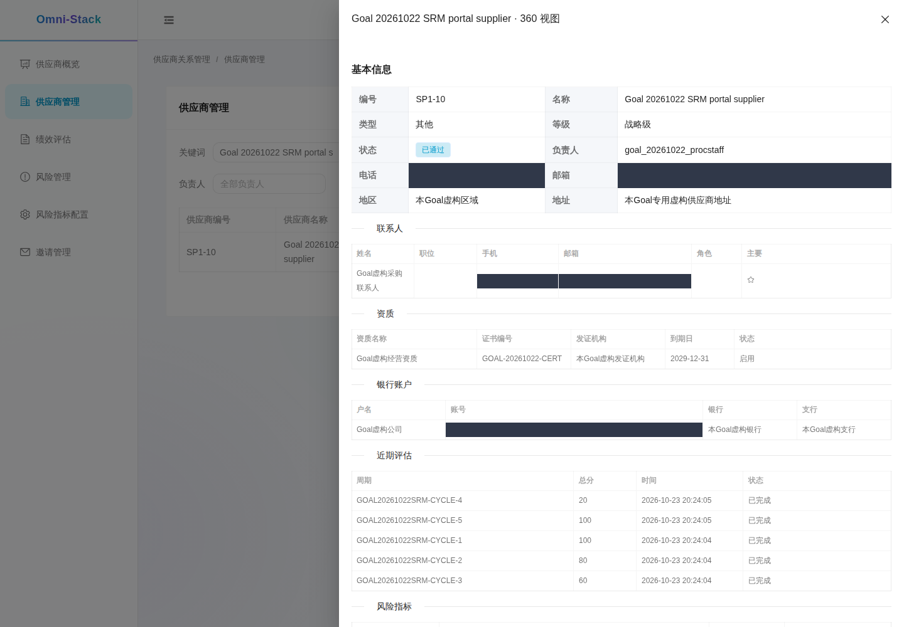

抽屉包含基本信息、联系人、资质、银行账户、近期绩效评估和风险指标。内容较长时在抽屉内继续向下滚动；近期评估只展示最近的一部分，完整记录到评估页查。

某一块为空，可能是尚未维护、没有相应权限，或当前没有可见记录。尤其不能只凭风险指标为空就判断“还没评估”：还应检查该企业是否已启用相应指标类型。手机号或账户出现星号表示当前身份收到的是脱敏资料，不是数据损坏。

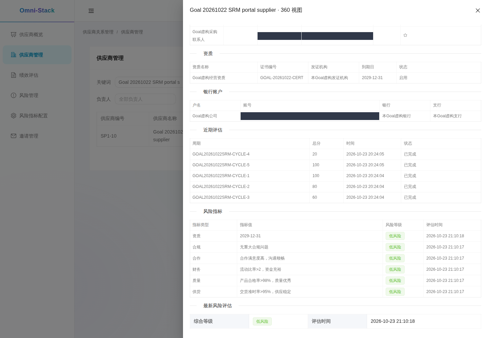

### 3.3 修改基本资料

在供应商行点击「编辑」，修改名称、类型、行业、品类、网站、联系方式或地区地址等当前表单支持的字段。供应商等级由绩效结果等实际规则决定，不要把编辑资料当成任意改等级或合作状态的入口。

如果某个联系方式只显示脱敏占位，不要为了“填完整”把星号重新抄进输入框。只更改需要调整的字段；不确定上次是否保存时，先刷新读回结果。

### 3.4 转交负责人

有权限的同事在编辑窗口搜索并选择新的内部负责人，再保存。候选由人员状态、组织和你的可分配范围共同决定。采购经理可以覆盖获授权的下级部门，因此不是所有跨部门操作都一律拒绝。

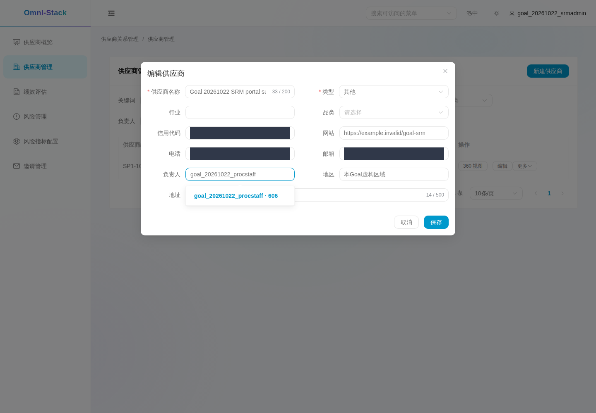

供应商门户账号不应成为内部负责人。搜不到门户账号是正常的身份隔离，不要通过另外改资料的方式绕过。合法转交会同时调整关联评估的负责范围，但不改写原来的评分。

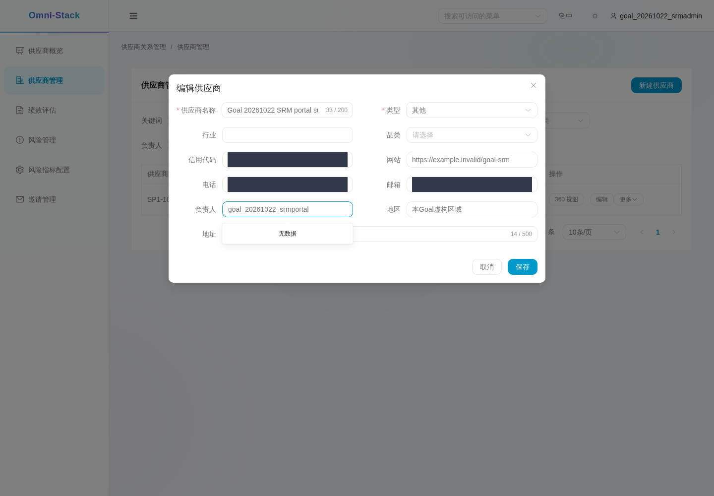

建议把资料修改和负责人转交分开核对。一次同时修改时，资料可能先保存，随后转交失败；这不表示先前保存的资料也被撤回。先刷新确认哪部分已经成功，再处理剩余部分。

## 四、冻结、恢复、黑名单、淘汰与删除

从对应行的「更多」进入。是否显示按钮，同时取决于当前状态和你的权限。

| 当前情况 | 可以怎样处理 | 完成后应确认什么 |
| --- | --- | --- |
| 正在审批，需要结束本轮 | 实际发起人按权限撤回或取消审批 | 原待办结束，供应商回到待处理状态 |
| 已通过，暂时不合作 | 冻结 | 列表显示已冻结 |
| 已冻结，恢复合作 | 使用冻结状态对应的恢复入口 | 列表重新显示已通过 |
| 已通过，需要禁止合作 | 加入黑名单 | 列表显示黑名单 |
| 黑名单，允许重新合作 | 使用移出黑名单的专用入口 | 按当前规则回到已通过 |
| 已通过或已冻结，决定终止合作 | 淘汰 | 显示已淘汰，并保留历史 |

冻结表示暂停合作；冻结后的恢复和移出黑名单是两种不同操作，不能相互代替。已淘汰是正式终态，当前没有普通恢复入口；删除也不是恢复合作的办法。

撤回或取消还要核对谁发起了流程。即使另一个经理看得到该供应商，也不代表他可以代发起人结束审批。结束审批后，先核实状态与待办，再决定下一步；不要默认都能直接重新提交。

删除同时受当前状态、审批和业务历史限制。不要删除已经形成评估等重要历史的供应商来“重置流程”。被拒绝时阅读原因，保留记录，按实际业务状态处理。

## 五、维护联系人、资质与银行账户

### 5.1 正确的维护入口

从供应商行的「更多」打开关联资料维护窗口，在联系人、资质和银行账户之间切换。360 视图主要帮助查看，不要把它或基本资料编辑窗口当成所有子资料的维护入口。

| 资料 | 填写和核对重点 | 怎样知道保存成功 |
| --- | --- | --- |
| 联系人 | 姓名、部门或职位、联系方式及是否主要联系人 | 列表出现记录，主要标记符合预期 |
| 资质 | 名称、证书编号、发证机构、签发日与到期日 | 日期正确，之后可查看、编辑或删除 |
| 银行账户 | 户名、账号、开户行、支行及是否默认账户 | 列表出现账户，默认标记符合预期 |

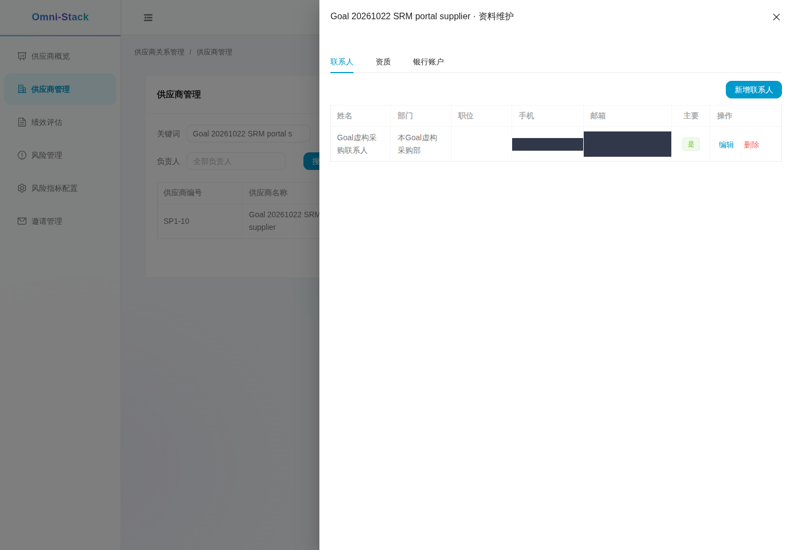

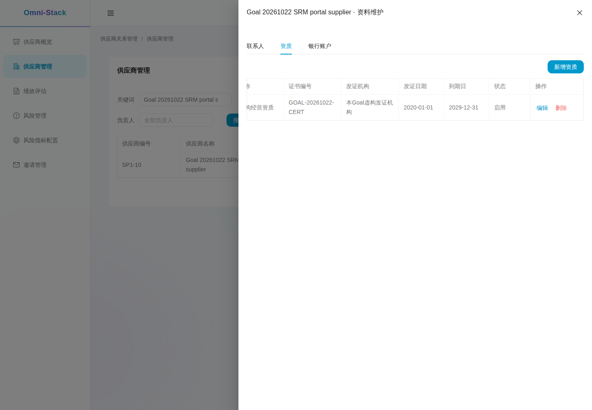

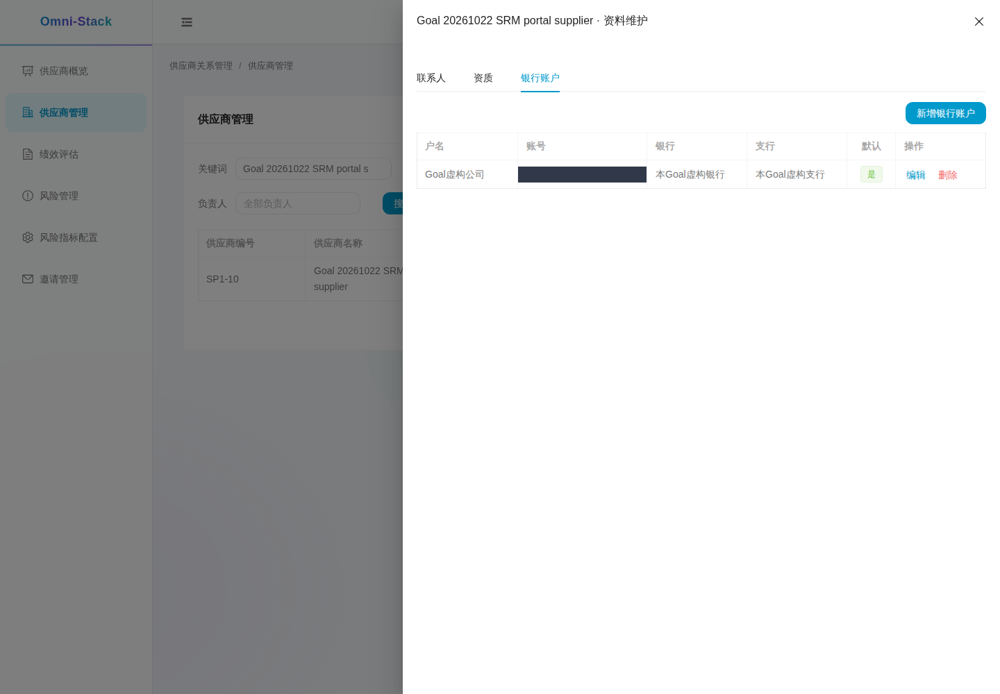

关联资料的表格也可以横向滚动。联系人是供应商一侧的沟通人，和第三节管理数据范围的内部负责人不是一回事。

### 5.2 主要联系人与默认账户

同一供应商只保留一个有效的主要联系人和一个有效的默认账户。把另一条设为主要或默认后，检查原来那条是否已取消对应标记。不要把两条表格记录都存在，误认为两个默认项都生效。

### 5.3 资质到期与隐私资料

资质到期日不能早于签发日。证书已过期或临近到期时，补充真实续期资料后再次查看风险；符合条件的供应商会重算相关证书风险。删除一份过期资质也可能改变结果，但不应为了消除风险提示而删除真实证据。

银行账户和联系方式可能按权限脱敏。表单检查必要字段，不代表系统验证了银行账号的真实性或归属。保存不确定时先刷新；删除后还应回到列表确认，不要连续重复操作。

## 六、绩效评估：从一次评分看到多期变化

### 6.1 发起一次新评估

有权限的内部人员打开「绩效评估」，点击新建评估。先选择已通过准入、已经有内部负责人且在自己范围内的供应商，再填写评估周期。

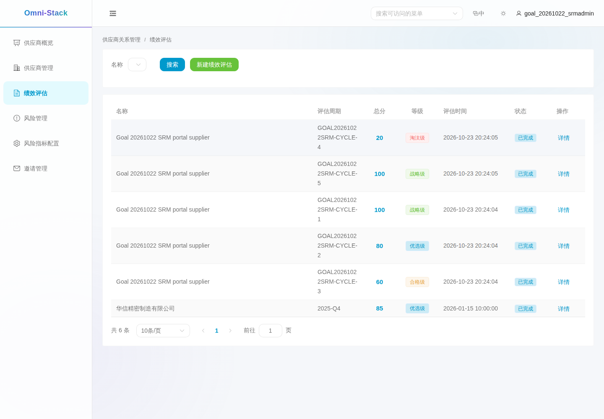

默认评估有质量、交期、价格和服务四个维度，对应权重为 30%、30%、20% 和 20%。按窗口给出的分值逐项评分，补充必要评语后提交。不能漏掉一个维度，也不能把同一项当作两项提交。

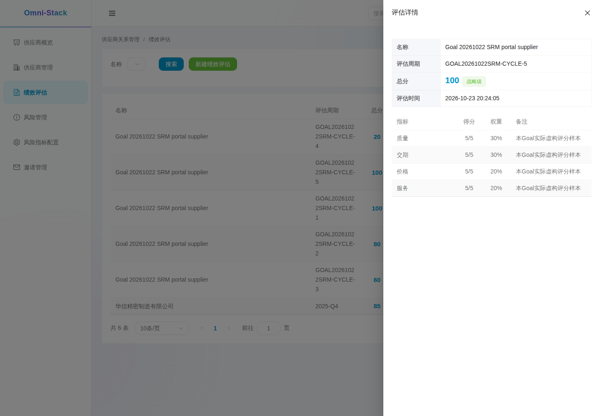

提交后回到列表打开详情，确认企业、周期、四项评分与加权总分。供应商尚未通过或负责人未分配时，先补齐业务前提，不能为了评分跳过准入。

### 6.2 理解总分和等级

当前总分在 20 至 100 分之间，等级按总分确定：

| 总分 | 评估等级 |
| --- | --- |
| 90 分及以上 | 战略级 |
| 75 分至不足 90 分 | 优选级 |
| 60 分至不足 75 分 | 合格级 |
| 不足 60 分 | 淘汰级 |

“淘汰级”是绩效等级，不等于供应商已经执行了生命周期里的淘汰。是否终止合作仍按对应业务操作和授权办理。

### 6.3 查看多周期历史

每个新周期形成一条新的评估记录，不覆盖之前的分数。可以在评估列表筛选供应商，在详情查看评分，或从 360 查看近期评估。完整历史与近期摘要的条数可能不同。

供应商通过自己的门户查看本企业评估，不能查看另一家企业的历史。默认模板缺失时应先检查企业配置；当前没有一个用于任意增删默认维度的模板管理页面。

## 七、风险管理：先看指标，再理解整体颜色

### 7.1 查看风险与历史

打开「风险管理」，按风险等级筛选，再进入某个供应商的指标或历史。

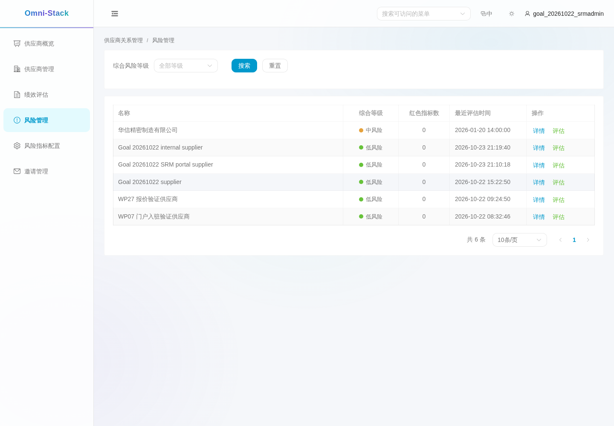

综合等级来自各项分数的合计，再对照当前配置的区间。某一项是红色，不代表整体一定红色；先看该项分数、总分和区间，再判断结果是否合理。

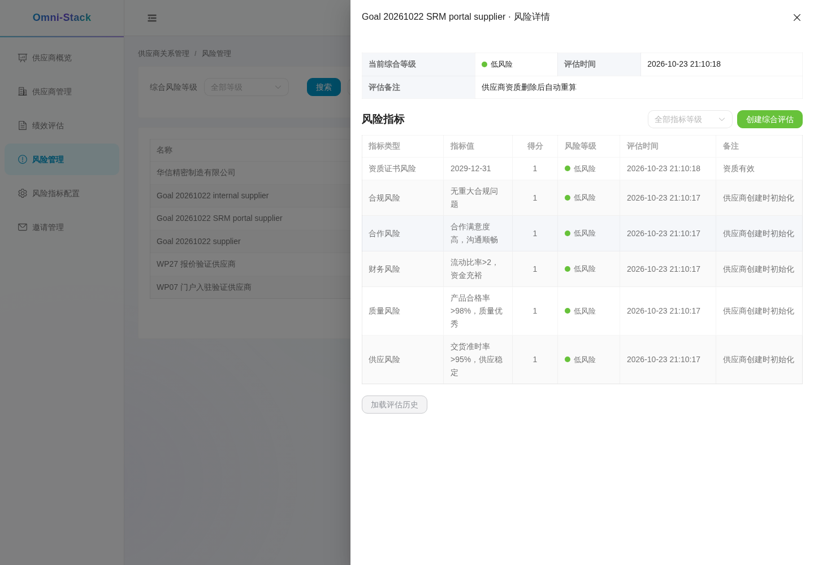

### 7.2 更新手工指标或发起评估

有权限的同事在允许编辑的指标上选择相应评分标准，并核对保存后的分数与说明。证书这类自动指标应从资质资料维护，不能当成普通手工项随意改色。

发起风险评估后，到历史中确认新增记录和综合结果。历史保留当时的结果，不会因为后来修改资质就把旧评估全部改写。风险事件已经产生，也不能据此认定外部短信、邮件或其他通知已经送达。

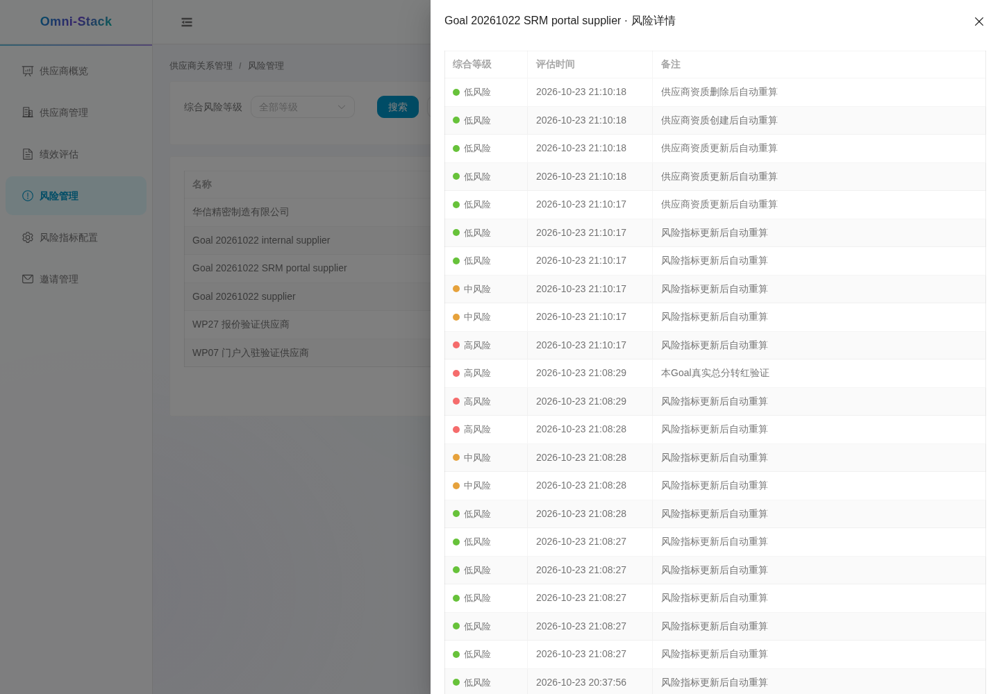

### 7.3 维护指标类型、标准和阈值

管理员从「风险指标配置」维护类型、评分标准和综合区间。

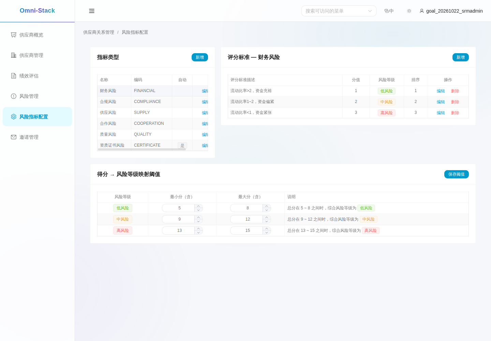

先点击左侧某种指标，右侧才会显示它的评分标准。图中选择了财务风险：单项分数为 1、2、3；下方综合区间用于判断所有指标的总分，两者不能混用。

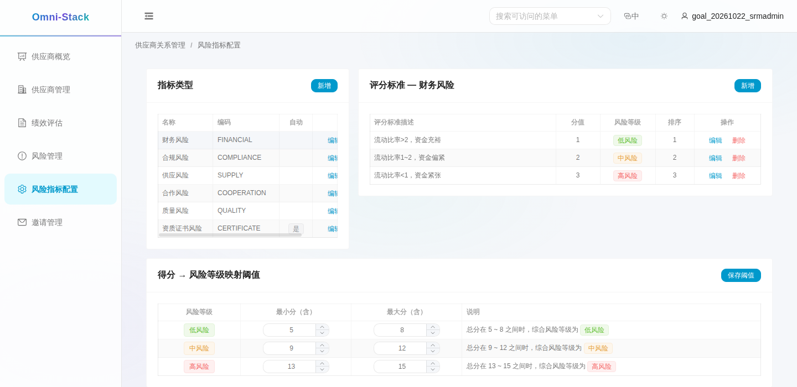

先区分“单项怎样打分”和“总分怎样分级”，再修改对应配置。删除仍有关联标准的类型可能被拒绝，应先处理其关联。更改前保存原配置并逐行核对，避免区间遗漏或重叠；不要假定系统会替你发现全部业务配置错误。

配置变化不等于所有旧历史已重新评估。按实际业务对需要更新的供应商发起评估，再核对结果；没有启用指标类型时，应先处理配置，不能只凭空列表判断风险为零。

新增类型时，在左侧点击「新增」，填写编码、名称和必要说明，再设置排序、是否自动计算及启用状态。编码在新增后不能从编辑窗口修改；保存后回列表核对名称和状态。日常人工评分使用手工类型，自动类型要依赖项目已有的计算规则，打开开关不会凭空增加新算法。

新增评分标准前，先选中它所属的手工类型，再点击右侧「新增」。填写容易理解的判断条件，设置分值、风险颜色、排序和启用状态；分值越高表示风险越高。修改用该行的「编辑」，删除前确认影响；自动计算类型没有这个手工新增入口。调整综合区间后，点击下方「保存阈值」，再读回各区间，不能只改了输入框就离开。

## 八、邀请管理：内部先准备入驻入口

### 8.1 创建和交付邀请

有权限的内部人员打开「邀请管理」，设置有效期和可使用次数，创建后将邀请信息交给正确的供应商联系人。

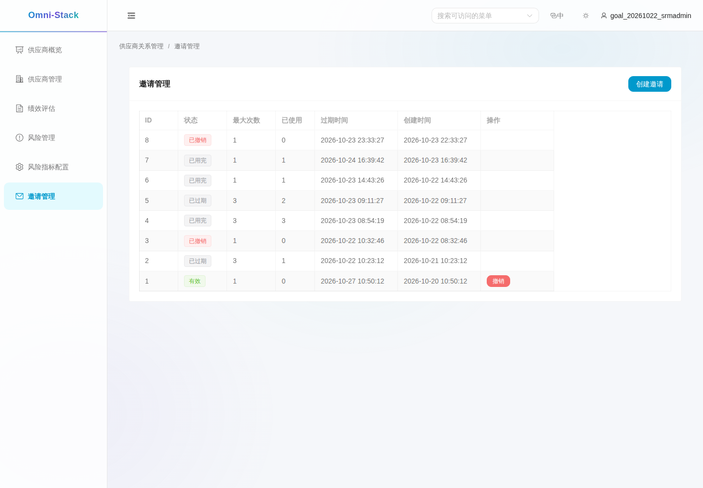

原始邀请信息只在创建时提供，列表不会一直显示完整令牌。不要把它放进公开截图、聊天群公告或普通文档中；后续找不到原始内容时，不要猜测或尝试恢复已隐藏的秘密。

### 8.2 查看状态与撤销

列表可能显示活跃、已用完、已过期或已撤销。已经受理的申请不会因为刷新页面就反复占用次数；但你仍应核对具体申请与当前邀请。

撤销前先确认目标。撤销后不能再用该邀请开启新的入驻，重复撤销会被拒绝。过期或次数不足时，按业务需要重新创建合法邀请，不要改用别家企业的邀请。

## 九、供应商门户：账号注册、入驻和资料修订

### 9.1 注册账号与申请入驻是两件事

供应商从供应商入口打开登录或注册页面，选择正确企业，按页面要求完成自己的账号注册和登录。随后使用内部提供的邀请，填写本企业名称、信用代码及必要联系资料并提交入驻。

只注册账号还没有供应商企业身份。提交入驻后也要区分三个阶段：申请已受理、门户权限与企业关联已建立、准入审批已通过。某一阶段成功，不能代替下一阶段。

### 9.2 等待、失败和重新登录

申请处理中先等待页面的真实状态。若提示角色或入驻处理失败，先按提示处理原因，等到允许重试后再重试；处理中不要连续提交新申请。

入驻关联完成后，按页面提示重新登录，让会话获得新权限。旧会话可能暂时仍打不开企业资料，这不意味着应再注册一个账号。准入审批还在进行时，继续关注企业状态和审批结果。

### 9.3 企业信息：修改不等于重新提交

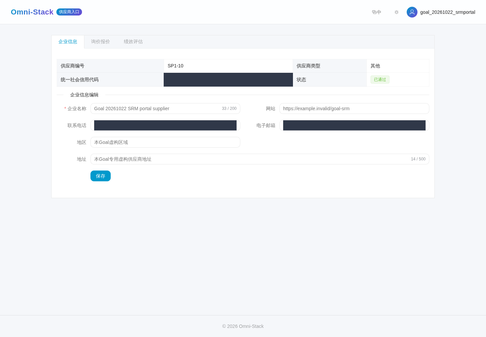

在「企业信息」查看本企业名称、编号、信用代码和状态，按当前表单维护网站、联系电话、邮箱、地区和地址等可修改字段。普通保存不会自动把企业重新变成待审核，也不等于发起新一轮审批。

被驳回时先修改资料，再使用页面允许的重新提交入口。重新提交后继续查看审批状态；已通过的企业不要反复提交准入。

### 9.4 绩效评估：查看本企业结果

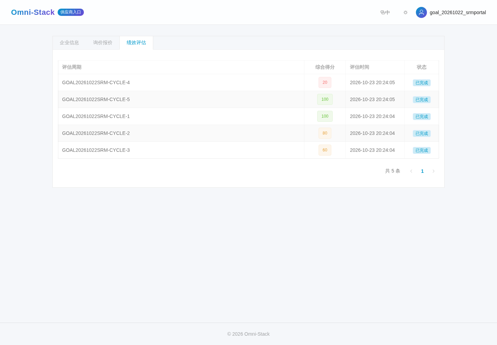

在「绩效评估」按周期查看本企业的内部评分。门户用于查看这些结果，不是供应商给自己打分的入口。没有记录时，先和采购对接人核对是否已对本企业完成评估。

## 十、门户询价报价：从收到邀请到保存结果

### 10.1 找到发给本企业的询价

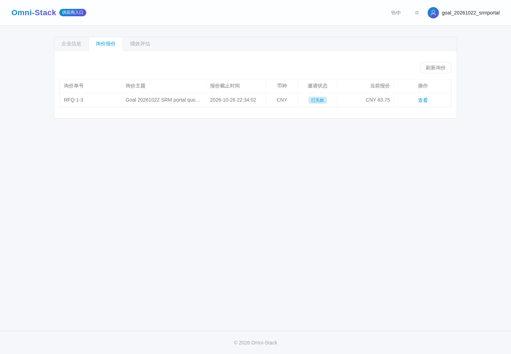

图中的示例询价已经取消，因此只显示查看入口。练习首次报价时，要由采购提供仍开放且确实邀请本企业的询价。

在「询价报价」查找邀请并打开详情，核对询价标题、物料行、数量、币种、截止时间和当前状态。供应商必须已通过准入，询价也必须确实邀请了本企业；其他企业的邀请不能借地址访问。

### 10.2 填写和首次提交

对详情中的每一条物料填写单价、交付天数和必要备注，再填写符合要求的报价有效期。所有物料行都要完整，单价必须为正；数量由询价提供，应先核对，不能在报价时随意改动。报价有效期不能早于询价截止时间。

提交后重新打开详情，确认金额、报价内容和当前版本。页面提示受理或按钮变灰时，先读回结果，不要因为等待时间稍长就连点保存。

如果提示未能确认提交结果，窗口会锁住当前内容。要保持原内容再次尝试，使用「按原请求重试」；要先确认服务器已经保存了什么，使用「刷新报价状态」。刷新会重新读取报价并用最新内容填回窗口，不等于保证上次提交成功。先核对金额和版本，再决定下一步；不要在结果不明时改价重发或另录一份。

### 10.3 修改报价与处理关闭状态

询价仍开放且允许更新时，基于最新内容修改报价，再核对新的金额和版本。另一窗口已经更新过时，先刷新，不要拿旧页面强行覆盖。

询价已经取消、过期或其他规则不允许更新时，历史报价仍可能可以查看，但这不表示还能发起新报价。与采购确认新的业务安排，不要尝试把旧的成功提示当成重新提交成功。

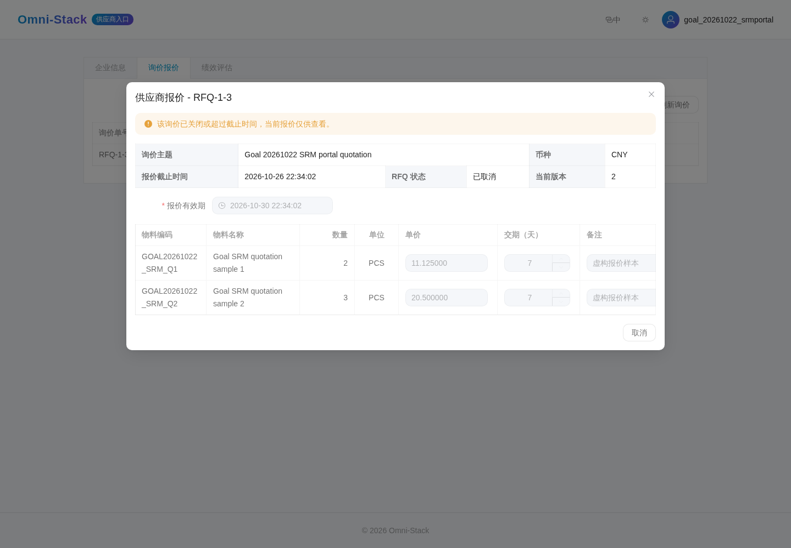

## 十一、常见失败与恢复

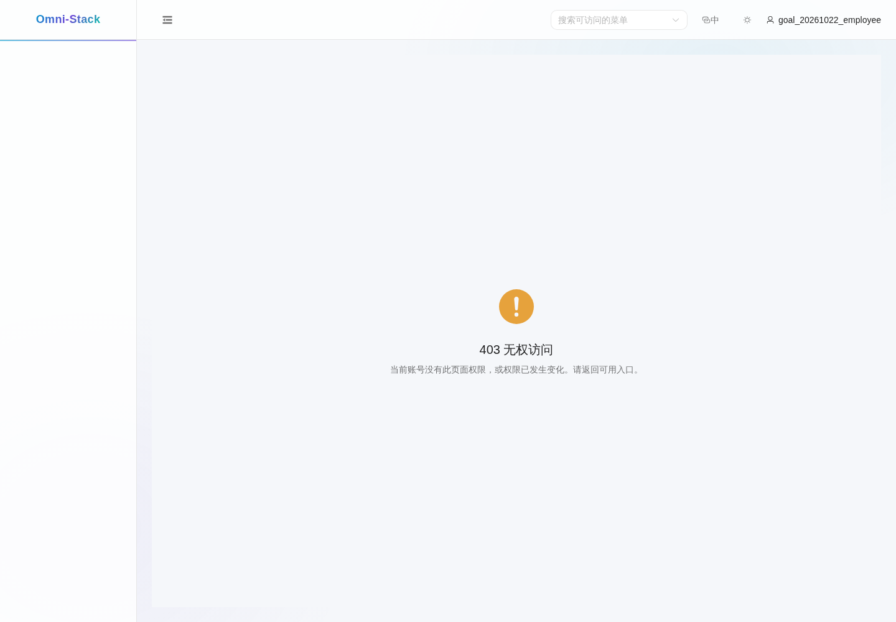

| 遇到什么 | 先核对什么 | 下一步 |
| --- | --- | --- |
| 列表为空 | 当前企业、筛选和实际数据范围 | 清空筛选，再确认负责人或组织 |
| 提示无权限或看不到记录 | 是否登录了正确身份，是否有对应权限和关联 | 使用自己获授权的入口，不借其他账号 |
| 搜不到负责人 | 是否为合法内部同事，是否在可分配范围 | 门户账号无候选是正常隔离 |
| 页面提示记录已变化 | 是否在其他窗口或被同事更新过 | 刷新读回最新结果后再决定 |
| 保存资料后转交失败 | 哪一部分已经真实保存 | 先核实资料，再处理转交，避免重复保存 |
| 状态不允许操作 | 当前合作状态、准入进度和实际发起人 | 使用对应状态的专用操作 |
| 入驻受理后仍打不开资料 | 关联是否完成，会话是否已重新登录 | 等待真实状态，处理失败原因后按提示重试 |
| 没有评估或风险数据 | 是否已维护资料、启用配置并实际评估 | 不用空列表推断业务已完成或没有风险 |
| 门户看不到询价或无法报价 | 本企业邀请、准入状态、截止时间与询价状态 | 由采购核对业务前提，不冒用其他企业 |

同一浏览器切换登录身份后，其他已打开页面也可能需要刷新确认身份。操作前先看右上角账号和当前企业；不确定写操作是否成功时，先查询原记录和历史，不重发一串相同操作。

## 十二、这篇教程的验证范围

本地专用样本已经实际经过准入驳回与重提、多位审批人批准、撤回和取消、冻结及恢复、黑名单专用恢复、淘汰、合法删除、负责人转交与恢复、资料增改查删、五个绩效周期、风险变化与证书续期、邀请撤销、门户入驻失败恢复和报价更新。采购员、上级经理、同级员工、内部管理员与两个供应商身份的边界均有对应实际结果。

这些结果只证明已记录的本地场景，不保证你的企业已经配置相同人员、流程模型或指标，也不证明外部通知已发送、真实第三方账号已实联或存在未实现的模板管理功能。接口集成与运行边界在工程事实中说明；普通使用不需要阅读源码、执行命令或接触数据库。
