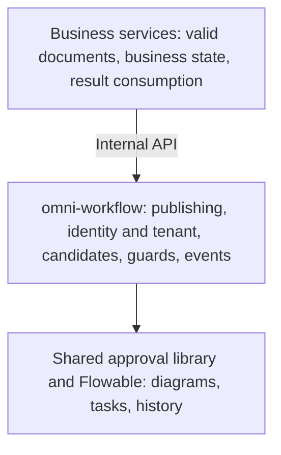

# 2. Design and choices: why use a dedicated workflow engine?

You can implement the previous example yourself or use an engine. The useful comparison is rule complexity and the maintenance your team is prepared to own.

## Three approaches and their costs

| Approach | Suitable situation | Cost |
|---|---|---|
| Store a status in the business table; route in code | Few stable steps | Implement branches, multiple tasks and history yourself |
| Build an approval module for each business area | A limited number of distinct domains | Duplicate people resolution, history and retry logic can accumulate |
| Use a BPMN engine | Shared management of branches, human waits, multiple reviewers and versions | Learn models, execution trees, variables and engine tables; provide security and operations |

Omni-Stack currently uses Flowable 8.0.0, adding model publishing, role-and-organization resolution, task guards and business result events around it. These tradeoffs are inferred from current source. They are not a claim that the repository contains a complete historical product evaluation, or that every application should choose this engine.

Flowable executes diagrams; BPMN expresses them. They are different things. Switching engines does not mean extensions, listeners and historical data transfer unchanged.

## The engine follows the diagram; the project makes it usable

An engine understands nodes, connections, tasks and execution state. It does not automatically know company managers, user permissions or purchasing state. The project has three layers:

Workflow runs in the separate omni-workflow service on business port 8103. Purchasing, asset and supplier services call internal APIs rather than embedding additional Flowable engines.

omni-common-workflow is a Java library wrapping engine actions, not another approval service. The workflow service checks tenant and current assignee before invoking those actions.

## Why project tables and engine tables are separate

Editing drafts, publishing versions and displaying a business title differ from tracking engine execution. Project wf_ tables hold models and business associations. Flowable ACT_ tables hold definitions, executions, tasks and history.

| Data | Current storage | What this does not imply |
|---|---|---|
| Models and versions | wf_process_model, wf_process_model_version | Saving a draft is not deployment |
| Business association and state | wf_process_instance_ext | This is not the business document |
| Start deduplication | wf_process_start_request | It does not cover every start endpoint automatically |
| Definitions, tasks and history | Flowable ACT_ tables | They do not implement company authorization automatically |
| Task projection and copies | wf_todo_task, wf_cc_record | A projection or copy record is not a live task or delivered external notification |
| Form and delegation-rule structures | wf_form_schema, wf_delegation_rule | Tables do not imply form CRUD or automatic delegation is implemented |

Formal migrations manage the schema; Flowable runtime schema updates are disabled. History is configured as audit, and an asynchronous executor is configured. That describes setup, not proof that every timer, asynchronous or nested model has been tested.

## Include trust boundaries in the design

User requests pass the gateway identity chain. Writes additionally check their declared functional permission and task ownership. Internal APIs use a shared token and tenant consistency checks; the calling business service must still supply a trusted initiator. An internal token does not replace end-user authorization.

Workflow has its own security configuration and tenant context, rather than the common-service bundle. Its wf_ table interceptor falls back to tenant 1 when context is absent. Raw JDBC and engine queries need their own explicit conditions. Raw definition operations by ID lack a unified tenant ownership check. These limits must remain visible rather than being described as complete isolation.

Candidate and nickname lookups also include direct JDBC reads from Auth's database. The default notification implementation only logs, and a copy record does not prove email or SMS delivery. Deployment, authorization and feature use must reflect these actual boundaries.

Continue to [framework source](workflow-framework.en.md), then see how the project adds business rules around engine calls.
