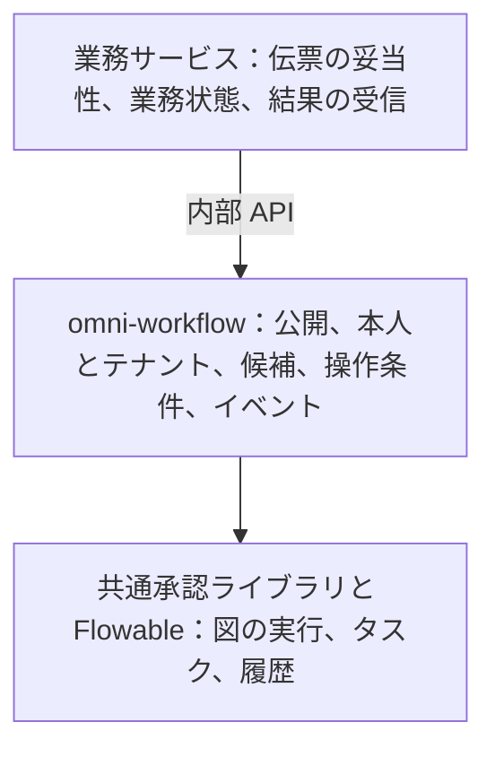

# 2. 設計と選択：専用エンジンにフローを任せる理由

前の例を自作することも、エンジンに任せることもできます。規則の複雑さと、チームが保守できる範囲を比較するのが出発点です。

## 三つの方法と負担

| 方法 | 向いている場合 | 負担 |
|---|---|---|
| 業務表に状態を保存し、コードで次へ進める | 手順が少なく規則が安定 | 分岐、複数タスク、履歴を自作する |
| 業務ごとに承認機能を作る | 独自性の高い業務が少数 | 担当者選定、記録、再試行が重複しやすい |
| BPMN エンジンを使う | 多段分岐、人の対応待ち、複数人承認、版管理を共通化 | モデル、実行ツリー、変数、エンジン表を学び、権限と運用も整える |

Omni-Stack は現在 Flowable 8.0.0 を使い、モデル公開、役割と組織による選定、タスクの操作条件、業務結果イベントを追加しています。この比較は現在のソースから読み取れる設計上の取捨選択です。過去に網羅的な製品評価を行った記録がある、あるいはどの製品にも最適だ、と主張するものではありません。

Flowable は図を実行するエンジン、BPMN は規則の表現方法です。エンジンを変更しても、独自拡張、リスナー、履歴がそのまま移せるとは限りません。

## 図を実行する責任と、正しく使う責任

エンジンはノード、接続、タスク、実行状態を理解しますが、会社の部門長、利用権限、購買状態を自動では理解しません。役割は三層に分かれます。

独立した omni-workflow サービスが業務ポート 8103 で動きます。購買、資産、仕入先サービスは内部 API を使い、それぞれに別の Flowable を組み込みません。

omni-common-workflow はエンジン操作を包む Java ライブラリであり、別の承認サービスではありません。操作の前に、ワークフローサービスがテナントと現在の担当者を確認します。

## プロジェクトの表とエンジンの表を分ける理由

下書きの編集、公開版、業務タイトルと、エンジンの実行位置は責任が異なります。wf_ 表はプロジェクトのモデルと業務関連、ACT_ 表は Flowable の定義、実行、タスク、履歴です。

| 情報 | 現在の保存先 | それだけでは言えないこと |
|---|---|---|
| モデルと版 | wf_process_model、wf_process_model_version | 下書き保存はデプロイではない |
| 業務との関連と状態 | wf_process_instance_ext | 業務伝票そのものではない |
| 開始要求の重複防止 | wf_process_start_request | すべての開始 API に自動適用されない |
| 定義、タスク、履歴 | Flowable の ACT_ 表 | 会社の権限制度は自動実装されない |
| タスク投影と回覧 | wf_todo_task、wf_cc_record | 実行中タスクや外部通知到達の証明ではない |
| フォームと委任規則の構造 | wf_form_schema、wf_delegation_rule | 表の存在は CRUD や自動委任の実装を意味しない |

正式なマイグレーションで構造を管理し、実行時の自動更新は無効です。履歴は audit、非同期実行器も設定済みです。これは設定の説明であり、すべてのタイマー、非同期経路、入れ子モデルを試験した証拠ではありません。

## 信頼の境界も設計に含める

ユーザー要求はゲートウェイの本人確認経路を通り、書き込みでは機能権限とタスクの帰属も確認します。内部 API は共有トークンとテナント整合性を確認しますが、呼び出す業務サービスは信頼できる起案者を渡す責任があります。内部トークンだけで利用者の権限を証明できません。

Workflow は独自のセキュリティ設定とテナント文脈を持ち、common-service の構成を一式使ってはいません。wf_ 表のプラグインは文脈がないとテナント 1 に戻ります。直接 JDBC とエンジン検索は個別の明示条件が必要です。生の定義管理では ID 指定操作の統一的なテナント確認がありません。完全分離済みと書かず、これらの制限を理解します。

候補者や表示名には Auth データベースを直接 JDBC で読む箇所もあります。標準通知はログのみで、回覧記録もメールや SMS 到達の証明ではありません。この現状に合わせて配備、権限、機能利用を判断します。

続いて[フレームワークのソース](workflow-framework.jp.md)を読み、エンジン呼び出しに業務規則を重ねる考え方を学びます。
