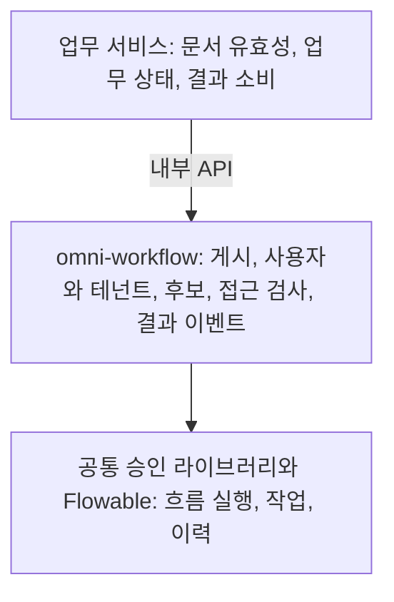

# 2. 설계와 선택: 흐름을 전용 엔진에 맡기는 이유

앞의 예시를 직접 구현하거나 엔진에 맡길 수 있습니다. 판단의 기준은 규칙의 복잡성과 팀이 감당할 유지보수 범위입니다.

## 세 가지 방법의 장단점

| 방법 | 적합한 상황 | 부담 |
|---|---|---|
| 업무 테이블에 상태를 저장하고 코드로 다음 단계 결정 | 단계가 적고 규칙이 안정적 | 분기·다중 작업·이력을 직접 구현 |
| 업무마다 별도 승인 모듈 구현 | 서로 다른 업무가 소수 | 담당자 찾기·기록·재시도가 중복되기 쉬움 |
| BPMN 엔진 사용 | 다단계 분기·사람의 처리 대기·다중 승인·버전의 통합 관리 | 모델·실행 트리·변수·엔진 테이블을 배우고 권한과 운영도 마련 |

Omni-Stack은 현재 Flowable 8.0.0을 사용하고, 모델 게시·역할과 조직에 따른 담당자 찾기·작업 접근 검사·업무 결과 이벤트를 그 주위에 더했습니다. 위 비교는 현재 소스에서 추론한 설계상의 선택입니다. 과거에 완전한 제품 평가를 수행한 기록이 있다거나 모든 프로젝트에 같은 엔진이 최적이라고 주장하지 않습니다.

Flowable은 그림을 실행하는 엔진이고 BPMN은 규칙을 표현하는 방식입니다. 엔진을 바꾼다고 확장 설정·리스너·이력 데이터가 그대로 이전되지는 않습니다.

## 엔진은 그림을 실행하고 프로젝트는 올바른 사용을 책임진다

엔진은 노드·연결·작업·실행 상태를 이해하지만, 회사의 부서장·사용자 권한·구매 상태를 저절로 알지 못합니다. 세 계층으로 나뉩니다.

독립된 omni-workflow 서비스가 업무 포트 8103에서 실행됩니다. 구매·자산·공급업체 서비스는 내부 API로 호출하며 각자 다른 Flowable을 내장하지 않습니다.

omni-common-workflow는 엔진 동작을 감싼 Java 라이브러리이며 또 다른 승인 서비스가 아닙니다. 워크플로 서비스가 호출 전에 현재 테넌트와 실제 담당자를 검사합니다.

## 프로젝트 테이블과 엔진 테이블을 분리하는 이유

초안 편집·버전 게시·업무 제목 표시는 엔진이 어느 단계인지 추적하는 일과 다릅니다. wf_ 테이블은 프로젝트 모델과 업무 연결을, ACT_ 테이블은 Flowable 정의·실행·작업·이력을 저장합니다.

| 정보 | 현재 저장 위치 | 이것만으로 뜻하지 않는 것 |
|---|---|---|
| 모델과 버전 | wf_process_model, wf_process_model_version | 초안 저장은 배포가 아님 |
| 업무 연결과 상태 | wf_process_instance_ext | 업무 문서 자체가 아님 |
| 시작 요청 중복 방지 | wf_process_start_request | 모든 시작 API에 자동 적용되지 않음 |
| 정의·작업·이력 | Flowable ACT_ 테이블 | 회사의 권한 체계가 자동 구현되지 않음 |
| 작업 투영과 참조 수신 | wf_todo_task, wf_cc_record | 실제 엔진 작업이나 외부 알림 전달 증거가 아님 |
| 폼과 위임 규칙 구조 | wf_form_schema, wf_delegation_rule | 테이블 존재가 CRUD나 자동 위임 구현을 뜻하지 않음 |

정식 마이그레이션이 구조를 관리하며 Flowable의 실행 중 자동 구조 변경은 꺼져 있습니다. 이력 수준은 audit이고 비동기 실행기도 설정됩니다. 설정의 존재가 모든 타이머·비동기·중첩 모델의 테스트 완료를 뜻하지는 않습니다.

## 신뢰 경계도 설계의 일부

사용자 요청은 게이트웨이의 신원 확인 경로를 거치며, 쓰기 동작은 기능 권한과 작업 소유 관계도 확인합니다. 내부 API는 공유 토큰과 테넌트 일치를 검사하지만, 호출한 업무 서비스가 신뢰할 수 있는 신청자를 제공해야 합니다. 내부 토큰은 최종 사용자의 권한을 대신하지 않습니다.

Workflow는 common-service 구성 전체 대신 자체 보안 설정과 테넌트 문맥을 사용합니다. wf_ 테이블 인터셉터는 문맥이 없으면 테넌트 1로 돌아갑니다. 직접 JDBC와 엔진 조회는 각각 명시 조건이 필요합니다. 원시 정의 관리의 ID 지정 동작에는 통합된 테넌트 소유 검사가 없습니다. 완전한 격리가 구현되었다고 설명하면 안 됩니다.

후보자와 표시 이름을 찾는 일부 경로는 Auth 데이터베이스를 직접 JDBC로 읽습니다. 기본 알림 구현은 로그만 남기고, 참조 수신 기록도 이메일·SMS 전달을 증명하지 않습니다. 실제 경계에 맞춰 배포·권한·기능 사용을 판단해야 합니다.

다음 [프레임워크 소스](workflow-framework.kr.md)에서 엔진 호출을 이해하고, 프로젝트가 어떻게 업무 규칙을 더하는지 살펴봅니다.
