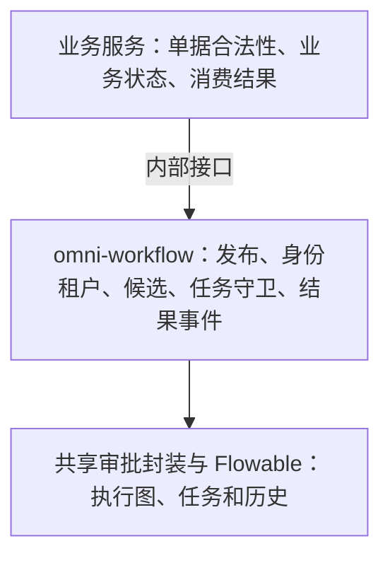

# 2. 设计与选型：为什么让专门的引擎负责流程

上一页的例子可以自己写，也可以交给流程引擎。选择的重点是规则的复杂程度，以及团队愿意承担多少维护工作。

## 先从三个方案看取舍

| 方案 | 适合什么情况 | 要付出的代价 |
|---|---|---|
| 业务表中保存状态，代码控制下一步 | 步骤少、规则稳定 | 新增分支、多人任务和历史记录要自己实现 |
| 为每个业务写专门的审批模块 | 业务差异大、数量有限 | 多个模块容易重复维护找人、记录和重试 |
| 使用 BPMN 流程引擎 | 多级分支、人工等待、多人任务和版本需要统一管理 | 要学习模型、执行树、变量及引擎表，也要做好权限和运维 |

Omni-Stack 当前使用 Flowable 8.0.0，并在它外面增加模型发布、角色组织找人、任务守卫和业务结果事件。上表是依据当前源码推导出的设计取舍，不是声称仓库保留了某次完整的产品评测，也不是断言所有项目都应该选同一个框架。

Flowable 是执行这份规则图的引擎；BPMN 是表达规则的方式。两者不能当成同一个东西。换一个引擎也不代表所有扩展配置、监听器和历史数据都可以原样搬走。

## 引擎负责走图，项目负责把图用对

引擎知道节点、连线、任务和执行状态，却不会自动认识公司的经理、用户权限和采购状态。项目因此分了三层：

工作流运行在独立的 omni-workflow 服务，业务端口是 8103。采购、资产和供应商等业务服务通过内部接口调用它，不在各自服务中嵌入另一套 Flowable。

共享的 omni-common-workflow 是一份 Java 库，负责封装引擎动作，不是另一个审批服务。是否属于当前租户、是否为当前处理人，由工作流服务在调用这些动作前判断。

## 为什么模型表和引擎表要分开

编辑草稿、发布版本、显示业务标题，与引擎运行到哪个节点，是不同的责任。项目用 wf_ 表保存自己的模型和业务关联；Flowable 用 ACT_ 表保存定义、执行、任务与历史。

| 数据 | 当前放在哪里 | 不代表什么 |
|---|---|---|
| 模型与版本 | wf_process_model、wf_process_model_version | 编辑草稿不等于部署 |
| 业务关联与状态 | wf_process_instance_ext | 不是业务单据本身 |
| 请求防重 | wf_process_start_request | 不自动覆盖所有启动接口 |
| 引擎定义、任务和历史 | Flowable 的 ACT_ 表 | 不自动实现公司的权限体系 |
| 待办与抄送 | wf_todo_task、wf_cc_record | 投影或抄送记录不等于实时任务或外部通知送达 |
| 表单和委托规则结构 | wf_form_schema、wf_delegation_rule | 有表不代表已有表单 CRUD 或自动委托功能 |

数据库结构由正式迁移管理，当前关闭 Flowable 运行时自动更新结构。历史级别配置为 audit；异步执行器也有配置。这些配置只说明应用怎样运行，不说明当前每一种定时、异步和嵌套模型都已经测试。

## 把信任边界也放进设计里

来自用户的请求先经过网关身份链，写动作再检查对应功能权限和任务归属。内部接口使用共享令牌和租户一致性检查，调用业务服务仍要负责提供可信发起人；“有内部令牌”不能替代最终用户的授权。

Workflow 有自己的安全配置和租户上下文，没有直接使用 common-service 的整套组合。wf_ 表插件缺少租户上下文时会回退到租户 1；原始 JDBC 和引擎查询还要检查各自显式条件。原始定义管理按 ID 的操作没有统一租户归属检查，这些是需要正视的现状，不能在教程里写成全面隔离已经成立。

候选人和昵称的读取还包含对 Auth 数据库的直接 JDBC 访问；默认通知实现只记日志，抄送也不等于发出了邮件或短信。部署、授权和功能选用都要以这些实际边界为前提。

接下来读[框架源码](workflow-framework.md)，先理解一次引擎调用，再看项目怎样给它补上业务规则。
