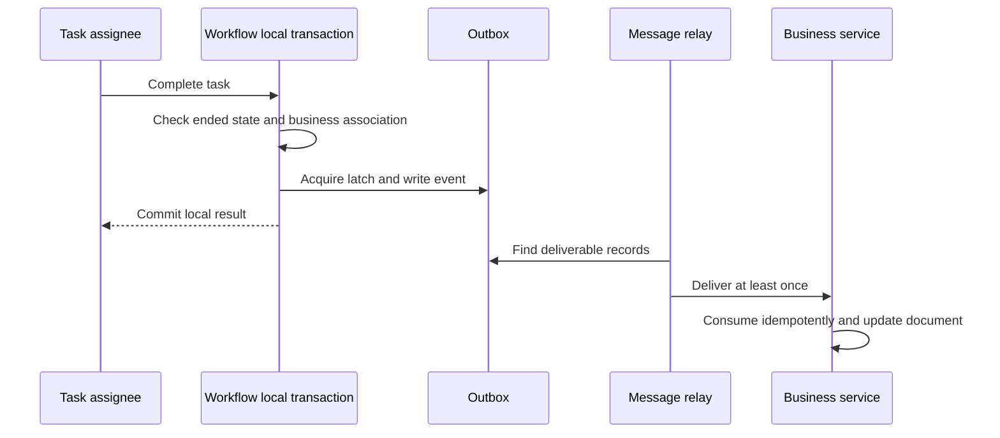

# 7. Results and troubleshooting: why has the document not changed?

Separate three facts: you handled a task, the entire process ended, and the business service received the result. None automatically establishes another.

## What progress and records tell you

My completed items means you completed a task; the process may still be with another reviewer. My tasks is queried by current identity and tenant. Task forms also check the current assignee; returned variables have no guarantee of automatic redaction of all personal information.

Progress and approval records first query the historic instance by instance ID and tenant. Invalid tenants give 400; missing or cross-tenant instances give 404 before reading activities, opinions, candidates or names. This adds no same-tenant participant ACL. Not every read endpoint has its own functional permission.

| Entry | Current use and checks |
|---|---|
| task/todo, task/count, task/{id}/form | Authenticated reads of own tasks, count or current task form |
| process-instance/my-initiated, my-completed | Own starts and processes in which you handled a task |
| process-instance/list | Requires workflow:instance:list |
| process-instance/{id}/progress, approval-records | Authentication and historic-instance tenant check, not participant authorization |
| stats/workspace, stats/admin | Workspace statistics; admin additionally requires workflow:stats:admin |

Candidate previews on unreached nodes do not guarantee the same final assignments. Ended tasks with a deletion reason may appear auto-completed; MI record labels can mean system skips. Apply the voting distinctions from the previous page.

## The task list is a query projection

Engine tasks govern execution. wf_todo_task is a projection for page queries. After completing a task and creating successors, the project waits for transaction commit before synchronizing that projection. From WorkflowApprovalServiceImpl:

<!-- omni:source path="omni-backend/omni-workflow/src/main/java/com/omni/workflow/service/impl/WorkflowApprovalServiceImpl.java" -->
```java
        TransactionSynchronizationManager.registerSynchronization(new TransactionSynchronization() {
            @Override
            public void afterCommit() {
                try {
                    workflowTodoSyncService.syncProcessTodos(processInstanceId);
                } catch (Exception e) {
                    log.error("事务提交后同步待办失败: processInstanceId={}", processInstanceId, e);
                }
            }
        });
    }
```

A synchronization failure is logged and does not undo the committed approval. For a stale task list, inspect synchronization logs and engine tasks, then use the formal synchronization or recovery path. Do not edit process state backward to fix a display.

## How the result leaves the workflow service

After approval, the project checks whether the instance is still running. When it ended and has a cross-service business association, it prepares workflow.process.completed.v1. Explicit termination uses CANCELLED. completion_event_id in the extension acts as a latch; the conditional update must acquire the right to write:

<!-- omni:source path="omni-backend/omni-workflow/src/main/java/com/omni/workflow/service/impl/WorkflowCompletionEventServiceImpl.java" -->
```java
        int updated = processInstanceExtMapper.markCompletionForEvent(completionUpdate);
        if (updated == 0) {
            return false;
        }
        if (updated != 1) {
            throw new BusinessException(500, "流程实例完成事件状态异常");
        }
```

The event is then inserted into the local Outbox with explicit tenant and event IDs:

<!-- omni:source path="omni-backend/omni-workflow/src/main/java/com/omni/workflow/service/impl/WorkflowCompletionEventServiceImpl.java" -->
```java
        reliableMessageRelay.send(BINDING_NAME, event, tenantId, eventId);
```

The latch and Outbox share a local transaction, preventing duplicate completion-event writes on this applicable path. A relay later sends the event to the broker; the business service consumes it idempotently. Here idempotency prevents repeated handling of the same event from changing business results twice. It differs from start-request deduplication.



APPROVED/REJECTED map to extension status 2; CANCELLED maps to 0. Business consumers control their own document status. Extension status 2 does not itself mean a document was approved.

## Not every engine ending produces an event

There is no generic engine-end listener covering every ending. Immediate completion during start, other administrative endings or missing business extensions do not prove an event was written. A standalone process without a cross-service business association should not be assumed to produce a business event.

The precise guarantee is: **within an applicable completion-publication call, latch and Outbox are transactional; not every engine ending is covered.** An Outbox insert still does not prove broker receipt or business consumption.

## Recover at the layer that failed

| Symptom | Establish first | Recovery direction |
|---|---|---|
| Publishing rejected | XML errors, actual draft state, published pointer | Correct, save and validate; do not assume FAILED persisted |
| Start timeout or 409 | STARTED versus in progress, matching intent | Formal queries and same request intent; do not blindly replace requestId |
| No candidates | Roles, organizations, enabled state, anchor, fallback | Correct legitimate configuration, then retry under business rules |
| Complete gives 409/403 | Already handled? Actually assigned to you? | Refresh or correct authorization instead of repeated clicking |
| Engine advanced, list is stale | Engine tasks and afterCommit logs | Repair projection synchronization; preserve real approval facts |
| Process ended, document unchanged | Event applicability, latch, Outbox, relay and consumer | Investigate retries/dead letters and business idempotency; do not fabricate success by changing database state |

The default notification service only logs; a copy record does not prove delivery. Missing XSS configuration or malformed rule JSON returns disabled and empty rules in Workflow; Redis read exceptions are not caught by that method. Other services' defaults do not prove variables, opinions and designer content here are uniformly sanitized.

## Where to begin an extension

For new nodes, change the model and assignment rules, publish and validate. Extend the candidate resolver and corresponding listener for new selection strategies. A new task action needs functional permission, tenant and assignee guards, valid targets and failure paths. Business consumers retain their own state machines and idempotency rather than embedding another engine.

This chapter describes current implementation, not a promise for every complex model. Validate new nodes, asynchronous paths, nested multi-instance activities, variable overrides and cross-service failures with appropriate tests and real business chains; existing screenshots do not establish a current reproduction.
