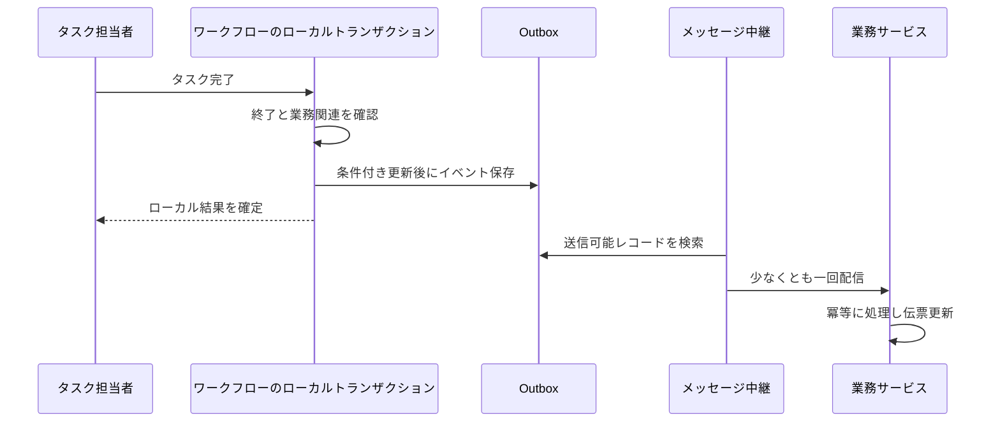

# 7. 結果と障害調査：承認したのに伝票が変わらない理由

「自分がタスクを処理した」「全体のプロセスが終わった」「業務サービスが結果を受け取った」を分けます。どれも他の事実を自動で証明しません。

## 進捗と記録が表すもの

自分の処理済み一覧は、自分のタスク完了を示すだけです。次の担当者が処理中かもしれません。本人のタスクは現在のユーザーとテナントで検索し、フォームは担当者も確認します。返る変数にあらゆる個人情報の自動マスキング保証はありません。

進捗と承認記録は、先にインスタンス ID とテナントで履歴を確認します。不正なテナントは 400、不存在・他テナントは 404 にし、その後で活動、意見、候補、表示名を読みます。同テナント内の参加者限定 ACL を追加したわけではなく、すべての読み取りに個別機能権限があるわけでもありません。

| 入口 | 用途と条件 |
|---|---|
| task/todo、task/count、task/{id}/form | 認証後、本人のタスク・件数・現タスクフォームを読む |
| process-instance/my-initiated、my-completed | 本人の起案・処理した申請 |
| process-instance/list | workflow:instance:list が必要 |
| process-instance/{id}/progress、approval-records | 認証と履歴インスタンスのテナント確認。参加者権限とは別 |
| stats/workspace、stats/admin | ワークスペース統計。admin は workflow:stats:admin も必要 |

未到達ノードの候補プレビューは、実行時の割り当てを保証しません。削除理由付き終了は auto-completed と表示される場合があり、MI 表示もシステム省略の場合があります。前ページの投票との違いを適用してください。

## タスク一覧は問い合わせ用の写し

実行の根拠はエンジンタスクで、wf_todo_task は画面検索用の投影です。タスク完了と次の生成の後、トランザクション確定を待って同期します。WorkflowApprovalServiceImpl の原文です。

<!-- omni:source path="omni-backend/omni-workflow/src/main/java/com/omni/workflow/service/impl/WorkflowApprovalServiceImpl.java" -->
```java
        TransactionSynchronizationManager.registerSynchronization(new TransactionSynchronization() {
            @Override
            public void afterCommit() {
                try {
                    workflowTodoSyncService.syncProcessTodos(processInstanceId);
                } catch (Exception e) {
                    log.error("事务提交后同步待办失败: processInstanceId={}", processInstanceId, e);
                }
            }
        });
    }
```

同期失敗はログに記録し、確定した承認を取り消しません。一覧が古ければ同期ログとエンジンタスクを確認し、正式な同期・復旧経路で直します。表示を直すために実行状態を直接戻してはいけません。

## 結果をワークフローサービスの外へ渡す

承認後に実行中かを調べ、終了済みで他サービスの業務との関連があれば workflow.process.completed.v1 を用意します。明示的な終了は CANCELLED です。拡張表の completion_event_id を留め金のように使い、条件付き更新で書き込み権を得ます。

<!-- omni:source path="omni-backend/omni-workflow/src/main/java/com/omni/workflow/service/impl/WorkflowCompletionEventServiceImpl.java" -->
```java
        int updated = processInstanceExtMapper.markCompletionForEvent(completionUpdate);
        if (updated == 0) {
            return false;
        }
        if (updated != 1) {
            throw new BusinessException(500, "流程实例完成事件状态异常");
        }
```

その後、テナントとイベント ID を明示してローカル Outbox に保存します。

<!-- omni:source path="omni-backend/omni-workflow/src/main/java/com/omni/workflow/service/impl/WorkflowCompletionEventServiceImpl.java" -->
```java
        reliableMessageRelay.send(BINDING_NAME, event, tenantId, eventId);
```

留め金と Outbox は同じローカルトランザクションで、この経路の重複イベント書き込みを防ぎます。後で中継処理が Broker に送り、業務サービスが冪等に受信します。ここでの冪等性は、同じイベントを再受信しても業務結果を二重更新しないことです。開始要求の重複防止とは別です。



APPROVED/REJECTED は拡張状態 2、CANCELLED は 0 です。伝票は業務側の消費処理が更新します。拡張状態 2 だけで伝票が承認済みとは言えません。

## すべての終了でイベントが出るわけではない

全終了方式を覆う共通のエンジン終了リスナーはありません。開始直後の終了、別の管理操作による終了、業務拡張がない場合に、イベント生成済みとは推測できません。サービス間の完了公開経路に入らないサービス内プロセスにも、業務イベントが当然に出るわけではありません。

正確には、**対象の完了公開呼び出しでは留め金と Outbox が同一トランザクションだが、全終了は網羅していない**、という保証です。Outbox 保存済みでも Broker 受領や業務消費の完了は未確定です。

## 失敗した層で復旧する

| 現象 | 先に調べること | 復旧の方向 |
|---|---|---|
| 公開拒否 | XML、実際の下書き状態、公開先参照 | 修正・保存・検証。FAILED 保存を決めつけない |
| 開始タイムアウト・409 | STARTED か処理中か、意図の一致 | 正式検索と同じ要求意図で復旧し、requestId を無闇に変えない |
| 候補なし | 役割、組織、有効状態、アンカー、代替方針 | 正規の設定を補い、業務規則で再試行 |
| 完了が 409/403 | 処理済みか、本当に本人の担当か | 一覧更新か権限訂正。連打しない |
| 進んだのに一覧が古い | エンジンタスクと afterCommit ログ | 投影同期を直し、実際の承認記録を保持 |
| 終了したのに伝票不変 | イベント対象か、留め金、Outbox、中継、消費 | 再試行・デッドレターと業務冪等性を調査。直接 DB 更新で成功を作らない |

標準通知はログのみで、回覧記録も外部通知到達の証明にはなりません。Workflow の XSS 設定がない、または規則 JSON の解析に失敗した場合は無効・空規則を返し、Redis 読み取り例外は同メソッドで捕捉しません。他サービスに既定防御があっても、ここでの変数、意見、設計内容が一律に浄化されるとは言えません。

## 拡張はどの層から始めるか

新ノードはモデルと割り当て規則を変え、公開して検証します。新しい選定方法は候補解決サービスと対応リスナーに追加します。新操作は機能権限、テナントと担当者、妥当な操作対象、失敗経路を合わせて設計します。業務側は独自の状態機械と受信冪等性を保ち、別のエンジンを組み込みません。

この章は現実装の説明で、あらゆる複雑なモデルの保証ではありません。新ノード、非同期経路、入れ子の複数人承認、変数上書き、サービス間の障害は対応テストと実業務経路で確認します。過去の画像だけで現在の再現を証明しないでください。
