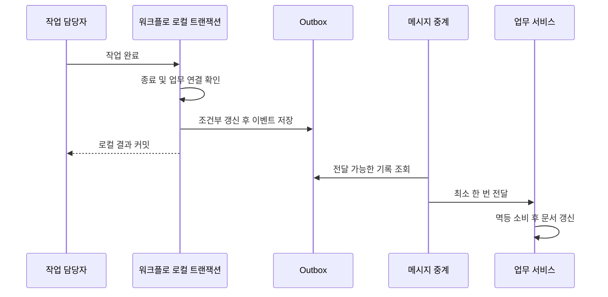

# 7. 결과와 문제 해결: 승인했는데 문서가 그대로인 이유

자신이 작업을 처리한 것, 프로세스 전체가 끝난 것, 업무 서비스가 결과를 받은 것을 구분해야 합니다. 어느 하나도 다른 사실을 자동 증명하지 않습니다.

## 진행 상황과 기록이 뜻하는 것

내 처리 완료 목록은 자신이 작업을 처리했다는 뜻일 뿐입니다. 다음 승인자가 처리 중일 수 있습니다. 내 작업은 현재 신원과 테넌트로 조회하며 폼은 현재 담당자도 검사합니다. 반환 변수의 모든 개인정보가 자동으로 가려진다는 보장은 없습니다.

진행 상황과 승인 기록은 먼저 인스턴스 ID와 테넌트로 이력을 확인합니다. 잘못된 테넌트는 400, 없거나 타 테넌트 인스턴스는 404로 처리한 뒤 활동·의견·후보·표시 이름을 읽습니다. 같은 테넌트 안에서 참여자만 허용하는 ACL을 추가한 것은 아니고 모든 읽기에 별도 기능 권한이 있는 것도 아닙니다.

| 입구 | 현재 용도와 검사 |
|---|---|
| task/todo, task/count, task/{id}/form | 인증 후 본인 작업·개수·현재 작업 폼 조회 |
| process-instance/my-initiated, my-completed | 자신이 시작했거나 처리한 신청 |
| process-instance/list | workflow:instance:list 필요 |
| process-instance/{id}/progress, approval-records | 인증과 이력 인스턴스 테넌트 검사. 참여자 권한과 다름 |
| stats/workspace, stats/admin | 작업 공간 통계. admin은 workflow:stats:admin도 필요 |

도달하지 않은 노드의 후보 미리 보기가 실행 시 최종 담당자를 보장하지 않습니다. 삭제 사유가 있는 종료 작업은 auto-completed로, MI 기록은 시스템 건너뛰기로 표시될 수 있습니다. 앞 페이지의 실제 투표와 구분해야 합니다.

## 작업 목록은 조회용 복사본이다

실행 기준은 엔진 작업이며 wf_todo_task는 화면 조회용 투영입니다. 작업 완료와 후속 작업 생성 후 트랜잭션 커밋을 기다려 동기화합니다. WorkflowApprovalServiceImpl 원문입니다.

<!-- omni:source path="omni-backend/omni-workflow/src/main/java/com/omni/workflow/service/impl/WorkflowApprovalServiceImpl.java" -->
```java
        TransactionSynchronizationManager.registerSynchronization(new TransactionSynchronization() {
            @Override
            public void afterCommit() {
                try {
                    workflowTodoSyncService.syncProcessTodos(processInstanceId);
                } catch (Exception e) {
                    log.error("事务提交后同步待办失败: processInstanceId={}", processInstanceId, e);
                }
            }
        });
    }
```

동기화가 실패해도 로그만 남기며 이미 커밋된 승인을 취소하지 않습니다. 목록이 오래되었다면 동기화 로그와 엔진 작업을 확인한 뒤 정식 동기화·복구 경로를 사용하세요. 화면을 고치려고 프로세스 상태를 직접 되돌리면 안 됩니다.

## 결과가 워크플로 서비스 밖으로 나가는 과정

승인 후 인스턴스가 아직 실행 중인지 확인합니다. 끝났고 서비스 간 업무 연결이 있으면 workflow.process.completed.v1을 준비하며 명시적 종료는 CANCELLED입니다. 확장 테이블의 completion_event_id는 잠금쇠처럼 동작합니다. 조건부 갱신으로 쓰기 권한을 얻어야 계속합니다.

<!-- omni:source path="omni-backend/omni-workflow/src/main/java/com/omni/workflow/service/impl/WorkflowCompletionEventServiceImpl.java" -->
```java
        int updated = processInstanceExtMapper.markCompletionForEvent(completionUpdate);
        if (updated == 0) {
            return false;
        }
        if (updated != 1) {
            throw new BusinessException(500, "流程实例完成事件状态异常");
        }
```

그 후 테넌트·이벤트 ID를 명시해 로컬 Outbox에 씁니다.

<!-- omni:source path="omni-backend/omni-workflow/src/main/java/com/omni/workflow/service/impl/WorkflowCompletionEventServiceImpl.java" -->
```java
        reliableMessageRelay.send(BINDING_NAME, event, tenantId, eventId);
```

잠금쇠와 Outbox가 같은 로컬 트랜잭션에 있어 해당 경로에서 중복 완료 이벤트 기록을 막습니다. 이후 중계기가 Broker로 전달하고 업무 서비스가 멱등 소비합니다. 여기서 멱등성이란 같은 이벤트를 다시 받아도 업무 결과를 두 번 바꾸지 않는다는 뜻이며 시작 요청 중복 방지와는 다릅니다.



APPROVED/REJECTED는 확장 상태 2, CANCELLED는 0입니다. 업무 소비자가 문서 상태를 바꿉니다. 확장 상태 2만으로 업무 문서가 승인되었다고 말할 수 없습니다.

## 모든 엔진 종료에 이벤트가 생기는 것은 아니다

모든 종료 방식을 다루는 공통 엔진 종료 리스너가 없습니다. 시작 직후 종료, 다른 관리 동작에 의한 종료, 업무 확장이 없는 경우 이벤트가 기록되었다고 추정하면 안 됩니다. 서비스 간 완료 게시 경로에 들어가지 않는 자체 프로세스에도 업무 이벤트가 당연히 생기지는 않습니다.

정확한 보장은 **해당 완료 게시 호출에서 잠금쇠와 Outbox가 같은 트랜잭션에 있지만 모든 종료를 포괄하지는 않는다**는 것입니다. Outbox에 저장되어도 Broker 수신·업무 소비 완료까지 증명하지 않습니다.

## 실패한 계층에서 복구한다

| 현상 | 먼저 확인할 내용 | 복구 방향 |
|---|---|---|
| 게시 거부 | XML·실제 초안 상태·게시 참조 | 수정·저장·검증. FAILED 저장을 단정하지 않음 |
| 시작 시간 초과·409 | STARTED인지 처리 중인지, 의도 일치 여부 | 정식 조회와 같은 요청 의도 사용. requestId를 무작정 변경하지 않음 |
| 후보 없음 | 역할·조직·활성 상태·앵커·대체 전략 | 정상 설정 보완 후 업무 규칙에 따라 재시도 |
| 완료 409/403 | 처리된 작업인지, 본인 담당인지 | 새로 조회하거나 권한 수정. 연속 클릭하지 않음 |
| 엔진은 진행했지만 목록은 오래됨 | 엔진 작업과 afterCommit 로그 | 투영 동기화를 고치고 실제 승인 사실 유지 |
| 프로세스 종료 후 문서 미변경 | 이벤트 대상 여부·잠금쇠·Outbox·중계·소비자 | 재시도·데드레터·업무 멱등성 조사. DB 상태 변경으로 성공을 만들지 않음 |

기본 알림은 로그만 남기며 참조 수신 기록도 외부 알림 전달 증거가 아닙니다. Workflow의 XSS 설정이 없거나 규칙 JSON 해석이 실패하면 비활성·빈 규칙을 반환합니다. Redis 읽기 예외는 그 메서드에서 잡지 않습니다. 다른 서비스의 기본 방어만으로 여기의 변수·의견·설계 내용이 모두 자동 정화된다고 설명하면 안 됩니다.

## 확장은 어디서 시작할까

새 노드는 모델과 할당 규칙을 수정해 게시하고 검증합니다. 새 후보 전략은 후보 해석 서비스와 대응 리스너에 추가합니다. 새 작업 동작은 기능 권한·테넌트·담당자 검사·정상 대상·실패 경로를 함께 설계합니다. 업무 소비자는 자체 상태 기계와 멱등성을 유지하고 다른 엔진을 내장하지 않습니다.

이 장은 현재 구현을 설명하며 모든 복잡한 모델의 동작을 보장하지 않습니다. 새 노드·비동기 경로·중첩 다중 승인·변수 덮어쓰기·서비스 간 장애는 해당 테스트와 실제 업무 흐름으로 검증하세요. 기존 화면만으로 현재 재현을 증명하지 않습니다.
