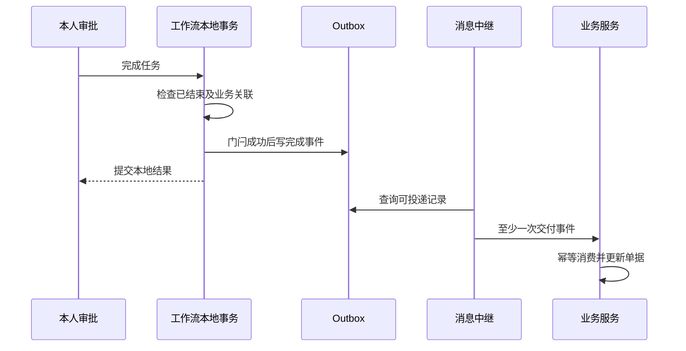

# 7. 结果与排障：为什么审批完了，单据还没变化

先分清三件事：你处理过任务、整个流程已结束、业务服务已经收到结果。任何两件都不能自动画等号。

## 看进度和记录，分别在看什么

“我办过的”只说明你完成过某个任务，流程可能还在下一位审批人手里。“我的待办”由当前身份和租户查询，表单还检查当前处理人；表单返回的变量没有任意个人信息自动脱敏保证。

进度与审批记录先按实例编号和租户检查历史实例。无效租户使用 400，不存在或跨租户统一 404，再读取活动、意见、候选与昵称。这里没有额外增加同租户参与人 ACL；也不是每个读取接口都有独立功能权限码。

| 入口 | 当前用途与约束 |
|---|---|
| task/todo、task/count、task/{id}/form | 认证后读取本人待办、数量或当前任务表单 |
| process-instance/my-initiated、my-completed | 本人发起和本人处理过的申请 |
| process-instance/list | 需要 workflow:instance:list |
| process-instance/{id}/progress、approval-records | 认证与历史实例租户检查，不等于参与人权限 |
| stats/workspace、stats/admin | 前者是工作台统计；后者还要求 workflow:stats:admin |

进度中的未到达节点候选预览，不代表运行时一定分配给同一批人。结束任务有删除原因时可能显示 auto-completed，记录中的 MI 标签也可能是系统跳过。请结合上一页的投票规则阅读。

## 待办是为查询准备的副本

引擎的任务是执行依据，wf_todo_task 是给页面查询用的投影。引擎完成任务并创建下游任务后，工程等事务提交，再同步投影。WorkflowApprovalServiceImpl 原文：

<!-- omni:source path="omni-backend/omni-workflow/src/main/java/com/omni/workflow/service/impl/WorkflowApprovalServiceImpl.java" -->
```java
        TransactionSynchronizationManager.registerSynchronization(new TransactionSynchronization() {
            @Override
            public void afterCommit() {
                try {
                    workflowTodoSyncService.syncProcessTodos(processInstanceId);
                } catch (Exception e) {
                    log.error("事务提交后同步待办失败: processInstanceId={}", processInstanceId, e);
                }
            }
        });
    }
```

如果同步失败，只记日志，不会把已经提交的审批撤销。所以“页面还有旧待办”先查同步日志和引擎任务，再按正式同步或恢复路径处理；不要为了修页面直接把流程状态改回去。

## 完成结果怎样离开工作流服务

审批完成后，工程查询实例是否仍运行。如果已经结束且有跨服务业务关联，就准备 workflow.process.completed.v1 事件；显式终止走 CANCELLED。扩展表中的 completion_event_id 像一个门闩，条件更新抢到这一写入权才继续：

<!-- omni:source path="omni-backend/omni-workflow/src/main/java/com/omni/workflow/service/impl/WorkflowCompletionEventServiceImpl.java" -->
```java
        int updated = processInstanceExtMapper.markCompletionForEvent(completionUpdate);
        if (updated == 0) {
            return false;
        }
        if (updated != 1) {
            throw new BusinessException(500, "流程实例完成事件状态异常");
        }
```

随后把事件写入本地 Outbox，显式带租户和事件编号：

<!-- omni:source path="omni-backend/omni-workflow/src/main/java/com/omni/workflow/service/impl/WorkflowCompletionEventServiceImpl.java" -->
```java
        reliableMessageRelay.send(BINDING_NAME, event, tenantId, eventId);
```

门闩和 Outbox 在同一本地事务，避免这条适用路径重复写完成事件。消息中继之后再把它交给 Broker，业务服务消费并幂等处理。“幂等”在这里指同一事件重放，不重复改变业务结果；它与启动请求防重是两处不同机制。



APPROVED/REJECTED 对应扩展状态 2，CANCELLED 对应 0；业务单据的状态由业务消费者自己处理。不能把扩展状态 2 直接当成“业务单据已通过”。

## 并非所有结束都有完成事件

当前没有覆盖全部结束方式的通用引擎结束监听器。启动后立刻结束、其他管理方式结束或缺少业务扩展，不能推断已写事件。普通站内流程未进入跨服务完成发布路径时，也不能凭流程结束去等一条并不存在的业务事件。

所以准确说法是：**适用的完成发布调用中，门闩与 Outbox 同事务；不是所有引擎结束都保证发事件。** 即使 Outbox 已写，也不等于 Broker 已收或业务已消费。

## 按失败发生的位置恢复

| 现象 | 先确认什么 | 恢复方向 |
|---|---|---|
| 发布被拒绝 | XML 错误、实际草稿状态和发布指针 | 修正、保存并校验；不能假设 FAILED 已持久化 |
| 启动超时或 409 | 请求记录是否 STARTED、仍处理中，意图是否一致 | 使用正式查询和相同请求意图恢复，不盲换 requestId |
| 无候选人 | 角色、组织、启用状态、锚点和回退配置 | 补合法配置再按业务重试，不能自动算通过 |
| 完成时 409/403 | 待办是否已处理、是否确为本人 | 刷新或纠正权限，不反复点击 |
| 流程已前进，待办还旧 | 引擎任务和 afterCommit 同步日志 | 修复投影同步，保留实际审批事实 |
| 流程结束，业务单未变 | 是否应发事件、门闩、Outbox、中继与消费者 | 查失败重试/死信及业务幂等，不直接改库制造成功 |

默认通知服务只记日志，抄送记录也不证明外部通知送达。XSS 配置读取缺失或规则 JSON 解析失败时，Workflow 返回关闭与空规则；Redis 读取异常没有在该方法捕获。不能因为其他服务有默认防护，就断言这里的变量、意见和设计器内容已经统一自动清洗。

## 二开从哪一层开始

新增流程节点先改模型和分配规则，再发布并验证；新增候选策略在候选解析服务与对应监听器中扩展；新增任务动作要同时设计功能权限、租户和处理人守卫、合法目标及失败路径。业务服务接结果时保持自己的状态机和消费幂等，不嵌入另一套引擎。

这章贴的是当前实现，不是对所有复杂流程的能力承诺。新节点、异步路径、嵌套会签、变量覆盖和跨服务故障，都应通过对应测试和真实业务链验证；不要用已有截图替代当前复现。
