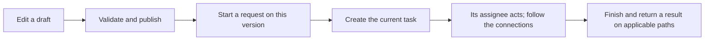

# 1. Workflow from scratch: how a request reaches its next approver

Suppose Li wants to buy office computers. He submits a requisition, his department manager reviews it, and the purchasing lead reviews it next. A rejection follows the company's configured path. A workflow remembers where the request is, who should act now, and what happens after that action.

Li and this requisition are teaching examples, not seeded accounts or evidence of a completed local transaction. Follow the story before reading the short source excerpts; you do not need to know Java first.

## Why a single approval status stops being enough

A few states such as pending, approved and rejected can be enough for one reviewer. Two approval levels, several reviewers and amount-based branches also require the application to remember the current node, each person's task and the rule version. The engine executes those rules. The business application still checks amounts, suppliers and whether the document is valid.

**An engine finishing a process does not mean the business document has already changed.** The project returns results through completion events on applicable paths, which may need retries.

## Four terms in the same story

| Term | Plain meaning | Example |
|---|---|---|
| Model | An editable rule diagram | Department manager → purchasing lead |
| Published version | A confirmed diagram available for new starts | Version 3 published today |
| Process instance | One request running a particular diagram | Li's computer purchase request |
| Task | One person's work within that request | The approval currently assigned to Manager Wang |

Editing a draft does not switch running instances to the new diagram. The project exposes no running-instance migration endpoint. Investigate the engine definition used at the start, not just the latest diagram in the editor.

## Three diagram symbols to recognize

Start and end events mark a path's boundaries. A user task means a person must do something. A gateway selects a path, for example based on an amount threshold. BPMN is the standard notation, usually stored as XML. The editor's boxes and lines must become this engine-readable text to execute.

Process variables travel with a request: its amount, initiator or the latest approval decision, for example. **Variables can affect routing; they are not unrestricted notes.** Additional approval variables currently lack reserved-field filtering in this project. The task page explains that limit.

## Which version are we discussing?

The project's model version, Flowable's definition version and a requisition's concurrency-control version are different things. Their numbers need not match. For now, remember that a start uses a particular rule, and changing a business document does not automatically replace that rule.

## Continue through these seven pages

| Page | Question it answers |
|---|---|
| [2. Design and choices](workflow-design.en.md) | Why an engine, and why keep business services? |
| [3. Framework source](workflow-framework.en.md) | What happens after Flowable receives complete? |
| [4. Models and publishing](workflow-models.en.md) | How does a draft become runnable? |
| [5. Starting and finding people](workflow-assignment.en.md) | Who starts, how are repeats handled, and who reviews next? |
| [6. Tasks and multiple reviewers](workflow-tasks.en.md) | What do approval, rejection, signer changes and delegation mean? |
| [7. Results and troubleshooting](workflow-events.en.md) | Why has the document or task list not changed yet? |

This chapter explains delivery source and matching upstream code. Source research, unit tests, real approvals and screenshots prove different things; none substitutes for the others.
