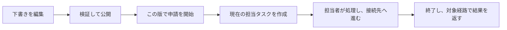

# 1. ワークフローの基礎：申請はどうやって次の承認者へ届くのか

李さんが業務用のパソコンを購入するとします。購入申請を出し、部門長が確認し、その後に購買責任者が確認します。否認された場合は、会社が定めた経路に進みます。ワークフローは「今どの段階か」「誰が対応するか」「対応後にどこへ進むか」を記録する仕組みです。

李さんと申請は説明用の例であり、登録済みアカウントや実行済みの取引ではありません。まず話の流れを理解し、その後で短い実際のソースを読んでください。Java の予備知識は不要です。

## 承認状態を一つ保存するだけでは足りない理由

担当者が一人なら、未処理・承認・否認の状態だけで済む場合もあります。二段階の承認、複数人の確認、金額による分岐が入ると、現在のノード、各人のタスク、適用した規則の版も必要になります。エンジンは規則を実行し、業務アプリケーションは金額、仕入先、伝票の妥当性を確認します。

**エンジンで処理が終わっても、業務伝票が更新済みとは限りません。** このプロジェクトでは対象となる経路で完了イベントを返します。その受け渡しには再試行が必要な場合があります。

## 同じ例で四つの言葉を覚える

| 言葉 | 意味 | 例 |
|---|---|---|
| モデル | まだ編集できる規則の図 | 部門長 → 購買責任者 |
| 公開版 | 新しい申請に使えるよう確定した図 | 今日公開した第 3 版 |
| プロセスインスタンス | 特定の版に従って動く一件の申請 | 李さんの今回の購入申請 |
| タスク | その申請で、特定の人が行う一件の作業 | 王部門長が持つ承認待ちの作業 |

下書きを変えても実行中の申請は自動で新しい図に切り替わりません。実行中インスタンスを移行する API は公開されていません。調査では編集画面の最新図だけでなく、開始時のエンジン定義を確認します。

## 最初に知っておく三つの図形

開始と終了は経路の両端です。ユーザータスクは人が行う作業、ゲートウェイは金額条件などで経路を選ぶ分岐です。図を表す標準的な記法を BPMN といい、通常は XML のテキストで保存します。画面の箱や線を、エンジンが読めるこの形式にする必要があります。

プロセス変数は金額、起案者、今回の承認結果など、申請とともに引き継ぐ情報です。**経路を変え得るため、自由なメモ欄とは違います。** 現在、追加の承認変数には予約フィールドの除外がありません。この制限はタスク編で説明します。

## 「版」は三種類ある

プロジェクトのモデル版、Flowable の定義版、伝票の同時更新制御用バージョンは別物で、数値も一致する必要はありません。まず「開始時には特定の規則を使う」「伝票の変更は規則の差し替えではない」と覚えてください。

## 七つのページで順に学ぶ

| ページ | 分かること |
|---|---|
| [2. 設計と選択](workflow-design.jp.md) | なぜエンジンを使い、業務サービスを残すのか |
| [3. フレームワークのソース](workflow-framework.jp.md) | complete を受けた後に何が起きるか |
| [4. モデルの公開](workflow-models.jp.md) | 下書きが実行可能な版になるまで |
| [5. 開始と担当者選定](workflow-assignment.jp.md) | 起案者、重複防止、次の承認者 |
| [6. タスクと複数人承認](workflow-tasks.jp.md) | 承認、否認、承認者の追加・削除、委任の意味 |
| [7. 結果と障害調査](workflow-events.jp.md) | 伝票やタスク一覧が変わらない理由 |

この章は配布するソースと対応する上流コードに基づきます。ソース調査、単体テスト、実際の承認、画面画像が証明する範囲はそれぞれ異なります。
