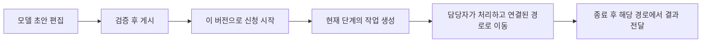

# 1. 워크플로의 기초: 신청은 어떻게 다음 승인자에게 전달될까

이 씨가 업무용 컴퓨터를 구매한다고 가정해 보겠습니다. 구매 요청을 제출하면 부서장이 검토하고, 그다음 구매 책임자가 검토합니다. 누군가 반려하면 회사가 정한 경로로 이동합니다. 워크플로는 지금 어느 단계인지, 누가 처리할 차례인지, 처리 후 어디로 갈지를 기억하는 장치입니다.

이 씨와 구매 요청은 설명을 위한 예시이며, 미리 만든 계정이나 실제 거래의 실행 증거가 아닙니다. 먼저 이야기를 이해하고 짧은 실제 소스를 읽으세요. Java를 미리 알 필요는 없습니다.

## 승인 상태 하나로 부족해지는 이유

담당자가 한 명이라면 대기·승인·반려 정도로 충분할 수 있습니다. 두 단계 승인, 여러 사람의 검토, 금액에 따른 분기가 추가되면 현재 노드, 각자의 작업, 적용한 규칙 버전도 기억해야 합니다. 엔진은 규칙을 실행하고, 업무 시스템은 금액·공급업체·문서의 유효성을 검사합니다.

**엔진에서 프로세스가 끝났다고 업무 문서까지 이미 바뀐 것은 아닙니다.** 프로젝트는 해당 경로에서 완료 이벤트로 결과를 전달하며, 이 전달에는 재시도가 필요할 수 있습니다.

## 같은 이야기로 네 가지 개념 이해하기

| 용어 | 쉬운 뜻 | 예시 |
|---|---|---|
| 모델 | 계속 수정할 수 있는 규칙 그림 | 부서장 → 구매 책임자 |
| 게시 버전 | 새 신청에 사용하도록 확정한 그림 | 오늘 게시한 버전 3 |
| 프로세스 인스턴스 | 특정 그림으로 실행하는 신청 한 건 | 이 씨의 이번 컴퓨터 구매 요청 |
| 작업 | 그 신청에서 특정 사람이 할 일 한 건 | 김 부서장에게 배정된 승인 대기 작업 |

초안을 바꿔도 실행 중인 신청이 새 그림으로 자동 전환되지 않습니다. 프로젝트에는 실행 중 인스턴스의 버전을 이전하는 API가 없습니다. 조사할 때는 편집기의 최신 그림뿐 아니라 시작할 때 사용한 엔진 정의를 확인해야 합니다.

## 먼저 알아둘 세 가지 도형

시작과 종료는 경로의 양 끝입니다. 사용자 작업은 사람이 처리할 일이고, 게이트웨이는 금액 조건처럼 경로를 고르는 분기입니다. 이런 그림을 표현하는 표준을 BPMN이라고 하며 보통 XML 텍스트로 저장합니다. 편집기의 상자와 선이 엔진이 읽을 수 있는 이 텍스트로 바뀌어야 실행됩니다.

프로세스 변수는 금액·신청자·이번 승인 결과처럼 신청과 함께 이동하는 정보입니다. **경로에 영향을 주므로 자유롭게 쓰는 메모가 아닙니다.** 현재 프로젝트의 추가 승인 변수에는 예약 필드 필터링이 없습니다. 작업 편에서 이 한계를 설명합니다.

## 어떤 버전을 말하는가

프로젝트의 모델 버전, Flowable의 정의 버전, 동시 수정 제어용 업무 문서 버전은 서로 다릅니다. 숫자도 같을 필요가 없습니다. 처음에는 시작 시 명확한 규칙을 선택하며, 문서 수정이 규칙 교체를 뜻하지 않는다는 점을 기억하세요.

## 일곱 페이지를 순서대로 읽기

| 페이지 | 알 수 있는 내용 |
|---|---|
| [2. 설계와 선택](workflow-design.kr.md) | 엔진을 사용하면서 업무 서비스도 유지하는 이유 |
| [3. 프레임워크 소스](workflow-framework.kr.md) | Flowable이 complete 이후에 하는 일 |
| [4. 모델과 게시](workflow-models.kr.md) | 초안이 실행 가능한 버전이 되는 과정 |
| [5. 시작과 담당자 찾기](workflow-assignment.kr.md) | 신청자, 중복 방지, 다음 승인자 |
| [6. 작업과 다중 승인](workflow-tasks.kr.md) | 승인·반려·승인자 추가와 제거·위임의 실제 의미 |
| [7. 결과와 문제 해결](workflow-events.kr.md) | 문서나 작업 목록이 아직 바뀌지 않은 이유 |

이 장은 배포 소스와 일치하는 상위 프레임워크 원문을 설명합니다. 소스 조사, 단위 테스트, 실제 승인, 화면 캡처가 증명하는 범위는 서로 다르며 대신할 수 없습니다.
