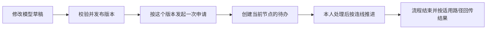

# 1. 从零认识工作流：一张申请怎样找到下一位审批人

假设小李想买一批办公电脑。他先提交请购单，部门经理同意后，再交给采购负责人；有人拒绝，就按公司的规则结束或进入其他分支。工作流负责记住这件事走到了哪里、现在该谁处理、处理后该往哪走。

这里的小李和请购单只是教学例子，不是预置账号，也不是某次已经跑通的业务记录。先理解故事，再读后面的小段真实源码，不需要先掌握 Java。

## 为什么不直接放一个“审批状态”

只有一个人处理时，“待处理、通过、拒绝”几个状态就可能够用。加入两级审批、多人会签、不同金额走不同路径以后，程序还要记住当前节点、每个人的任务和使用的规则版本。工作流引擎负责执行这些规则，业务系统仍负责采购金额、供应商和单据是否合法。

**引擎把流程走完，不等于业务单据已经更新。** 项目通过完成事件把结果交回业务服务，这一段也可能需要重试。

## 四个词，放进同一个故事

| 名称 | 大白话 | 例子 |
|---|---|---|
| 模型 | 可以继续修改的规则图 | “部门经理 → 采购负责人”这张图 |
| 发布版本 | 已经确认、可用于启动的那一版图 | 今天发布的第 3 版 |
| 流程实例 | 按某版图开始的一次申请 | 小李这次购买电脑的申请 |
| 任务 | 某次申请里，交给某个人的一件事 | 王经理现在手里的审批待办 |

修改草稿不会让已经运行的实例自动换图。项目没有暴露运行实例迁移接口；排查在途申请时，要看它启动时的引擎定义，不能只看编辑器中最新的图。

## 再认识三个画图符号

开始和结束表示一条路径的起止。用户任务表示需要人处理的事情。网关表示分路规则，例如“金额是否达到某个标准”。图的标准表示法叫 BPMN，通常保存成 XML 文本；编辑器画出的方框和连线，要变成引擎能读的这份文本才能执行。

流程变量是随这次申请一起走的数据，例如金额、发起人和本次是否通过。**变量会影响路径，所以不能把它当成可以随意填的备注。** 本项目目前仍有附加审批变量未过滤保留字段的限制，任务篇会具体说明。

## 哪个版本才是“版本”

项目记录的业务模型版本、Flowable 自己的定义版本、请购单用于并发控制的单据版本，是三回事。它们不必数值相同。第一次学习时，只需要记住：启动要选择明确的规则，改业务单据也不会自动更换流程规则。

## 按这七页读下去

| 页 | 要解决的问题 |
|---|---|
| [2. 设计与选型](workflow-design.md) | 为什么用引擎，为什么还保留业务服务 |
| [3. 框架源码](workflow-framework.md) | Flowable 接到“完成”之后做了什么 |
| [4. 模型与发布](workflow-models.md) | 草稿怎样变成可运行版本 |
| [5. 启动与找人](workflow-assignment.md) | 谁发起、如何防重、下一位审批人是谁 |
| [6. 任务与会签](workflow-tasks.md) | 通过、拒绝、加减签和委派到底意味着什么 |
| [7. 结果与排障](workflow-events.md) | 为什么流程结束了，单据或待办还没变化 |

本章依据交付源码和匹配版本的上游原文解释实现。源码研究、单元测试、真实审批和页面截图分别说明各自能证明的事，不能互相代替。
