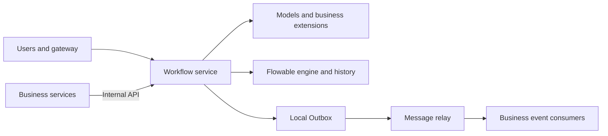

# Workflow facts and runtime boundaries

This document owns the current model, execution, approval, tenant and cross-service consistency rules. Modeling and UI steps belong in [Workflow development and modeling](wiki/workflow-development.en.md); layouts and historical images are in [Interface reference](wiki/interface-reference.en.md#workflow). [API contracts](api-contract.en.md) own request fields and response structures, and [Docker deployment](docker-deployment.en.md) owns deployment steps.

## 1. Service and persistence boundaries

`omni-workflow` is a standalone Servlet service on business port `8103` and management port `19903`. The backend parent POM pins Flowable to `8.0.0`. Business services call internal APIs rather than embedding the engine. Its POM directly depends on `omni-common-core`, `omni-common`, `omni-common-mybatis`, `omni-common-redis`, `omni-common-operlog`, `omni-common-job`, `omni-common-mqlog` and `omni-common-workflow`; it does not use the security composition from `omni-common-service`.



`application.yml` uses database `omni_workflow` and Redis DB `0`, with `history-level: audit`, an async executor and `database-schema-update: false`. The migrator owns formal schemas; engine startup must not create them. Candidate, identity and display-name queries include direct JDBC access to `omni_auth`, so deployment requires the corresponding database access. These reads do not all go through Auth HTTP APIs.

Domain schemas are in `database/changelog/workflow/0001-workflow-schema.yaml`:

| Table | Current use and limits |
|---|---|
| `wf_process_model` | Tenant model catalog; unique `(tenant_id, model_key)`; draft and current published pointers |
| `wf_process_model_version` | Designer JSON, BPMN XML, digest, business version and engine deployment; unique `(model_id, version)` |
| `wf_process_instance_ext` | Initiator, business association, instance status and completion-event latch |
| `wf_process_start_request` | Internal start reservation; separate tenant-scoped unique request, business and instance associations |
| `wf_todo_task` | Assignee todo projection; engine tasks remain the execution authority |
| `wf_cc_record` | CC records; a record does not prove external notification delivery |
| `wf_form_schema` | Schema exists; this module currently has no form-definition CRUD Controller/Service |
| `wf_delegation_rule` | Schema exists; it does not establish automatic rule-driven task reassignment |

`sys_mq_message` is the shared Outbox, whose sole DDL owner is `database/changelog/common/0001-mq-schema.yaml`. Dedicated migrations manage Flowable `ACT_*` tables. Neither belongs in the `wf_` business-table tenant interceptor.

## 2. Model and version invariants

`WorkflowModelController` owns model APIs and uses `workflow:model:*` permissions. A new modelKey must match `^[a-zA-Z][a-zA-Z0-9-]*$` and be unique in its tenant. Creation makes an enabled model and version `0` in `DRAFT`; initial designerJson does not automatically become publishable BPMN.

Draft saving stores the supplied designerJson and bpmnXml and computes the XML digest. The backend currently does not generate XML from designerJson. A new draft is created when the current pointer is not `DRAFT`, preserving published content. Models with status `0` are excluded from ordinary lists; a model with a `PUBLISHED` version cannot be deleted directly.

`BpmnXmlValidator` uses hardened XML parsing: DOCTYPE and external entities are disabled, as are external DTD/stylesheets in the transformer. It checks one executable process, a process id matching modelKey, start/end events, `omni:assignment` on UserTasks, `omni:cc` on relevant CC nodes, exclusive-gateway default flows and flow references; multiple start events produce a warning. Reference checking uses direct process children and only checks nonblank sourceRef/targetRef. Extension presence is not validation of assignment JSON or a script/listener/expression safety allowlist, nor proof that business paths execute.

The local transaction in `WorkflowModelServiceImpl.publishModel()` locks the model row using raw JDBC `SELECT ... FOR UPDATE`, requires a nonempty `DRAFT`, validates again, deploys to Flowable, allocates the next business version and stores engine identifiers. The new version becomes `PUBLISHED`, the version at the previous published pointer is archived, and the model pointer changes. Raw JDBC row locking bypasses the MyBatis-Plus tenant plugin and is not authorization.

The validation-failure branch attempts to write `FAILED` before throwing inside that same rollback transaction; durable failure status is not guaranteed. A publication exception says nothing about rollback of Brokers, business services or external notifications. Local database/engine transactions and cross-service consistency have different boundaries.

Legacy `/api/workflow/process-definition` APIs retain deployment, BPMN reading, suspension, activation and cascading deletion with `workflow:definition:*` permissions. They bypass the model draft validation and business-version publication path. `ProcessDefinitionServiceImpl` currently adds a tenant predicate only to lists with a nonempty tenant context; ID-based reads/suspend/activate/delete lack a common ownership check. Function permissions do not prove tenant isolation for these APIs.

## 3. Candidates, listeners and countersigning

### 3.1. Configuration shape

Assignment configuration lives in BPMN `omni:assignment`; the XML namespace is `http://omni.com/workflow`, with Flowable extensions under `http://flowable.org/bpmn`. This illustrates the configuration shape only; roles and organizations must exist in the target tenant:

```json
{
  "assignmentType": "SCOPED_ROLE",
  "roleCode": "SUPER_ADMIN",
  "anchorType": "START_USER_PRIMARY_UNIT",
  "anchorParams": {},
  "scopeMode": "SAME_UNIT",
  "fallbackStrategy": "ERROR",
  "approvalMode": "ALL"
}
```

### 3.2. Anchor sources

| anchorType | Actual anchor source |
|---|---|
| `START_USER_PRIMARY_UNIT` | Enabled initiator's primary organization |
| `PARENT_BY_TYPE`, `PARENT_CHILDREN` | Walk upward from the primary organization by targetType; use the primary organization when targetType is absent |
| `CHILD_BY_CODE`, `SIBLING_BY_CODE` | Direct child/sibling of the primary organization, by childCode/siblingCode |
| `DEPT_BY_CODE` | Enabled organization in the current tenant by deptCode |
| `ABSOLUTE_UNIT` | Ordinary candidate queries support anchorParams.unitIds or unitId |
| `PARENT` | Parent of the primary organization |
| `CHILD_UNIT`, `SIBLING_UNIT` | Configured unitId directly; no kinship check against the initiator |

### 3.3. Scope

`SAME_UNIT` selects roles in that organization; `UNIT_AND_BELOW` uses organization paths for it and descendants; `CHILDREN_ONLY` selects direct children only. Unknown scopeMode currently falls back to same-unit lookup. SQL filters by role tenant and enabled role, role scope and user status; this is not complete Auth authorization for arbitrary configured users. Query errors usually become empty candidate sets.

### 3.4. Empty candidates

`ERROR`, including missing/other strategies, throws. `ASSIGN_ADMIN` queries `SUPER_ADMIN` candidates in organization ID `1` of the current tenant and throws if none exist; it does not hardcode user ID `1`. `ESCALATE_PARENT` starts at the resolved anchor's parent, keeps roleCode and scopeMode, and searches at most `20` ancestor levels, returning the first match. No match fails rather than approving automatically. For `ABSOLUTE_UNIT`, escalation reads a single unitId; it does not choose the first unitIds entry. Missing initiators/anchors or organization-query errors can also fail resolution.

### 3.5. Countersign counters

Multi-instance counters initialize locally on the MI root, searching up to `32` execution levels and using the current execution if none is found. `_counters_init` deduplicates within that activity root, preventing votes from leaking to a later countersign node. Initial thresholds are candidate count for `ALL` and `1` for `ANY`; dynamic signer changes recalculate the ALL threshold as approved plus still pending. The designer's condition is `${rejectedCount > 0 || approvedCount >= requiredApprovals}`. Other BPMN models must provide their own correct completion conditions and rejection routing.

### 3.6. Candidate resolution components

The designer's `useBpmnExtension.writeAssignment()` writes `ExecutionListener(event=start)` referencing `${scopedRoleAssignmentListener}`, parallel multi-instance execution, collection `candidateUserIds`, element variable `userId` and assignee `${userId}`. The old `TaskListener` entry only logs and cannot replace the execution-start listener. `CandidateResolverBean` also supports the `${candidateResolver.resolve(execution)}` collection expression. Candidate resolution shares `CandidateResolutionService`, including compatibility delegates and design-time previews.

This escalation and exception propagation apply to the execution listener and `CandidateResolverBean`. The listener may return when assignment or roleCode is missing; extension presence does not guarantee a populated collection. Compatibility `CandidateResolverDelegate` has no ESCALATE_PARENT branch, may return without a target, and catches execution errors to log them. Legacy BPMN paths therefore do not all share the same failure behavior.

## 4. Instances, tasks and approval records

Ordinary starts use the Gateway actor and reject simulateUserId/simulateUserName differing from that actor. Before entering the engine, input variables `initiator`, `startUserId`, `authenticatedUserId` and `START_USER_ID` are removed and the real initiator is set; Flowable authentication is cleared in finally. modelVersionId requires a same-tenant `PUBLISHED` version with an engine definition ID. A processKey-only request uses the legacy key-and-tenant start path and need not use the catalog's current published pointer.

The extension is written after engine start: status `1` means running, `2` completed and `0` terminated. Ordinary requestId/businessType fields alone do not establish the internal reservation's idempotency. Todo synchronization runs after commit; errors are logged without rolling back the committed instance, so projections are not real-time engine state.

Completion, add/remove signer and delegation in `ApprovalController` require their respective `workflow:approval:*` permissions. The service additionally requires a current-tenant task and the exact assignee. Missing tasks use business code `409`; another assignee uses `403`. There are no separate claim, transfer or withdraw Controllers, and internal candidate validation does not claim a task. Signer/delegation targets only undergo numeric parsing; enabled-user and Auth tenant ownership validation is not established. Delegation sets the assignee.

Approval first stores comments, task-local approved/comment and runtime variables, then updates MI approval/rejection counters, and finally calls `taskService.complete()` so the condition can see the current vote. Extra variables are applied afterward to task-local and process scopes without reserved-name filtering. Arbitrary client variables therefore cannot be claimed incapable of overwriting counters or routing values.

The read APIs are `GET /api/workflow/process-instance/{processInstanceId}/progress` and `GET /api/workflow/process-instance/{processInstanceId}/approval-records`. Both explicitly accept Gateway `X-Tenant-Id` and query the historic instance by ID and tenant first. Invalid tenants use business code `400`; missing and foreign-tenant instances both use `404`, before activities, comments, candidates or display names are read. This boundary adds neither same-tenant participant ACLs nor function permissions.

| Display/read | Current meaning |
|---|---|
| Progress nodes | Aggregate historic activities and assignees with completed/active/pending states; unreached nodes may show candidate previews, not final assignments |
| Per-person progress | An ended task with no deleteReason is actually completed; any non-null deleteReason on an ended task becomes auto-completed |
| Approval records | Normally ended tasks use task-local approved; a missing variable defaults to approved for compatibility; unfinished tasks are pending |
| Deleted tasks | A deleteReason starting with MI retains legacy label `auto-approved`; other deletions are cancelled. `MI_END` is an engine skip, not that person's approval vote |
| Comments | The first returned task comment is used; it is not guaranteed to be the latest |

Initiated/completed-by-me and todo lists filter by tenant and current user. Completed-by-me means a task was handled, not that the whole process ended. Task forms require the current-tenant assignee and return process variables, without arbitrary PII redaction guarantees. Initiator termination requires a same-tenant extension, that initiator and running status.

## 5. Trust, tenancy and content boundaries

External security requires authentication. `GatewayPreAuthFilter` checks the forwarding marker and HMAC identity assertion and rejects conflicts with plain identity headers; Controllers declare function permissions. Internal `/api/internal/**` uses a preceding shared-token filter rather than user JWT. Identity, tenant, task eligibility and business association are separate checks.

`TenantInfoFilter` clears `TenantInfoHolder` in finally. Workflow's MyBatis-Plus chain is Tenant → Optimistic → Pagination, intercepts only `wf_` tables and falls back to tenant `1` when context is absent. Raw JDBC and Flowable queries bypass it; inspect explicit constraints in each method rather than inferring service-wide owner DataScope.

The standalone `XssConfigProviderImpl` reads `xss:enabled:{tenantId}` and `xss:rules:{tenantId}` from Redis DB `0`. Missing configuration or invalid rule JSON returns enabled=false and empty rules; this method does not catch Redis read exceptions. It has neither common-service's Auth fallback nor its default safety baseline. Variables, comments, designer JSON/XML and logs must be considered along their actual input/output paths; uniform automatic sanitization is not guaranteed.

`CcNotifyDelegate` writes `wf_cc_record`, creates no todo and calls no external notification service; execution errors are caught and logged. Default `NoOpNotificationService` only logs. Operation logs and Outbox records likewise do not prove email, SMS or other notification delivery.

## 6. Internal starts and completion events

Eight method paths in `InternalWorkflowController` cover version details, current version by category, published lists, batch version resolution, approval-graph preview, start, eligibility validation and termination. [API contracts](api-contract.en.md) own the complete fields. Calls require `X-Internal-Token` and `X-Tenant-Id`, with matching body/query tenants where applicable. The caller supplies the real startUserId/startUserName; a shared token does not establish end-user authorization.

Internal start reserves `wf_process_start_request` in a local transaction. Unique keys constrain both `(tenant_id, request_id)` and `(tenant_id, business_type, business_key)`. Replay compares business identity, modelVersionId and startUserId, not a full hash of title, startUserName or variables. STARTED records return the original instance with replayed=true; the response requestId comes from the current request. In-progress records return `409`. FAILED records can be reserved again with the same requestId; changing only requestId while hitting the same business key does not automatically acquire retry rights.

A new start revalidates the published version. `ASSET_TRANSFER`, `ASSET_DISPOSAL` and `SRM_SUPPLIER_ONBOARDING` require exact category/businessType equality. The internal service overwrites requestId/businessType/businessKey variables, and the ordinary start layer overwrites initiator variables. Reservation, start, extension and markStarted share a local transaction, not distributed atomic commit with business services.

Eligibility first matches tenant task and extension businessType/businessKey, then assignee; only unassigned tasks check candidates. valid=true neither claims nor completes a task. Availability and graph previews derive from model metadata/BPMN and do not establish final candidates, continuing engine runnability or successful business approval.

The event type is `workflow.process.completed.v1`, written to the shared Outbox through `workflow-domain-out-0`. Current callers are approval detecting the ended runtime instance and explicit termination. Results are the request's APPROVED/REJECTED or CANCELLED respectively. A conditional completion_event_id update in the extension latches one write in the same transaction as the Outbox event. An existing latch returns false without another write; it is not Broker delivery acknowledgment.

There is currently no general engine-end listener covering all endings. Immediate completion during startup, other administration endings or missing business extensions do not imply an event was generated. Relaying is at least once and consumers must be idempotent. APPROVED/REJECTED map to extension status `2`, CANCELLED to `0`; domain consumers own final business state. See [MQ reliability](mq-reliability.en.md).

## 7. Source entry points and verification scope

| Entry point | What to inspect |
|---|---|
| `WorkflowModelController` / `WorkflowModelServiceImpl` / `BpmnXmlValidator` | Permissions, version pointers, locking, validation and publishing |
| `ProcessInstanceServiceImpl` / `WorkflowTaskServiceImpl` | Initiator identity, tenant reads, own lists, forms and termination |
| `WorkflowApprovalServiceImpl` / common-workflow `ApprovalServiceImpl` | Assignee, MI counter ordering, dynamic signers and completion |
| `CandidateResolutionService` / `ScopedRoleAssignmentListener` / `CandidateResolverBean` | Anchors, empty candidates, listener timing and counter scope |
| `InternalWorkflowServiceImpl` / `WorkflowProcessStartRequestServiceImpl` / `WorkflowCompletionEventServiceImpl` | Internal intent replay and Outbox latch |
| `SecurityConfig` / `GatewayPreAuthFilter` / `MybatisPlusConfig` / `XssConfigProviderImpl` | Standalone security configuration and actual limits |

The initializer corrects and publishes default tenant `1` models `supplier-onboarding`, `procurement-approval`, `asset-transfer` and `asset-disposal`. Missing models or publication failure prevent startup; this does not establish readiness for every tenant and external dependency.

Tests cover models, start identity, approval, internal protocols, completion events and tenant boundaries. `ProcessInstanceReadTenantBoundaryTest` uses real MVC/service code and mocked history for the two read APIs, not real Flowable DB/Gateway integration. `it/Fw*IT` requires a guarded isolated environment and does not run in default Surefire unit execution. Docker builds, units, real approval, browser screenshots and message/notification acceptance are recorded separately; historical screenshots do not prove a current business run. Commands are centralized in [AGENTS.md](../AGENTS.md).
