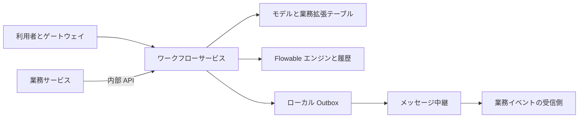

# ワークフローの現行仕様と実行境界

本書は、現行サービスのモデル、実行、承認、テナント分離、サービス間整合性の規則を管理します。モデリングと画面操作は [ワークフロー開発とモデリング](wiki/workflow-development.jp.md)、画面配置と過去の画像は [画面リファレンス](wiki/interface-reference.jp.md#workflow) を参照してください。リクエスト項目と応答構造は [API 契約](api-contract.jp.md)、配置手順は [Docker デプロイ](docker-deployment.jp.md) が管理します。

## 1. サービスと永続化の境界

`omni-workflow` は独立した Servlet サービスで、業務ポートは `8103`、管理ポートは `19903` です。バックエンド親 POM が Flowable を `8.0.0` に固定します。業務サービスは内部 API を呼び、エンジンを組み込みません。POM の直接依存は `omni-common-core`、`omni-common`、`omni-common-mybatis`、`omni-common-redis`、`omni-common-operlog`、`omni-common-job`、`omni-common-mqlog`、`omni-common-workflow` で、`omni-common-service` のセキュリティ構成は使いません。



`application.yml` はデータベース `omni_workflow`、Redis DB `0`、`history-level: audit`、非同期実行器、`database-schema-update: false` を設定します。正式な構造は移行ツールが管理し、実行時エンジンの自動作成には依存しません。候補者、ID 情報、表示名の取得には `omni_auth` への直接 JDBC アクセスが含まれるため、必要なデータベースアクセス権を配置時に用意します。すべてが Auth HTTP API 経由ではありません。

ドメイン構造は `database/changelog/workflow/0001-workflow-schema.yaml` にあります。

| テーブル | 現在の用途と制約 |
|---|---|
| `wf_process_model` | テナント内のモデル台帳。`(tenant_id, model_key)` が一意。草稿と現在の公開版へのポインタ |
| `wf_process_model_version` | 設計用 JSON、BPMN XML、ダイジェスト、業務版、エンジン配置情報。`(model_id, version)` が一意 |
| `wf_process_instance_ext` | 起案者、業務関連、インスタンス状態、完了イベントの書き込みラッチ |
| `wf_process_start_request` | 内部起動の予約。リクエスト、業務キー、インスタンス関連にそれぞれテナント内一意制約 |
| `wf_todo_task` | 担当者別の未処理タスク投影。実行の正はエンジンタスク |
| `wf_cc_record` | CC 記録。記録の存在は外部通知の配信完了を示さない |
| `wf_form_schema` | 構造は存在するが、本モジュールにフォーム定義 CRUD Controller/Service はない |
| `wf_delegation_rule` | 構造は存在するが、規則による自動的な担当変更の実装を意味しない |

`sys_mq_message` は共通 Outbox で、DDL の唯一の管理元は `database/changelog/common/0001-mq-schema.yaml` です。Flowable の `ACT_*` は専用の移行が管理します。これらを `wf_` 業務テーブルのテナントインターセプタ対象に含めません。

## 2. モデルと版の不変条件

モデル API は `WorkflowModelController` が管理し、`workflow:model:*` 権限を使用します。作成時の modelKey は `^[a-zA-Z][a-zA-Z0-9-]*$` に一致し、テナント内で一意である必要があります。有効モデルと版番号 `0` の `DRAFT` を作成します。初期 designerJson から公開可能な BPMN が自動生成されるわけではありません。

草稿保存は受信した designerJson と bpmnXml を保存し、XML のダイジェストを計算します。現在のバックエンドは designerJson から XML を生成しません。現在のポインタが `DRAFT` でなければ新しい草稿を作り、過去の公開内容を保持します。状態 `0` のモデルは通常一覧から除外され、`PUBLISHED` 版のあるモデルは直接削除できません。

`BpmnXmlValidator` は DOCTYPE と外部エンティティを無効にした XML パーサを使用し、変換器でも外部 DTD/スタイルシートを無効化します。単一の実行可能 process、modelKey と一致する process id、開始/終了イベント、UserTask の `omni:assignment`、対象 CC ノードの `omni:cc`、排他ゲートウェイの既定フローとフロー参照を検査します。開始イベントが複数なら警告します。参照検査は process の直接の子要素に基づき、空でない sourceRef/targetRef のみを検査します。拡張要素の存在確認は assignment JSON の妥当性、スクリプト/リスナー/式の安全な許可リスト、業務経路の実行成功を保証しません。

`WorkflowModelServiceImpl.publishModel()` のローカルトランザクションは、生 JDBC の `SELECT ... FOR UPDATE` でモデル行をロックし、空でない `DRAFT` を要求して再検査後に Flowable へ配置し、次の業務版とエンジン識別子を保存します。新版は `PUBLISHED`、直前の公開ポインタが指す版はアーカイブとなり、公開ポインタを更新します。生 JDBC の行ロックは MyBatis-Plus テナントプラグインを通らず、認可検査ではありません。

検査失敗時は `FAILED` を書こうとしてから同じロールバック対象トランザクション内で例外を投げるため、失敗状態の永続化は保証できません。公開例外は Broker、業務サービス、外部通知のロールバックを意味しません。ローカル DB/エンジンのトランザクションとサービス間整合性は別の境界です。

旧 `/api/workflow/process-definition` は `workflow:definition:*` 権限で配置、BPMN 読み取り、一時停止、有効化、関連インスタンスを含む削除を提供します。モデル草稿の検査と業務版公開経路は通りません。現行 `ProcessDefinitionServiceImpl` は一覧かつテナントコンテキストがある場合だけテナント条件を加え、ID による読み取り/一時停止/有効化/削除に共通の所属検査はありません。機能権限だけでこれらのデータ分離が証明されたとはいえません。

## 3. 候補者、リスナー、複数人承認

### 3.1. 構成の形状

担当設定は BPMN の `omni:assignment` に保存します。XML 名前空間は `http://omni.com/workflow`、Flowable 拡張は `http://flowable.org/bpmn` です。以下は構成形状のみを示し、ロールと組織は対象テナントに設定する必要があります。

```json
{
  "assignmentType": "SCOPED_ROLE",
  "roleCode": "SUPER_ADMIN",
  "anchorType": "START_USER_PRIMARY_UNIT",
  "anchorParams": {},
  "scopeMode": "SAME_UNIT",
  "fallbackStrategy": "ERROR",
  "approvalMode": "ALL"
}
```

### 3.2. 基準組織

| anchorType | 実際の基準組織 |
|---|---|
| `START_USER_PRIMARY_UNIT` | 有効な起案者の主組織 |
| `PARENT_BY_TYPE`、`PARENT_CHILDREN` | 主組織から targetType で上方検索。targetType がなければ主組織 |
| `CHILD_BY_CODE`、`SIBLING_BY_CODE` | 主組織の直属下位/同階層を childCode/siblingCode で検索 |
| `DEPT_BY_CODE` | 現テナントの有効組織を deptCode で検索 |
| `ABSOLUTE_UNIT` | 通常候補検索は anchorParams.unitIds または unitId に対応 |
| `PARENT` | 主組織の親組織 |
| `CHILD_UNIT`、`SIBLING_UNIT` | 設定の unitId を直接使用し、起案者との親子/兄弟関係は検査しない |

### 3.3. 検索範囲

`SAME_UNIT` は同じ組織のロール、`UNIT_AND_BELOW` は組織パスで本組織と下位、`CHILDREN_ONLY` は直属下位のみを検索します。未知の scopeMode は現在同組織検索になります。SQL はロールのテナント、有効ロール、ロール範囲、ユーザー状態で絞りますが、任意に設定したユーザーの完全な Auth 認可検査とは異なります。検索例外は通常空候補になります。

### 3.4. 空候補の処理

`ERROR` は未指定/その他の戦略を含めて例外を投げます。`ASSIGN_ADMIN` は現テナントの組織 ID `1` の `SUPER_ADMIN` 候補を検索し、不在なら失敗します。ユーザー ID `1` を固定する処理ではありません。`ESCALATE_PARENT` は解決した基準組織の親から同じ roleCode と scopeMode で最大 `20` 階層をたどり、最初の候補を返します。見つからなければ失敗し、自動承認しません。`ABSOLUTE_UNIT` の上方検索は単一 unitId を読み、unitIds の先頭を自動的に基準にしません。起案者/基準組織の欠落や組織検索例外でも失敗します。

### 3.5. 複数人承認のカウンタ

複数インスタンスのカウンタは MI ルートのローカル変数として初期化し、最大 `32` 実行階層を探索して見つからなければ現在の実行を使います。`_counters_init` の重複防止はその活動ルート内のみで、次の承認ノードへの票数流出を防ぎます。初期しきい値は `ALL` なら候補人数、`ANY` なら `1`。署名者の増減後は全員承認のしきい値を「承認済み + 未処理」で再計算します。設計器の完了条件は `${rejectedCount > 0 || approvedCount >= requiredApprovals}` です。その他の BPMN は適切な条件と却下経路を用意する必要があります。

### 3.6. 候補解決コンポーネント

設計器の `useBpmnExtension.writeAssignment()` は `${scopedRoleAssignmentListener}` を参照する `ExecutionListener(event=start)`、並列複数インスタンス、集合 `candidateUserIds`、要素変数 `userId`、担当者 `${userId}` を書き込みます。旧 `TaskListener` はログ記録のみで、実行開始リスナーの代わりにはなりません。`CandidateResolverBean` は集合式 `${candidateResolver.resolve(execution)}` もサポートします。候補解決は互換代理と設計時プレビューも含めて `CandidateResolutionService` を共用します。

この上方検索と例外伝播は実行リスナーと `CandidateResolverBean` の動作です。リスナーは assignment または roleCode がなければ直接戻る場合があり、拡張の存在だけでは集合の設定を保証しません。互換 `CandidateResolverDelegate` は ESCALATE_PARENT 分岐がなく、対象欠落時は戻り、実行例外を捕捉してログのみ残します。すべての旧 BPMN が同じ失敗終了動作を持つとはいえません。

## 4. インスタンス、タスク、承認記録

通常起動は Gateway の主体を使い、異なる simulateUserId/simulateUserName を拒否します。エンジンに入る前に入力変数 `initiator`、`startUserId`、`authenticatedUserId`、`START_USER_ID` を除去し、実際の initiator を設定します。Flowable 認証コンテキストは finally で解除します。modelVersionId 指定時は同テナントの `PUBLISHED` 版とエンジン定義 ID が必要です。processKey のみでは互換の key/テナント起動を使い、モデル台帳の現行公開ポインタとは限りません。

エンジン起動後に拡張レコードを書きます。状態 `1` は実行中、`2` は完了、`0` は中止です。通常起動の requestId/businessType だけでは内部予約の冪等性は得られません。未処理タスク同期はコミット後に実行し、例外は記録するだけでコミット済みインスタンスを戻しません。投影はエンジンの即時状態ではありません。

`ApprovalController` の完了、承認者追加/削除、委任はそれぞれ `workflow:approval:*` 権限を要求し、サービスは現テナントのタスクと正確な assignee も要求します。タスク不在は業務コード `409`、別担当者は `403` です。独立した claim、transfer、withdraw Controller はなく、内部候補資格検査もタスクを自動取得しません。追加/削除/委任対象は数値解析のみで、有効ユーザーや Auth テナント所属の検査済みとはいえません。委任は assignee の設定です。

承認完了は先に意見、タスク局所の approved/comment と実行変数を保存し、MI の承認/却下カウンタを更新してから `taskService.complete()` を呼び、今回の票を完了条件に反映します。追加 variables はその後タスク局所とプロセススコープに設定され、予約名を除外しません。任意のクライアント変数がカウンタや経路値を上書きできないとは保証できません。

読み取り API は `GET /api/workflow/process-instance/{processInstanceId}/progress` と `GET /api/workflow/process-instance/{processInstanceId}/approval-records` です。両方が Gateway の `X-Tenant-Id` を明示的に受け、ID とテナントで履歴インスタンスを先に照会します。無効テナントは業務コード `400`、不在/他テナントは共通の `404` で、活動、意見、候補、表示名の読み取り前に拒否します。同テナント参加者 ACL や機能権限の追加はありません。

| 表示/読み取り | 現在の意味 |
|---|---|
| 進捗ノード | 履歴活動と担当者を集約し completed/active/pending を表示。未到達ノードの候補プレビューは最終担当を示さない |
| 個人別進捗 | deleteReason のない終了タスクが実際の完了。終了タスクの null でない deleteReason はすべて auto-completed |
| 承認記録 | 通常終了はタスク局所 approved で判定し、変数欠落は互換の approved。未終了は pending |
| 削除タスク | MI で始まる deleteReason は旧ラベル `auto-approved`、その他は cancelled。`MI_END` はエンジンによるスキップで、その人の賛成票ではない |
| 意見 | 取得したタスク意見の最初の一件。最新の一件である保証はない |

自分の起案/処理済みと未処理一覧はテナントと現在ユーザーで絞ります。「処理済み」はタスクを処理した意味で、プロセス全体の完了とは限りません。タスクフォームは現テナントかつ現在担当者を要求し、プロセス変数を返しますが、任意の個人情報の自動マスキングは保証しません。起案者による中止は同テナント拡張、本人、実行中状態を要求します。

## 5. 信頼、テナント、入力内容の境界

外部セキュリティチェーンは認証を要求します。`GatewayPreAuthFilter` は転送印と HMAC 身元アサーションを検証し、平文身元ヘッダーとの不一致を拒否します。機能権限は各 Controller が宣言します。内部 `/api/internal/**` はユーザー JWT ではなく前段の共有トークンフィルターが保護します。身元、テナント、担当資格、業務関連は別々の検査です。

`TenantInfoFilter` は finally で `TenantInfoHolder` を解除します。Workflow の MyBatis-Plus 順序は Tenant → Optimistic → Pagination、対象は `wf_` のみで、コンテキスト欠落時はテナント `1` になります。生 JDBC と Flowable 照会はこのプラグインを通らないため、各メソッドの明示的な制約を確認し、サービス全体の owner DataScope を推定しないでください。

独立した `XssConfigProviderImpl` は Redis DB `0` の `xss:enabled:{tenantId}` と `xss:rules:{tenantId}` を読みます。設定欠落や規則 JSON の解析失敗では enabled=false と空規則を返し、Redis 読み取り例外はこのメソッドで捕捉しません。common-service の Auth 再取得や既定安全基準はありません。変数、意見、設計 JSON/XML、ログは実際の入出力経路で扱い、統一的な自動無害化を保証しません。

`CcNotifyDelegate` は `wf_cc_record` に書き、未処理タスクや外部通知を生成しません。実行例外は捕捉して記録します。既定 `NoOpNotificationService` はログのみです。操作ログや Outbox もメール/SMS 等の配信証拠にはなりません。

## 6. 内部起動と完了イベント

`InternalWorkflowController` の八つのメソッドパスは版詳細、区分別現在版、公開版一覧、版の一括解決、承認図プレビュー、起動、担当資格検査、中止を提供します。完全な項目は [API 契約](api-contract.jp.md) が管理します。`X-Internal-Token` と `X-Tenant-Id` を送り、該当する body/query のテナントも一致させます。呼び出し側が実際の startUserId/startUserName を提供し、共有トークンだけでは利用者の認可を証明できません。

内部起動はローカルトランザクションで `wf_process_start_request` を予約し、`(tenant_id, request_id)` と `(tenant_id, business_type, business_key)` を一意制約で守ります。再送は業務識別、modelVersionId、startUserId を比較し、title/startUserName/variables の完全ハッシュは比較しません。STARTED は元インスタンスと replayed=true を返し、応答 requestId は今回のリクエスト由来です。処理中は `409`。同じ requestId の FAILED は再予約できますが、同じ業務キーで requestId だけ変更しても自動的に再試行権を得ません。

新規起動では公開版を再検査し、`ASSET_TRANSFER`、`ASSET_DISPOSAL`、`SRM_SUPPLIER_ONBOARDING` は category と businessType の完全一致を要求します。内部サービスが変数 requestId/businessType/businessKey を上書きし、通常起動層が起案者変数を上書きします。予約、起動、拡張、markStarted はローカルトランザクション内ですが、業務サービスとの分散原子コミットではありません。

担当資格は先にテナントのタスクと拡張の businessType/businessKey を照合し、次に assignee、未割当時のみ candidate を確認します。valid=true は取得/完了を行いません。版の利用可能状態と図プレビューはモデルメタデータ/BPMN に基づき、最終候補者、エンジン実行可能性、業務承認成功を保証しません。

イベント型は `workflow.process.completed.v1` で、`workflow-domain-out-0` から共通 Outbox に書きます。現行呼び出し元は実行インスタンス終了を検出した承認サービスと明示的中止です。結果はそれぞれリクエストの APPROVED/REJECTED、または CANCELLED。拡張の completion_event_id 条件更新が一回の書き込みを制御し、Outbox と同じトランザクションに入ります。既存ラッチでは false を返して再書き込みせず、Broker 配信確認ではありません。

すべての終了を扱う汎用エンジン終了リスナーはありません。起動直後の終了、別の管理操作による終了、業務拡張の欠落から完了イベント生成を推定できません。中継は少なくとも一回の配信で、受信側は冪等である必要があります。APPROVED/REJECTED は拡張状態 `2`、CANCELLED は `0` となり、最終業務状態は業務受信側が処理します。[MQ 信頼性](mq-reliability.jp.md) を参照してください。

## 7. ソース入口と検証範囲

| 入口 | 確認対象 |
|---|---|
| `WorkflowModelController` / `WorkflowModelServiceImpl` / `BpmnXmlValidator` | 権限、版ポインタ、ロック、検査、公開 |
| `ProcessInstanceServiceImpl` / `WorkflowTaskServiceImpl` | 起案者身元、テナント読み取り、本人一覧、フォーム、中止 |
| `WorkflowApprovalServiceImpl` / common-workflow の `ApprovalServiceImpl` | 担当者、MI カウンタ順序、承認者増減、完了 |
| `CandidateResolutionService` / `ScopedRoleAssignmentListener` / `CandidateResolverBean` | 基準組織、空候補、リスナー時機、カウンタスコープ |
| `InternalWorkflowServiceImpl` / `WorkflowProcessStartRequestServiceImpl` / `WorkflowCompletionEventServiceImpl` | 内部意図の再送と Outbox ラッチ |
| `SecurityConfig` / `GatewayPreAuthFilter` / `MybatisPlusConfig` / `XssConfigProviderImpl` | 独立セキュリティ構成と実際の制約 |

初期化器は既定テナント `1` の `supplier-onboarding`、`procurement-approval`、`asset-transfer`、`asset-disposal` を修正/公開します。不在や公開失敗は起動を妨げますが、すべてのテナントと外部依存の準備完了は保証しません。

テストはモデル、起動身元、承認、内部プロトコル、完了イベント、テナント境界を対象にします。`ProcessInstanceReadTenantBoundaryTest` は実際の MVC/サービスと模擬履歴で二つの読み取りを検査し、実 Flowable DB/Gateway 統合の代わりにはなりません。`it/Fw*IT` は保護された隔離環境が必要で、既定 Surefire 単体実行には含まれません。Docker ビルド、単体、実承認、ブラウザー画像、メッセージ/通知検証を区別し、過去画像を今回の業務再現証拠にしません。コマンドは [AGENTS.md](../AGENTS.md) に集約します。
