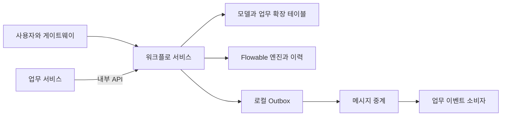

# 워크플로 현재 규칙과 실행 경계

이 문서는 현재 서비스의 모델, 실행, 승인, 테넌트 및 서비스 간 일관성 규칙을 관리합니다. 모델링과 화면 조작은 [워크플로 개발과 모델링](wiki/workflow-development.kr.md), 화면 배치와 과거 이미지는 [화면 참조](wiki/interface-reference.kr.md#workflow)를 참고합니다. 요청 필드와 응답 구조는 [API 계약](api-contract.kr.md), 배포 절차는 [Docker 배포](docker-deployment.kr.md)가 관리합니다.

## 1. 서비스와 영속성 경계

`omni-workflow`는 업무 포트 `8103`, 관리 포트 `19903`을 사용하는 독립 Servlet 서비스입니다. 백엔드 부모 POM은 Flowable을 `8.0.0`으로 고정합니다. 업무 서비스는 엔진을 내장하지 않고 내부 API를 호출합니다. POM의 직접 의존성은 `omni-common-core`, `omni-common`, `omni-common-mybatis`, `omni-common-redis`, `omni-common-operlog`, `omni-common-job`, `omni-common-mqlog`, `omni-common-workflow`이며 `omni-common-service`의 보안 조합을 사용하지 않습니다.



`application.yml`은 `omni_workflow` 데이터베이스, Redis DB `0`, `history-level: audit`, 비동기 실행기와 `database-schema-update: false`를 설정합니다. 정식 스키마는 마이그레이터가 관리하며 엔진의 런타임 테이블 생성에 의존하지 않습니다. 후보자, 신원 정보와 표시 이름 조회에는 `omni_auth`에 대한 직접 JDBC 접근이 포함되므로 배포 시 해당 데이터베이스 접근 조건을 갖춰야 합니다. 모든 조회가 Auth HTTP API를 거치는 것은 아닙니다.

도메인 스키마는 `database/changelog/workflow/0001-workflow-schema.yaml`에 있습니다.

| 테이블 | 현재 용도와 제한 |
|---|---|
| `wf_process_model` | 테넌트 모델 목록. `(tenant_id, model_key)` 고유 제약. 초안과 현재 게시 버전 포인터 |
| `wf_process_model_version` | 디자이너 JSON, BPMN XML, 해시, 업무 버전과 엔진 배포 정보. `(model_id, version)` 고유 제약 |
| `wf_process_instance_ext` | 시작 사용자, 업무 연결, 인스턴스 상태와 완료 이벤트 기록 잠금 표식 |
| `wf_process_start_request` | 내부 시작 예약. 요청, 업무 키, 인스턴스 연결에 각각 테넌트별 고유 제약 |
| `wf_todo_task` | 담당자별 할 일 투영. 실제 실행 기준은 엔진 태스크 |
| `wf_cc_record` | 참조 수신 기록. 기록이 있어도 외부 알림 전달을 입증하지 않음 |
| `wf_form_schema` | 스키마는 존재하나 현재 모듈에 양식 정의 CRUD Controller/Service는 없음 |
| `wf_delegation_rule` | 스키마 존재가 규칙 기반 자동 태스크 재배정 구현을 뜻하지 않음 |

`sys_mq_message`는 공통 Outbox이며 DDL의 유일한 소유자는 `database/changelog/common/0001-mq-schema.yaml`입니다. Flowable `ACT_*` 테이블은 전용 마이그레이션이 관리합니다. 이 테이블들을 `wf_` 업무 테이블의 테넌트 인터셉터에 포함하지 않습니다.

## 2. 모델과 버전 불변 조건

모델 API는 `WorkflowModelController`가 관리하며 `workflow:model:*` 권한을 사용합니다. 생성 시 modelKey는 `^[a-zA-Z][a-zA-Z0-9-]*$`에 맞고 테넌트 안에서 고유해야 합니다. 활성 모델과 버전 `0`의 `DRAFT`를 생성하며 초기 designerJson이 자동으로 게시 가능한 BPMN이 되지는 않습니다.

초안 저장은 호출자가 보낸 designerJson과 bpmnXml을 저장하고 XML 해시를 계산합니다. 현재 백엔드는 designerJson에서 XML을 생성하지 않습니다. 현재 포인터가 `DRAFT`가 아니면 새 초안을 만들고 이전 게시 내용을 보존합니다. 상태 `0`인 모델은 일반 목록에서 제외되며 `PUBLISHED` 버전이 있는 모델은 직접 삭제할 수 없습니다.

`BpmnXmlValidator`는 DOCTYPE과 외부 엔티티를 비활성화한 XML 파서를 사용하며 변환기에서도 외부 DTD/스타일시트를 막습니다. 실행 가능한 단일 process, modelKey와 일치하는 process id, 시작/종료 이벤트, UserTask의 `omni:assignment`, 해당 참조 수신 노드의 `omni:cc`, 배타 게이트웨이 기본 흐름과 흐름 참조를 검사합니다. 시작 이벤트가 여러 개면 경고합니다. 참조 검사는 process의 직접 자식 요소와 비어 있지 않은 sourceRef/targetRef만 대상으로 합니다. 확장 요소 존재 검사는 assignment JSON의 유효성, 스크립트/리스너/표현식 안전 허용 목록이나 업무 경로 실행 성공을 보장하지 않습니다.

`WorkflowModelServiceImpl.publishModel()`의 로컬 트랜잭션은 원시 JDBC `SELECT ... FOR UPDATE`로 모델 행을 잠그고 비어 있지 않은 `DRAFT`를 요구합니다. 재검사 후 Flowable에 배포하고 다음 업무 버전과 엔진 식별자를 저장합니다. 새 버전은 `PUBLISHED`, 직전 게시 포인터의 버전은 보관 상태가 되며 모델 포인터를 갱신합니다. 원시 JDBC 행 잠금은 MyBatis-Plus 테넌트 플러그인을 거치지 않으며 인가 검사가 아닙니다.

검사 실패 분기는 `FAILED`를 기록하려 한 뒤 같은 롤백 트랜잭션에서 예외를 던지므로 실패 상태 영속화를 보장할 수 없습니다. 게시 예외가 Broker, 업무 서비스나 외부 알림의 롤백을 뜻하지도 않습니다. 로컬 DB/엔진 트랜잭션과 서비스 간 일관성은 서로 다른 경계입니다.

기존 `/api/workflow/process-definition` API는 `workflow:definition:*` 권한으로 배포, BPMN 읽기, 일시 중지, 활성화와 연관 인스턴스 포함 삭제를 제공합니다. 모델 초안 검사와 업무 버전 게시 경로는 거치지 않습니다. 현재 `ProcessDefinitionServiceImpl`은 목록에서 테넌트 문맥이 있을 때만 테넌트 조건을 추가하며 ID 기반 읽기/중지/활성화/삭제에는 공통 소유 테넌트 검사가 없습니다. 기능 권한만으로 이 API들의 데이터 격리를 입증할 수 없습니다.

## 3. 후보자, 리스너와 다중 승인

### 3.1. 설정 형태

담당 설정은 BPMN `omni:assignment`에 저장하며 XML 네임스페이스는 `http://omni.com/workflow`, Flowable 확장은 `http://flowable.org/bpmn`입니다. 다음은 설정 형태만 보여 줍니다. 역할과 조직은 대상 테넌트에 구성해야 합니다.

```json
{
  "assignmentType": "SCOPED_ROLE",
  "roleCode": "SUPER_ADMIN",
  "anchorType": "START_USER_PRIMARY_UNIT",
  "anchorParams": {},
  "scopeMode": "SAME_UNIT",
  "fallbackStrategy": "ERROR",
  "approvalMode": "ALL"
}
```

### 3.2. 기준 조직

| anchorType | 실제 기준 조직 |
|---|---|
| `START_USER_PRIMARY_UNIT` | 활성 시작 사용자의 주 조직 |
| `PARENT_BY_TYPE`, `PARENT_CHILDREN` | 주 조직부터 targetType으로 상위 검색. targetType이 없으면 주 조직 |
| `CHILD_BY_CODE`, `SIBLING_BY_CODE` | 주 조직의 직계 하위/동급 조직을 childCode/siblingCode로 조회 |
| `DEPT_BY_CODE` | 현 테넌트의 활성 조직을 deptCode로 조회 |
| `ABSOLUTE_UNIT` | 일반 후보 조회는 anchorParams.unitIds 또는 unitId 지원 |
| `PARENT` | 주 조직의 부모 조직 |
| `CHILD_UNIT`, `SIBLING_UNIT` | 설정 unitId를 직접 사용하며 시작 사용자와의 부모/형제 관계는 검사하지 않음 |

### 3.3. 조회 범위

`SAME_UNIT`은 같은 조직의 역할을, `UNIT_AND_BELOW`는 조직 경로에 따라 해당 조직과 하위를, `CHILDREN_ONLY`는 직계 하위만 조회합니다. 알 수 없는 scopeMode는 현재 같은 조직 조회로 처리합니다. SQL은 역할의 테넌트와 활성 역할, 역할 범위, 사용자 상태를 제한하지만 임의 설정 사용자에 대한 완전한 Auth 인가 검사는 아닙니다. 조회 오류는 보통 빈 후보가 됩니다.

### 3.4. 빈 후보 처리

`ERROR`는 누락/기타 전략을 포함해 예외를 던집니다. `ASSIGN_ADMIN`은 현 테넌트의 조직 ID `1`에서 `SUPER_ADMIN` 후보를 찾고 없으면 실패합니다. 사용자 ID `1`을 고정하지 않습니다. `ESCALATE_PARENT`는 해석된 기준 조직의 부모부터 같은 roleCode와 scopeMode로 최대 `20`단계를 검색해 첫 후보를 반환합니다. 없으면 실패하며 자동 승인하지 않습니다. `ABSOLUTE_UNIT`의 상위 검색은 단일 unitId만 읽고 unitIds의 첫 요소를 자동으로 기준으로 삼지 않습니다. 시작 사용자/기준 조직 누락과 조직 조회 오류도 실패를 일으킬 수 있습니다.

### 3.5. 다중 승인 카운터

다중 인스턴스 카운터는 MI 루트의 로컬 변수로 초기화합니다. 실행 트리를 최대 `32`단계 탐색하고 루트가 없으면 현재 실행을 사용합니다. `_counters_init`는 해당 활동 루트 안에서만 중복 초기화를 막아 다음 승인 노드로 이전 표가 전달되지 않게 합니다. 초기 임계값은 `ALL`이면 후보 수, `ANY`이면 `1`입니다. 승인자 추가/제거 후 전체 승인 임계값은 “승인 완료 + 아직 대기 중”으로 다시 계산합니다. 디자이너의 완료 조건은 `${rejectedCount > 0 || approvedCount >= requiredApprovals}`입니다. 다른 BPMN은 올바른 완료 조건과 반려 경로를 직접 갖춰야 합니다.

### 3.6. 후보 해석 구성요소

디자이너의 `useBpmnExtension.writeAssignment()`는 `${scopedRoleAssignmentListener}`를 참조하는 `ExecutionListener(event=start)`, 병렬 다중 인스턴스, 컬렉션 `candidateUserIds`, 요소 변수 `userId`, 담당자 `${userId}`를 기록합니다. 기존 `TaskListener` 진입점은 로그만 남기므로 실행 시작 리스너를 대신할 수 없습니다. `CandidateResolverBean`은 컬렉션 표현식 `${candidateResolver.resolve(execution)}`도 지원합니다. 후보 해석은 호환 델리게이트와 설계 시 미리보기를 포함해 `CandidateResolutionService`를 공유합니다.

이 상위 검색과 예외 전달은 실행 리스너와 `CandidateResolverBean`의 동작입니다. 리스너는 assignment나 roleCode가 없으면 바로 반환할 수 있으므로 확장 존재만으로 컬렉션 기록을 보장하지 않습니다. 호환 `CandidateResolverDelegate`에는 ESCALATE_PARENT 분기가 없고 대상이 없으면 반환하며 실행 예외는 잡아서 로그만 남깁니다. 모든 기존 BPMN이 같은 실패 종료 동작을 한다고 주장할 수 없습니다.

## 4. 인스턴스, 태스크와 승인 기록

일반 시작은 Gateway 주체를 사용하며 다른 simulateUserId/simulateUserName을 거부합니다. 엔진에 들어가기 전에 입력 변수 `initiator`, `startUserId`, `authenticatedUserId`, `START_USER_ID`를 제거하고 실제 initiator를 설정하며 finally에서 Flowable 인증 문맥을 지웁니다. modelVersionId를 지정하면 같은 테넌트의 `PUBLISHED` 버전과 엔진 정의 ID가 필요합니다. processKey만 지정하면 기존 key/테넌트 시작 경로를 사용하므로 모델 목록의 현재 게시 포인터와 일치한다고 보장할 수 없습니다.

엔진 시작 후 확장 레코드를 기록하며 상태 `1`은 실행 중, `2`는 완료, `0`은 중단입니다. 일반 시작의 requestId/businessType만으로 내부 예약 멱등성이 생기지는 않습니다. 할 일 동기화는 커밋 후 실행되고 오류는 기록되며 커밋된 인스턴스를 롤백하지 않습니다. 따라서 투영은 엔진의 실시간 상태와 같지 않습니다.

`ApprovalController`의 완료, 승인자 추가/제거, 위임은 각각 해당 `workflow:approval:*` 권한을 요구합니다. 서비스는 현 테넌트 태스크와 정확한 assignee도 요구합니다. 태스크 부재는 업무 코드 `409`, 다른 담당자는 `403`입니다. 별도 claim, transfer, withdraw Controller는 없으며 내부 후보 자격 검사도 태스크를 자동 선점하지 않습니다. 추가/제거/위임 대상은 숫자 파싱만 하므로 활성 사용자와 Auth 테넌트 소속을 검사했다고 주장할 수 없습니다. 위임은 assignee 설정으로 구현됩니다.

승인 완료는 의견, 태스크 로컬 approved/comment와 실행 변수를 먼저 기록하고 MI 승인/반려 카운터를 갱신한 뒤 `taskService.complete()`를 호출하여 이번 표를 완료 조건에 반영합니다. 추가 variables는 그 뒤 태스크 로컬과 프로세스 범위에 적용되며 예약 변수 이름을 제거하지 않습니다. 임의 클라이언트 변수가 카운터나 라우팅 값을 덮어쓸 수 없다는 보장은 없습니다.

읽기 API는 `GET /api/workflow/process-instance/{processInstanceId}/progress`와 `GET /api/workflow/process-instance/{processInstanceId}/approval-records`입니다. 두 API는 Gateway의 `X-Tenant-Id`를 명시적으로 받고 ID와 테넌트로 이력 인스턴스를 먼저 조회합니다. 잘못된 테넌트는 업무 코드 `400`, 부재/다른 테넌트 인스턴스는 동일한 `404`로 활동, 의견, 후보자와 표시 이름을 읽기 전에 거부합니다. 이 경계는 같은 테넌트 참여자 ACL이나 기능 권한을 추가하지 않습니다.

| 표시/조회 | 현재 의미 |
|---|---|
| 진행 노드 | 이력 활동과 담당자를 집계하여 completed/active/pending 표시. 미도달 노드 후보 미리보기는 최종 배정이 아님 |
| 개인별 진행 | deleteReason 없는 종료 태스크는 실제 완료. 종료 태스크의 null이 아닌 deleteReason은 모두 auto-completed |
| 승인 기록 | 정상 종료는 태스크 로컬 approved로 판정. 변수 누락은 호환상 approved, 미종료는 pending |
| 삭제 태스크 | MI로 시작하는 deleteReason은 기존 `auto-approved`, 다른 삭제는 cancelled. `MI_END`는 엔진 건너뛰기이며 해당 사용자의 찬성표가 아님 |
| 의견 | 반환된 태스크 의견 중 첫 항목을 사용하며 최신 항목을 보장하지 않음 |

내 시작/처리 완료 및 할 일 목록은 테넌트와 현재 사용자로 제한합니다. “처리 완료”는 태스크를 처리했다는 뜻이며 전체 프로세스 종료를 보장하지 않습니다. 태스크 양식은 현 테넌트의 현재 담당자만 읽으며 프로세스 변수를 반환하지만 임의 개인정보 자동 마스킹은 보장하지 않습니다. 시작 사용자의 중단은 같은 테넌트 확장, 본인과 실행 중 상태를 요구합니다.

## 5. 신뢰, 테넌트와 입력 내용 경계

외부 보안 체인은 인증을 요구합니다. `GatewayPreAuthFilter`는 전달 표식과 HMAC 신원 어서션을 확인하고 일반 신원 헤더와의 불일치를 거부합니다. 기능 권한은 각 Controller가 선언합니다. 내부 `/api/internal/**`는 사용자 JWT 대신 앞단 공유 토큰 필터로 보호합니다. 신원, 테넌트, 태스크 처리 자격과 업무 연결은 별개의 검사입니다.

`TenantInfoFilter`는 finally에서 `TenantInfoHolder`를 지웁니다. Workflow의 MyBatis-Plus 순서는 Tenant → Optimistic → Pagination이며 `wf_` 테이블만 가로채고 문맥이 없으면 테넌트 `1`로 처리합니다. 원시 JDBC와 Flowable 조회는 이 플러그인을 거치지 않으므로 메서드별 명시 제약을 확인해야 하며 서비스 전체에 owner DataScope가 있다고 추정할 수 없습니다.

독립 `XssConfigProviderImpl`은 Redis DB `0`의 `xss:enabled:{tenantId}`와 `xss:rules:{tenantId}`를 읽습니다. 설정 누락이나 규칙 JSON 파싱 실패는 enabled=false와 빈 규칙을 반환하며 Redis 읽기 예외는 이 메서드에서 잡지 않습니다. common-service의 Auth 재조회나 기본 보안 기준도 없습니다. 변수, 의견, 디자이너 JSON/XML과 로그는 실제 입출력 경로별로 처리해야 하며 일괄 자동 정화를 보장하지 않습니다.

`CcNotifyDelegate`는 `wf_cc_record`만 기록하고 할 일이나 외부 알림을 생성하지 않으며 실행 예외를 잡아 로그로 남깁니다. 기본 `NoOpNotificationService`도 로그만 기록합니다. 작업 로그와 Outbox 역시 이메일/SMS 등 알림 전달 증거가 아닙니다.

## 6. 내부 시작과 완료 이벤트

`InternalWorkflowController`의 여덟 메서드 경로는 버전 상세, 분류별 현재 버전, 게시 버전 목록, 일괄 버전 해석, 승인 그래프 미리보기, 시작, 처리 자격 검사와 중단을 제공합니다. 전체 필드는 [API 계약](api-contract.kr.md)이 관리합니다. `X-Internal-Token`과 `X-Tenant-Id`를 보내고 해당 body/query 테넌트도 일치시켜야 합니다. 호출자는 실제 startUserId/startUserName을 제공해야 하며 공유 토큰이 최종 사용자 인가를 입증하지는 않습니다.

내부 시작은 로컬 트랜잭션에서 `wf_process_start_request`를 예약하며 `(tenant_id, request_id)`와 `(tenant_id, business_type, business_key)`를 고유 제약으로 보호합니다. 재요청은 업무 식별자, modelVersionId와 startUserId를 비교하며 title/startUserName/variables의 전체 해시는 비교하지 않습니다. STARTED는 원래 인스턴스와 replayed=true를 반환하고 응답 requestId는 이번 요청에서 가져옵니다. 처리 중이면 `409`입니다. 같은 requestId의 FAILED는 다시 예약할 수 있지만 같은 업무 키에 requestId만 바꿔서는 실패 기록의 재시도 권한을 자동으로 얻지 못합니다.

새 시작은 게시 버전을 다시 검사하며 `ASSET_TRANSFER`, `ASSET_DISPOSAL`, `SRM_SUPPLIER_ONBOARDING`은 category와 businessType의 정확한 일치를 요구합니다. 내부 서비스가 변수 requestId/businessType/businessKey를 덮어쓰고 일반 시작 계층이 시작 사용자 변수를 덮어씁니다. 예약, 시작, 확장과 markStarted는 로컬 트랜잭션에 속하며 업무 서비스와의 분산 원자적 커밋은 아닙니다.

처리 자격은 테넌트 태스크와 확장의 businessType/businessKey를 먼저 맞춘 뒤 assignee를 확인하고 미배정 태스크만 candidate를 확인합니다. valid=true는 선점이나 완료를 수행하지 않습니다. 버전 가용성과 그래프 미리보기는 모델 메타데이터/BPMN에 근거하며 최종 후보, 엔진 실행 가능성이나 업무 승인 성공을 입증하지 않습니다.

이벤트 유형은 `workflow.process.completed.v1`이며 `workflow-domain-out-0`을 통해 공통 Outbox에 기록합니다. 현재 호출 지점은 실행 인스턴스 종료를 확인한 승인 서비스와 명시적 중단입니다. 결과는 각각 요청의 APPROVED/REJECTED 또는 CANCELLED입니다. 확장의 completion_event_id 조건부 갱신은 한 번의 기록을 제어하며 Outbox 이벤트와 같은 트랜잭션에 속합니다. 기존 표식이 있으면 false를 반환하고 다시 기록하지 않으며 Broker 전달 확인은 아닙니다.

모든 종료를 처리하는 범용 엔진 종료 리스너는 현재 없습니다. 시작 즉시 종료, 다른 관리 동작으로 종료하거나 업무 확장이 없을 때 완료 이벤트가 생성되었다고 추정할 수 없습니다. 중계는 적어도 한 번 전달하므로 소비자는 멱등해야 합니다. APPROVED/REJECTED는 확장 상태 `2`, CANCELLED는 `0`이며 최종 업무 상태는 업무 소비자가 처리합니다. [MQ 신뢰성](mq-reliability.kr.md)을 참고합니다.

## 7. 소스 진입점과 검증 범위

| 진입점 | 확인 대상 |
|---|---|
| `WorkflowModelController` / `WorkflowModelServiceImpl` / `BpmnXmlValidator` | 권한, 버전 포인터, 잠금, 검사와 게시 |
| `ProcessInstanceServiceImpl` / `WorkflowTaskServiceImpl` | 시작 사용자 신원, 테넌트 읽기, 본인 목록, 양식과 중단 |
| `WorkflowApprovalServiceImpl` / common-workflow의 `ApprovalServiceImpl` | 담당자, MI 카운터 순서, 승인자 증감과 완료 |
| `CandidateResolutionService` / `ScopedRoleAssignmentListener` / `CandidateResolverBean` | 기준 조직, 빈 후보, 리스너 시점과 카운터 범위 |
| `InternalWorkflowServiceImpl` / `WorkflowProcessStartRequestServiceImpl` / `WorkflowCompletionEventServiceImpl` | 내부 의도 재요청과 Outbox 표식 |
| `SecurityConfig` / `GatewayPreAuthFilter` / `MybatisPlusConfig` / `XssConfigProviderImpl` | 독립 보안 설정과 실제 제한 |

초기화기는 기본 테넌트 `1`의 `supplier-onboarding`, `procurement-approval`, `asset-transfer`, `asset-disposal`을 보정하고 게시합니다. 모델 누락이나 게시 실패는 시작을 막지만 모든 테넌트와 외부 의존성이 준비되었다고 보장하지 않습니다.

테스트는 모델, 시작 신원, 승인, 내부 프로토콜, 완료 이벤트와 테넌트 경계를 다룹니다. `ProcessInstanceReadTenantBoundaryTest`는 실제 MVC/서비스와 모의 이력으로 두 읽기 API를 검사하며 실제 Flowable DB/Gateway 통합을 대체하지 않습니다. `it/Fw*IT`는 보호된 격리 환경이 필요하고 기본 Surefire 단위 실행에 포함되지 않습니다. Docker 빌드, 단위 테스트, 실제 승인, 브라우저 이미지와 메시지/알림 검증은 따로 기록하며 과거 이미지가 이번 업무 재현을 입증하지 않습니다. 명령은 [AGENTS.md](../AGENTS.md)에 모읍니다.
