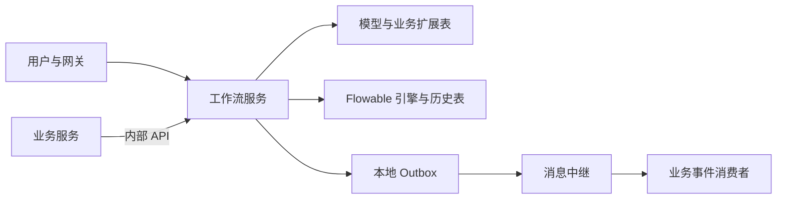

# 工作流事实与运行边界

本文维护当前工作流服务的模型、执行、审批、租户及跨服务一致性规则。建模步骤和界面操作见 [工作流开发与建模](wiki/workflow-development.md)，界面布局与历史图片见 [界面参考](wiki/interface-reference.md#workflow)。请求字段与响应结构由 [API 契约](api-contract.md) 维护，部署步骤见 [Docker 部署](docker-deployment.md)。

## 1. 服务与持久化边界

`omni-workflow` 是独立 Servlet 微服务，业务端口为 `8103`，管理端口为 `19903`；Flowable 版本由后端父 POM 固定为 `8.0.0`。业务服务通过内部 API 调用它，不嵌入引擎。当前 POM 直接依赖 `omni-common-core`、`omni-common`、`omni-common-mybatis`、`omni-common-redis`、`omni-common-operlog`、`omni-common-job`、`omni-common-mqlog`、`omni-common-workflow`，没有使用 `omni-common-service` 的安全组合。



`application.yml` 使用 `omni_workflow` 数据库、Redis DB `0`，配置 `history-level: audit`、异步执行器以及 `database-schema-update: false`。正式结构由迁移器管理，不能依赖引擎运行时建表。候选人、身份数据及昵称查询包含对 `omni_auth` 的直接 JDBC 读取，部署时必须满足相应数据库访问条件；它们并非全部通过 Auth HTTP 接口取得。

Workflow 的领域结构见 `database/changelog/workflow/0001-workflow-schema.yaml`：

| 表 | 当前用途与限制 |
|---|---|
| `wf_process_model` | 租户内模型目录；`(tenant_id, model_key)` 唯一；保存草稿与当前发布版本指针 |
| `wf_process_model_version` | 设计器 JSON、BPMN XML、摘要、业务版本及引擎部署信息；`(model_id, version)` 唯一 |
| `wf_process_instance_ext` | 发起人、业务关联、实例状态及完成事件门闩 |
| `wf_process_start_request` | 内部启动预留；租户内 requestId、业务键及实例关联分别有唯一约束 |
| `wf_todo_task` | 按处理人查询的待办投影；引擎任务仍是实际执行依据 |
| `wf_cc_record` | 抄送记录；存在记录不代表外部通知送达 |
| `wf_form_schema` | 已有结构，本模块当前没有表单定义 CRUD Controller/Service |
| `wf_delegation_rule` | 已有结构，不等同于已经实现自动按委托规则转派任务 |

`sys_mq_message` 属于公共 Outbox，DDL 唯一所有者是 `database/changelog/common/0001-mq-schema.yaml`；Flowable 的 `ACT_*` 表由专用迁移管理。不要把这些表归入 `wf_` 业务租户拦截范围。

## 2. 模型与版本不变量

模型接口由 `WorkflowModelController` 维护，使用 `workflow:model:*` 权限。创建请求要求 modelKey 匹配 `^[a-zA-Z][a-zA-Z0-9-]*$`，且在当前租户唯一。创建启用模型及版本号 `0` 的 `DRAFT`；初始 designerJson 不会自动变成可发布 BPMN。

保存草稿存储调用方提交的 designerJson 和 bpmnXml，计算 XML 摘要；后端当前没有从 designerJson 生成 XML 的实现。当前指针不是 `DRAFT` 时创建新草稿，保留旧发布内容。模型状态 `0` 不进入普通列表；已有 `PUBLISHED` 版本的模型不能直接删除。

`BpmnXmlValidator` 使用加固的 XML 解析器：禁用 DOCTYPE、外部实体，转换器禁用外部 DTD/样式表。它检查一个可执行 process、process id 与 modelKey 一致、开始/结束事件、UserTask 的 `omni:assignment`、相关抄送节点的 `omni:cc`、排他网关默认连线及连线引用；多个开始事件产生警告。连线引用检查基于 process 的直接子元素，且只检查非空 sourceRef/targetRef。扩展元素存在检查不等于 assignment JSON、脚本、监听器或表达式安全白名单，也不证明业务路径可执行。

发布由 `WorkflowModelServiceImpl.publishModel()` 的本地事务执行：先通过原始 JDBC `SELECT ... FOR UPDATE` 锁定模型行，再要求当前草稿非空、状态为 `DRAFT`，重新校验后部署 Flowable，分配下一业务版本并保存引擎标识。新版本成为 `PUBLISHED`，此前发布指针对应的版本归档，模型发布指针更新。原始 JDBC 行锁不经过 MyBatis-Plus 租户插件，不能把行锁解释为授权检查。

校验失败分支尝试写 `FAILED` 后抛异常；该写入位于同一回滚事务中，不能承诺失败状态必然持久化。发布异常不能解释为 Broker、业务服务或外部通知均已回滚；本地数据库/引擎事务与跨服务一致性是不同边界。

原始定义管理入口 `/api/workflow/process-definition` 保留部署、BPMN 读取、挂起、激活与级联删除功能，使用 `workflow:definition:*` 权限。它不经过上述模型草稿校验和业务版本发布流程。当前 `ProcessDefinitionServiceImpl` 仅在列表且租户上下文非空时增加租户条件，按 ID 读取/挂起/激活/删除没有统一租户归属检查；不能把功能权限当成这些入口的数据隔离证明。

## 3. 候选人、监听器与会签

### 3.1. 配置形状

审批分配配置保存在 BPMN 的 `omni:assignment` 中；XML 命名空间为 `http://omni.com/workflow`，Flowable 扩展使用 `http://flowable.org/bpmn`。以下仅表示配置形状，角色及组织仍须在目标租户配置：

```json
{
  "assignmentType": "SCOPED_ROLE",
  "roleCode": "SUPER_ADMIN",
  "anchorType": "START_USER_PRIMARY_UNIT",
  "anchorParams": {},
  "scopeMode": "SAME_UNIT",
  "fallbackStrategy": "ERROR",
  "approvalMode": "ALL"
}
```

### 3.2. 锚点来源

| anchorType | 实际锚点来源 |
|---|---|
| `START_USER_PRIMARY_UNIT` | 启用发起人的主组织 |
| `PARENT_BY_TYPE`、`PARENT_CHILDREN` | 从主组织向上按 targetType 查找；没有 targetType 时使用主组织 |
| `CHILD_BY_CODE`、`SIBLING_BY_CODE` | 主组织的直属子组织/同级组织，分别按 childCode/siblingCode 查询 |
| `DEPT_BY_CODE` | 当前租户按 deptCode 查询启用组织 |
| `ABSOLUTE_UNIT` | 普通候选查询支持 anchorParams.unitIds 或 unitId |
| `PARENT` | 主组织的父组织 |
| `CHILD_UNIT`、`SIBLING_UNIT` | 直接使用配置中的 unitId，并不验证它与发起人的亲缘关系 |

### 3.3. 作用域

`SAME_UNIT` 查询同组织角色；`UNIT_AND_BELOW` 按组织路径查询本组织及下级；`CHILDREN_ONLY` 只取直属子组织。未知 scopeMode 当前落到同组织查询。候选 SQL 按角色租户及启用角色、角色范围、用户状态过滤；这不等于对任意配置用户执行完整 Auth 授权校验。查询异常通常转换为空候选。

### 3.4. 空候选处理

`ERROR`（含缺省/其他策略）抛错。`ASSIGN_ADMIN` 查询当前租户、组织 ID `1` 下的 `SUPER_ADMIN` 候选，找不到仍抛错，不硬编码用户 ID `1`。`ESCALATE_PARENT` 从解析锚点的父组织开始，用相同 roleCode 和 scopeMode 最多上溯 `20` 层，首次命中即返回；未命中时失败，不自动审批。其锚点解析对 `ABSOLUTE_UNIT` 读取单个 unitId，并不会把 unitIds 的第一个元素自动作为上溯起点。缺发起人或锚点、组织查询异常也可能导致失败。

### 3.5. 会签计数

多实例计数器在 MI 根执行本地初始化；最多向上找 `32` 层，未找到时使用当前执行。`_counters_init` 只在该活动根本地去重，避免下一会签节点继承上一节点票数。`ALL` 初始阈值为候选人数，`ANY` 为 `1`；动态加/减签后，全员阈值按“已同意 + 仍待办”重算。设计器的完成条件为 `${rejectedCount > 0 || approvedCount >= requiredApprovals}`；其他 BPMN 必须自行提供正确条件和驳回路由。

### 3.6. 候选人解析组件

设计器 `useBpmnExtension.writeAssignment()` 写入 `ExecutionListener(event=start)`，引用 `${scopedRoleAssignmentListener}`；同时写入并行多实例、集合 `candidateUserIds`、元素变量 `userId` 及受理人 `${userId}`。旧 `TaskListener` 入口目前只记录日志，不能替代执行启动监听器。`CandidateResolverBean` 还支持 `${candidateResolver.resolve(execution)}` 集合表达式；候选解析共用 `CandidateResolutionService`，兼容代理与设计时预览也使用该服务。

上述上溯与异常传播由执行监听器和 `CandidateResolverBean` 实现。监听器缺 assignment 或 roleCode 时可直接返回；配置存在检查不保证集合已写入。兼容 `CandidateResolverDelegate` 没有 ESCALATE_PARENT 分支，缺目标时可返回，执行异常只捕获记日志，不能宣称所有旧 BPMN 都按相同方式失败关闭。

## 4. 实例、任务与审批记录

普通发起入口使用 Gateway 身份，拒绝与当前主体不同的 simulateUserId/simulateUserName。进入引擎前移除输入变量 `initiator`、`startUserId`、`authenticatedUserId`、`START_USER_ID`，写入真实 initiator，并在 finally 清理 Flowable 认证上下文。指定 modelVersionId 时要求同租户 `PUBLISHED` 版本及引擎定义 ID；仅传 processKey 则走按 key 与租户启动的兼容路径，不一定对应模型目录的当前发布指针。

实例启动后写扩展记录，状态 `1` 表示进行中；状态 `2` 表示完成，`0` 表示终止。普通发起的 requestId/businessType 字段本身不建立内部启动预留幂等。待办同步在提交后执行，异常会被记录，不回滚已提交实例，因此待办投影不等于引擎实时状态。

`ApprovalController` 的完成、加签、减签与委托分别校验对应 `workflow:approval:*` 权限；服务还要求当前租户任务及精确 assignee。任务不存在使用业务码 `409`，其他处理人使用 `403`。当前没有独立 claim、transfer 或 withdraw Controller；内部候选资格校验也不自动认领任务。加签/减签/委托目标只做数值解析，不能宣称已校验目标用户启用状态及 Auth 租户归属；委托实现是设置 assignee。

完成审批时，先写意见、任务局部 approved/comment 和运行变量，再更新 MI 同意/拒绝计数，最后调用 `taskService.complete()`，让完成条件读到本次票数。附加 variables 在这些写入之后应用到任务局部和流程作用域，当前没有过滤保留变量；不能承诺任意客户端变量都无法覆盖计数或路由值。

进度与记录入口为 `GET /api/workflow/process-instance/{processInstanceId}/progress` 和 `GET /api/workflow/process-instance/{processInstanceId}/approval-records`。两者显式接收 Gateway 的 `X-Tenant-Id`，先按实例 ID 与租户查询历史实例；无效租户使用业务码 `400`，不存在或其他租户实例统一使用 `404`，在活动、意见、候选及昵称读取前拒绝。该边界没有新增同租户参与人 ACL 或功能权限。

| 展示/读取 | 当前含义 |
|---|---|
| 进度节点 | 汇总历史活动和历史 assignee；状态为 completed/active/pending；未到达节点可附候选预览，不代表最终分配 |
| 逐人进度 | 无 deleteReason 的已结束任务为真实完成；任意非 null deleteReason 的结束任务标为 auto-completed |
| 审批记录 | 正常结束按任务局部 approved 判定；缺变量时兼容默认为 approved；待办为 pending |
| 删除任务 | deleteReason 以 MI 开头时保留 legacy `auto-approved` 标签，其他删除为 cancelled；`MI_END` 是引擎跳过，不是该审批人的同意票 |
| 意见 | 返回任务意见列表中的第一条；不是保证返回最后一条 |

本人发起/已办与待办列表按租户和当前用户过滤；“已办”表示用户办过任务，不保证整个流程已结束。任务表单要求同租户且当前 assignee，返回流程变量，没有任意 PII 自动脱敏保证。发起人终止要求同租户扩展、本人及进行中状态。

## 5. 信任、租户与内容边界

外部安全链要求认证，`GatewayPreAuthFilter` 校验转发标记和 HMAC 签名身份断言，并拒绝断言与明文身份不一致；功能权限按各 Controller 声明执行。内部 `/api/internal/**` 由前置共享令牌过滤器保护，不依赖用户 JWT。身份、租户、任务受理资格及业务关联是不同校验层。

`TenantInfoFilter` 在 finally 清理 `TenantInfoHolder`；Workflow 的 MyBatis-Plus 链为 Tenant → Optimistic → Pagination，仅拦截 `wf_` 表，缺租户上下文时回落到 `1`。原始 JDBC 与 Flowable 查询不经过该插件，必须检查各方法的显式约束，不能推断全服务已经具有 owner DataScope。

本服务独立 `XssConfigProviderImpl` 从 Redis DB `0` 读取 `xss:enabled:{tenantId}` 和 `xss:rules:{tenantId}`。配置缺失或规则 JSON 解析失败时返回 enabled=false、空规则；Redis 读取异常并未被该方法捕获。它没有 common-service 的 Auth 回源或默认安全基线。流程变量、意见、设计器 JSON/XML 与日志需要按实际输入和返回路径处理，不能承诺统一自动清洗。

`CcNotifyDelegate` 将抄送写入 `wf_cc_record`，不生成待办、不调用外部通知；执行异常被捕获并记录。默认 `NoOpNotificationService` 只记录日志。操作日志与 Outbox 也不能作为邮件、短信或其他通知已送达的凭据。

## 6. 内部启动与完成事件

`InternalWorkflowController` 的八个方法路径覆盖版本详情、按分类取当前版本、发布版本列表、批量版本解析、审批图预览、启动、处理资格校验和终止。完整字段由 [API 契约](api-contract.md) 维护；内部请求必须携带 `X-Internal-Token` 和 `X-Tenant-Id`，相应 body/query 租户须一致。内部调用方负责提供真实 startUserId/startUserName；不能把共享令牌当作终端用户授权证明。

内部启动在本地事务中预留 `wf_process_start_request`，唯一键同时约束 `(tenant_id, request_id)` 与 `(tenant_id, business_type, business_key)`。同一请求/业务重放比较业务标识、modelVersionId 和 startUserId，不比较 title、startUserName 或 variables 的完整哈希。已 STARTED 的记录返回原实例且 replayed=true，响应中的 requestId 来自本次请求；处理中返回 `409`。相同 requestId 的 FAILED 记录可重新预留；仅换 requestId 命中同一业务键不会自动取得失败记录的重试权。

新启动重新校验已发布版本；`ASSET_TRANSFER`、`ASSET_DISPOSAL`、`SRM_SUPPLIER_ONBOARDING` 要求模型 category 与 businessType 精确一致。内部服务覆盖变量 requestId/businessType/businessKey，普通启动层再覆盖发起人变量。预留、启动、扩展和 markStarted 位于本地事务，不能据此承诺跨业务服务分布式原子提交。

处理资格校验先匹配租户任务及扩展的 businessType/businessKey，再检查 assignee；未分配任务才检查 candidate。valid=true 不等于已经认领或完成。版本可用状态和图预览依据模型元数据/BPMN，不证明当前用户最终候选、引擎定义仍可运行或业务审批已成功。

完成事件类型为 `workflow.process.completed.v1`，经 `workflow-domain-out-0` 写入公共 Outbox。当前调用点是审批服务观察到运行实例已结束，以及显式终止；结果分别为请求的 APPROVED/REJECTED 或 CANCELLED。扩展中的 completion_event_id 条件更新作为一次写入门闩，和事件入 Outbox 同事务；有门闩时返回 false，不再写入。它不是 Broker 送达确认。

当前没有通用引擎结束监听器覆盖所有结束方式。启动后立即结束、其他管理操作结束或缺业务扩展，不能推断已经生成完成事件。消息中继采用至少一次交付，业务消费者必须幂等；APPROVED/REJECTED 对应扩展状态 `2`，CANCELLED 对应 `0`，业务领域最终状态仍由消费者处理。可靠性规则见 [MQ 可靠性](mq-reliability.md)。

## 7. 源码入口与验证范围

| 入口 | 核对内容 |
|---|---|
| `WorkflowModelController` / `WorkflowModelServiceImpl` / `BpmnXmlValidator` | 模型权限、版本指针、锁定、校验与发布 |
| `ProcessInstanceServiceImpl` / `WorkflowTaskServiceImpl` | 发起身份、租户读取、本人列表、表单与终止 |
| `WorkflowApprovalServiceImpl` / common-workflow 的 `ApprovalServiceImpl` | assignee、MI 计数顺序、动态签人与完成 |
| `CandidateResolutionService` / `ScopedRoleAssignmentListener` / `CandidateResolverBean` | 锚点、空候选、监听时机及计数作用域 |
| `InternalWorkflowServiceImpl` / `WorkflowProcessStartRequestServiceImpl` / `WorkflowCompletionEventServiceImpl` | 内部意图重放与 Outbox 门闩 |
| `SecurityConfig` / `GatewayPreAuthFilter` / `MybatisPlusConfig` / `XssConfigProviderImpl` | 独立安全配置与实际限制 |

启动初始化器校正并发布默认租户 `1` 的 `supplier-onboarding`、`procurement-approval`、`asset-transfer`、`asset-disposal`；缺模型或发布失败会阻止启动，不保证所有租户和全部外部依赖都已准备好。

源码测试包括模型、启动身份、审批、内部协议、完成事件及租户边界。`ProcessInstanceReadTenantBoundaryTest` 使用真实 MVC/服务与模拟历史数据覆盖两处读取，不能代替真实 Flowable 数据库和 Gateway 集成。`it/Fw*IT` 使用受守卫的隔离环境，默认 Surefire 单元运行不执行这些 IT。Docker 构建、单元测试、真实审批、浏览器截图和消息/通知验收分别记账，历史截图不证明当前业务复现；验证命令统一见 [AGENTS.md](../AGENTS.md)。
